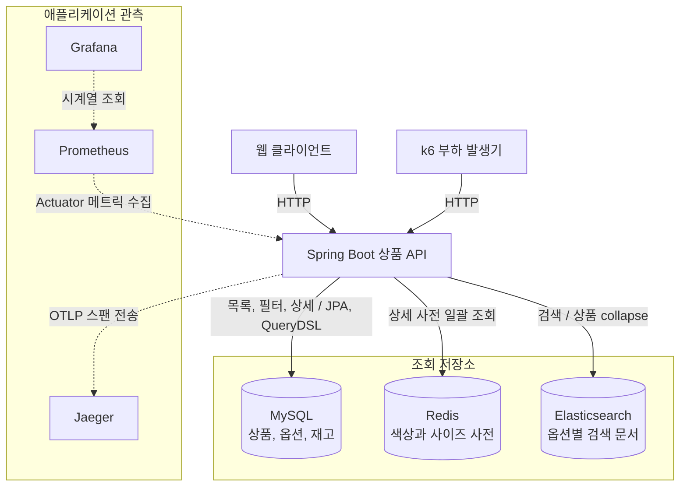
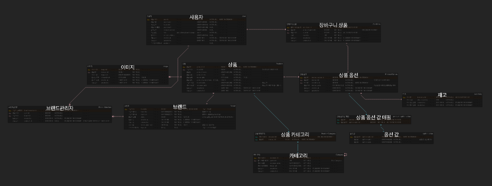
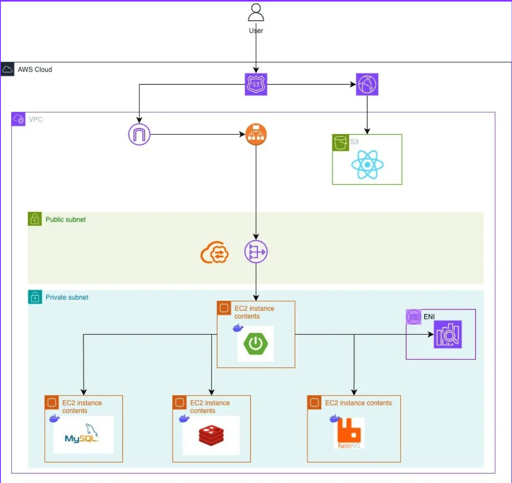
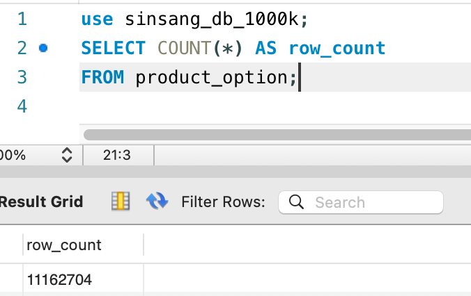
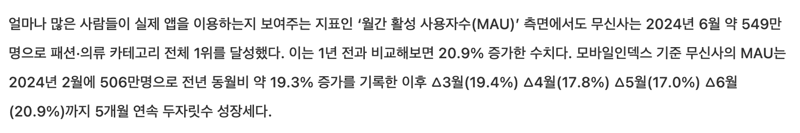
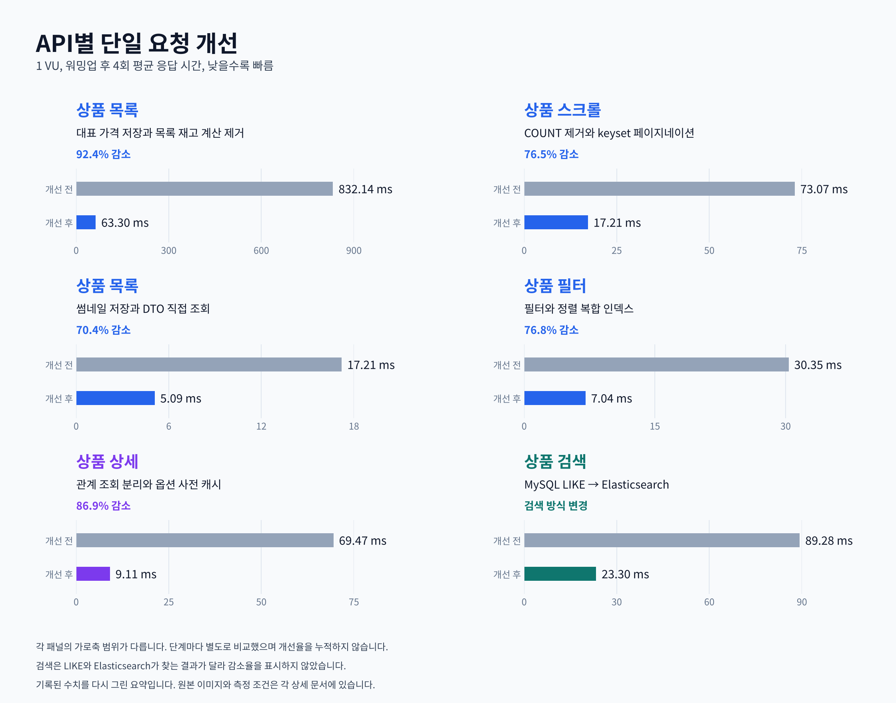

  <h1>Musinsang · 상품 조회 및 검색 최적화</h1>
  
상품마다 필요한 정보를 어떻게 읽고 검색할지 설계하고, 그 선택을 데이터로 검증한 백엔드 프로젝트.

  

    
    
    
  

  
<a href="./README.md">English</a> · <strong>한국어</strong>

  

    <a href="#시연">시연</a> ·
    <a href="#프로젝트-소개">소개·기여</a> ·
    <a href="#핵심-요약">핵심 요약</a> ·
    <a href="#기술-스택">기술·선택 이유</a> ·
    <a href="#아키텍처">아키텍처</a> ·
    <a href="#측정-환경과-시나리오">환경·시나리오</a> ·
    <a href="#단일-요청-개선">주요 사례</a> ·
    <a href="#트러블슈팅">트러블슈팅</a> ·
    <a href="#한계와-후속-계획">후속 계획</a>
  

---

## 시연

<h3 align="center"><a href="https://youtu.be/oC8-prv8Qdo">시연 영상 보기</a></h3>

---

## 프로젝트 소개

무신사를 모델로 한 이커머스 팀 프로젝트입니다.  
상품마다 수십 개의 옵션이 연결된 데이터에서 화면에 필요한 정보를 어떻게 읽고 검색할지, 부하가 커지면 요청이 어디서 기다리는지를 다루고 있습니다.

### 담당 역할

총 6명의 팀원 중 상품 파트를 담당했습니다.  
상품 데이터 수집과 적재, 데이터 구조 설계, 상품 등록과 수정, 목록, 상세, 검색 API를 구현했으며, 이후 k6로 성능을 측정하고 병목을 분석해 조회 구조를 개선했습니다.

---

## 핵심 요약

| 문제 | 설계 판단 | 결과 | 근거 |
| --- | --- | --- | --- |
| 목록 가격 계산을 위한 옵션과 재고 관계 탐색 | 대표 가격 저장과 목록 재고 계산 제거 | 평균 832.14→63.30ms | [대표 가격](docs/ko/improvements/list-price.md) |
| 전체 페이지 수를 위한 COUNT와 OFFSET 비용 | COUNT 제거와 keyset 페이지네이션 적용 | 평균 73.07→17.21ms | [페이지네이션](docs/ko/improvements/list-keyset.md) |
| 상세 응답을 위한 반복 조회 | 관계에 따른 조회 분리와 옵션 사전 일괄 조회 | 평균 69.47→9.11ms | [상세 조회](docs/ko/improvements/product-detail.md) |
| 상품명에 없는 색상과 종류의 검색 의도 | 옵션 단위 ES 문서, 다중 필드 매칭, 관련도 정렬 적용 | LIKE에서 놓친 ‘블랙 스커트’ 결과 반환 | [검색 설계](docs/ko/improvements/product-search.md) |
| 고부하에서 늘어나는 요청 대기 | 기준 부하 확인 후 연결 풀, 스레드, 검색 경로 조사 | 4개 API 각각 단독으로 1,000 RPS 유지. 상세와 검색의 대기 경로 확인 | [기준 결과](#고부하-결과) · [병목 조사](#트러블슈팅) |

각 상세 문서에서 자세한 내용을 확인하실 수 있습니다.

---

## 기술 스택

| 영역 | 기술 |
| --- | --- |
| Backend | Java 21, Spring Boot 3.5.6, Spring Data JPA, QueryDSL |
| 데이터와 검색 | MySQL, Redis, Elasticsearch |
| 측정 | k6, Prometheus, Grafana, Jaeger, ES Profile / hot threads |
| 인프라와 테스트 | Docker, AWS, JUnit, Spring Boot Test |

> **[기술 선택 이유 자세히 보기 →](docs/ko/technology-decisions.md)**

---

## 아키텍처

전체 ERD

AWS 배포 구조

팀 서비스 배포 당시의 AWS 구성이며, 현재는 운영하지 않습니다. 
아래 성능 측정은 로컬에서 진행했으며, 실행 조건은 측정 환경 문서에 정리했습니다.

---

## 측정 환경과 시나리오

실제 상품 데이터로 조회와 검색을 검증하기 위해 [네이버 쇼핑 검색 API](https://developers.naver.com/docs/serviceapi/search/shopping/shopping.md)로 상품 155,036개를 수집했습니다. 
여기에 색상과 사이즈를 조합해 상품당 약 72개, 총 11,162,704개의 상품 옵션을 적재했습니다. 
이는 [쿠팡처럼 옵션을 최소 상품 단위로 다루는 방식](https://developers.coupang.com/ko/getting-started/coupang-open-api)에서 착안했습니다.

모든 측정은 Apple M3 Max(메모리 36GB) 장비 한 대에서 진행했으며 Docker에서 k6, application, DB, ES, 관측 도구를 실행했습니다.

측정 데이터

[네이버 쇼핑 검색 API](https://developers.naver.com/docs/serviceapi/search/shopping/shopping.md)로 수집한 상품 155,036개에 색상과 사이즈를 조합해, 총 11,162,704개의 상품 옵션을 생성했습니다. 
상품당 옵션은 평균 약 72개(최소 50개, 최대 95개)입니다. 수집한 상품 정보의 품질이 높지 않아 브랜드와 옵션은 임의로 연결했기 때문에, 실제 판매자의 옵션 분포와는 다릅니다.

목표 부하와 시나리오

**시나리오**

실제 쇼핑 앱에서 사용자가 상품을 찾는 흐름을 바탕으로 목록, 스크롤, 필터, 상세, 검색 다섯 가지로 나눠 테스트했습니다. 
API마다 따로 부하를 걸었고, 부하는 VU 수가 아닌 초당 요청 수(RPS)로 정했습니다.

| API | 테스트 범위 |
| --- | --- |
| 목록 | 첫 페이지 24개 |
| 스크롤 | 응답 커서로 1~5페이지 연속 조회 |
| 필터 | 필터 10가지 × 정렬 3가지, 첫 24개 |
| 상세 | 옵션 60~72개 상품 5개 반복 |
| 검색 | 스커트, 블랙 스커트, 나이키, 나이키 후드 |

**목표 부하**

[2024년 6월 기준 무신사 MAU 549만 명](https://www.fi.co.kr/main/view.asp?idx=82843)에서 출발했습니다. 
쇼핑 앱의 DAU/MAU는 [보통 10~25% 수준](https://clevertap.com/blog/dau-vs-mau-app-stickiness-metrics/)이라 그 상한인 25%를 적용해 DAU를 약 137만 명으로 잡았습니다. 
방문 한 번에는 [모바일 쇼핑 평균 약 4.4페이지](https://www.opensend.com/post/pages-per-session-ecommerce)에 스크롤로 더 불러오는 호출을 더해 상품 조회 API를 15~20회 호출한다고 가정했고, 이때 평균은 약 240~320 RPS입니다. 
여기에 블랙프라이데이 같은 이벤트 피크를 고려해 평균의 4배인 약 950~1,270 RPS를 피크로 보고, 그 하단인 1,000 RPS를 목표로 잡았습니다. 
이 값은 조회 API 전체의 피크인데 측정에서는 API마다 단독으로 걸었기 때문에, 각 API는 실제 비중보다 큰 부하를 받은 셈입니다.

**응답 시간 기준**

[구글은 검색 결과가 0.5초 느려지자 트래픽이 20% 줄었다고 밝혔고](https://glinden.blogspot.com/2006/11/marissa-mayer-at-web-20.html), [Nielsen은 1초를 사용자의 생각 흐름이 끊기지 않는 한계](https://www.nngroup.com/articles/response-times-3-important-limits/)로 봅니다. 
이를 참고해 p95 500ms 이내를 목표로 하고, 1,000 RPS를 120초 동안 유지하는 동안 p95가 1초를 넘지 않으면서 HTTP 실패와 drop이 없는 것을 통과 기준으로 잡았습니다. 
기준을 통과한 네 API는 모두 p95 10ms 이내였습니다.

---

## 단일 요청 개선

워밍업 후 1 VU 환경에서 개선 전후의 평균 API 응답시간을 비교했습니다.

### 상품 목록과 스크롤

| 순서 | 변경과 상세 문서 | 변경 전 평균 | 변경 후 평균 | 감소 |
| --- | --- | ---: | ---: | ---: |
| 1 | [대표 가격 저장과 목록 재고 계산 제거 →](docs/ko/improvements/list-price.md) | 832.14ms | 63.30ms | 92.4% |
| 2 | [COUNT 제거와 keyset 페이지네이션 →](docs/ko/improvements/list-keyset.md) | 73.07ms | 17.21ms | 76.5% |
| 3 | [썸네일 저장과 DTO 직접 조회 →](docs/ko/improvements/list-thumbnail-dto.md) | 17.21ms | 5.09ms | 70.4% |

### 상품 필터

| 변경과 상세 문서 | 변경 전 평균 | 변경 후 평균 | 감소 |
| --- | ---: | ---: | ---: |
| [필터와 정렬 복합 인덱스 →](docs/ko/improvements/filter-indexes.md) | 30.35ms | 7.04ms | 76.8% |

### 상품 상세

| 변경과 상세 문서 | 변경 전 평균 | 변경 후 평균 | 감소 |
| --- | ---: | ---: | ---: |
| [관계 조회 분리와 옵션 사전 캐시 →](docs/ko/improvements/product-detail.md) | 69.47ms | 9.11ms | 86.9% |

### 상품 검색

| 변경과 상세 문서 | 변경 전 평균 | 변경 후 평균 |
| --- | ---: | ---: |
| [MySQL LIKE → ES 검색 모델 →](docs/ko/improvements/product-search.md) | 89.28ms | 23.30ms |

---

## 고부하 결과

각 API의 기준 부하 테스트 결과이며, 자세한 내용은 상세 문서에서 확인할 수 있습니다. 

| API와 상세 결과 | 완료한 유지 구간 | 유지 평균 | 유지 p95 | 결과                 |
| --- | --- | ---: | ---: |--------------------|
| [상품 목록 →](docs/ko/load-tests/product-list.md) | 1,000 RPS, 120초 | 2.64ms | 4.26ms | HTTP 실패와 drop 없음 |
| [상품 스크롤 →](docs/ko/load-tests/product-scroll.md) | 1,000 RPS, 120초 | 2.44ms | 3.95ms | HTTP 실패와 drop 없음 |
| [상품 필터 →](docs/ko/load-tests/product-filter.md) | 1,000 RPS, 120초 | 3.05ms | 5.03ms | HTTP 실패와 drop 없음 |
| [상품 상세 →](docs/ko/load-tests/product-detail.md) | 1,000 RPS, 120초 | 5.07ms | 7.21ms | HTTP 실패와 drop 없음 |
| [상품 검색 →](docs/ko/load-tests/product-search.md) | 250 RPS, 30초 | 15.39ms | 40.53ms | 이후 증가 구간에서 drop 179건, 조기 중단 |

검색은 HTTP 오류 없이 응답했지만, 부하가 오르며 응답이 느려지자 요청을 시작할 VU가 부족해져 `dropped_iterations` 179건이 발생했고 테스트가 중단됐습니다.  
API 오류가 아니라 이 로컬 환경에서 검색이 처리할 수 있는 한계에 도달한 것으로 보고, 원인은 아래 트러블슈팅에서 추적했습니다.

---

## 트러블슈팅

기준 부하를 확인한 뒤, 상세는 더 높은 부하에서 요청이 어디서 기다리는지, 검색은 테스트가 왜 중단되는지 추적했습니다.

| 문제 | 확인한 병목 | 한 일과 결과 | 상세 |
| --- | --- | --- | --- |
| 상세 2,000 RPS에서 처리량 정체 | DB 커넥션 대기 | Hikari 10 → 50, p95 875ms → 59ms | [Hikari →](docs/ko/troubleshooting/hikari.md) |
| 상세 3,000 RPS에서 약 2,100 RPS 정체 | 공유 호스트 CPU 평균 사용률 96% 이상 | 풀과 스레드를 추가로 늘려도 처리량이 늘지 않아 Hikari 50, Tomcat 200 유지 | [Tomcat →](docs/ko/troubleshooting/tomcat.md) |
| 검색 250 RPS 유지 후 증가 구간에서 중단 | DB 연결 대기 → ES HTTP 연결 대기 → ES 내부 처리 대기 | 트랜잭션 분리와 풀 확대로 대기는 줄였지만 목표 부하는 미달성 | [검색 병목 →](docs/ko/troubleshooting/search-capacity.md) |

풀, 스레드 비교는 설정별 1회 실행했습니다. 부하 단계를 추가한 확장 시나리오에서는 같은 설정의 2,000 RPS 구간 p95가 266ms로 측정됐습니다.

**그 밖의 이슈**

- [상세 원인 격리](docs/ko/troubleshooting/detail-isolation.md): Security 스팬이 길게 보여 Mock으로 경로를 분리하고, 서비스 진입 대기와 조회, 응답 조립으로 조사 범위를 좁혔습니다.
- [검색 품질](docs/ko/troubleshooting/search-quality.md): 검색어의 토큰마다 필수 매칭을 걸고, 관련도 가중치는 별도로 구성했습니다.
- [검색 페이지네이션](docs/ko/troubleshooting/search-pagination.md): 현재 관련도 정렬에서는 collapse와 search_after 병용에 제약이 있어 from/size를 사용했습니다. 깊은 페이지의 조회 비용은 남아 있습니다.
- [OpenSearch 배포 호환](docs/ko/troubleshooting/opensearch-deployment.md): 응답 제품 헤더 주입과 호환 요청 헤더를 적용해 기존 클라이언트의 연결 문제를 우회했습니다.
- [관측 비용의 역습](docs/ko/troubleshooting/observability-overhead.md): 부하 테스트에서는 DEBUG 로그와 과한 추적을 줄였습니다.

---

## 한계와 후속 계획

현재 결과는 고정된 상품과 옵션 데이터에서 조회 설계를 로컬 환경으로 테스트한 결과입니다. 
실제 배포 환경의 성능과 데이터 변경 시 대표값, 캐시, 검색 색인의 정합성은 후속 과제로 남겼습니다.

후속 과제

| 후속 과제 | 확인할 내용 |
| --- | --- |
| 실제 배포 환경 검증 | AWS나 Azure에서 부하 발생기와 서비스 자원을 분리하고, 네트워크와 자원 배치에 따른 처리량, 지연, 병목 확인 |
| 데이터 변경 정합성 | 대표 가격과 썸네일 갱신, Redis 사전 변경 반영, DB→ES 변경 전파, 실패 재처리, 재색인 검증 |
| Redis, 로컬 메모리, RDB 비교 | 같은 옵션 사전과 응답을 기준으로 조회 지연, 네트워크 비용, 갱신, 장애 의존성 비교 |
| ES nested 모델 검증 | 현재 옵션별 문서와 상품 중심 nested 모델의 옵션 조합, 조회, 색인 크기, 갱신 비용 비교 |

- **배포 환경:** 로컬과 배포 환경의 수치는 장비와 네트워크가 달라 하나의 개선율로 합치지 않고 따로 비교할 계획입니다.
- **정합성:** 대표 가격은 지금 더 싼 옵션이 추가될 때만 낮아집니다. 최저가 옵션의 품절이나 가격 상승 시 재계산과, DB 변경을 ES에 반영하는 경로는 아직 없습니다.
- **옵션 사전:** 색상과 사이즈 60개를 Redis에 두었지만 TTL과 DB fallback이 없습니다. 사전이 작아서 로컬 메모리가 더 단순할 수 있어, 같은 부하에서 비교할 계획입니다.
- **검색 문서 구조:** nested도 내부적으로 옵션 문서를 따로 두기 때문에, collapse를 없앤다는 이유만으로 더 빠르다고 보지 않고 읽기와 갱신 비용을 함께 비교할 계획입니다.

