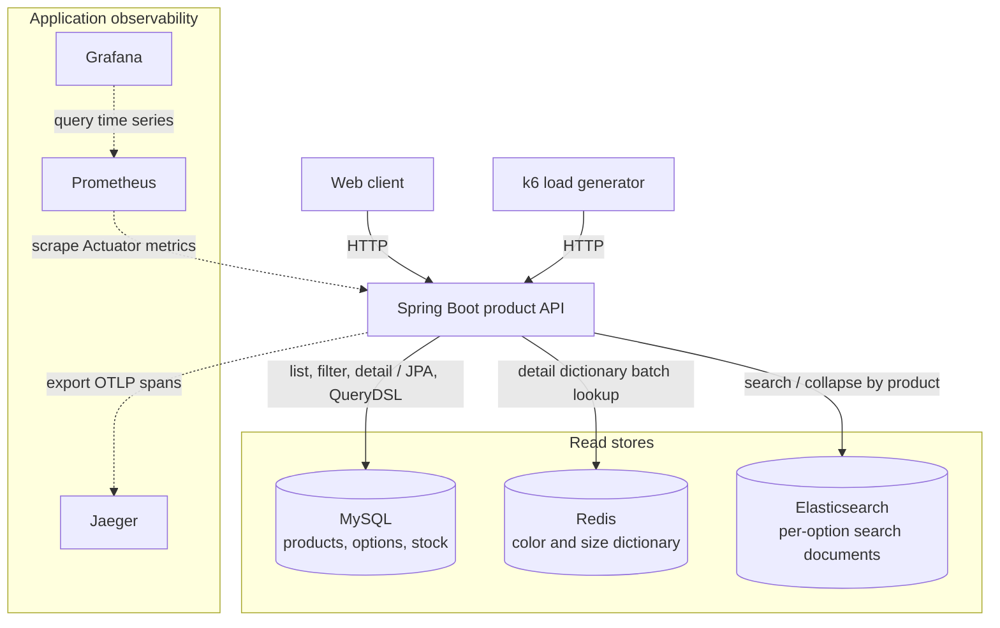
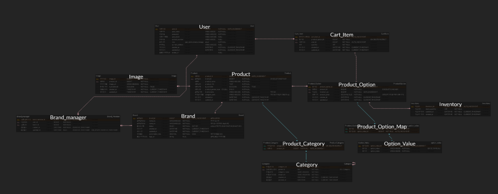
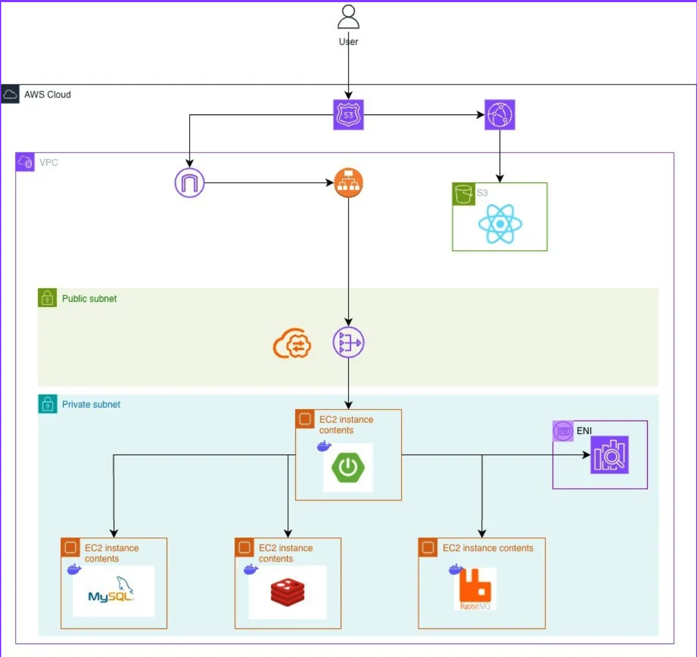
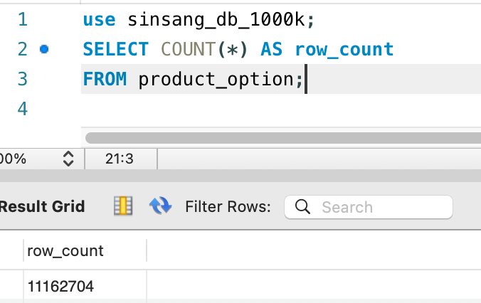
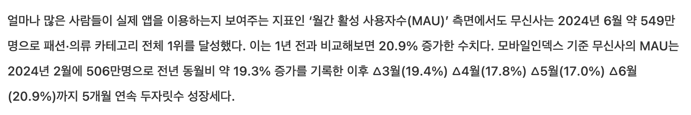
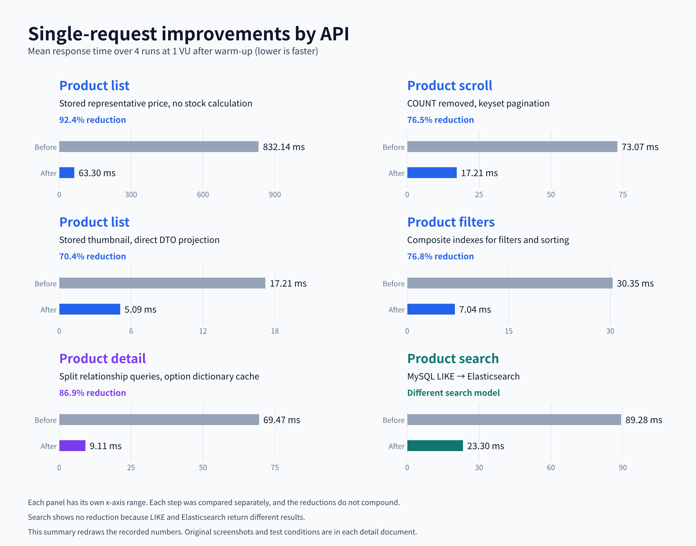

  <h1>Musinsang · Product Listing &amp; Search Optimization</h1>
  
A backend project that designs how each product's data is read and searched, and validates those choices with measurements.

  

    
    
    
  

  
<strong>English</strong> · <a href="./README.ko.md">한국어</a>

  

    <a href="#demo">Demo</a> ·
    <a href="#about-the-project">About &amp; role</a> ·
    <a href="#summary">Summary</a> ·
    <a href="#tech-stack">Tech &amp; rationale</a> ·
    <a href="#architecture">Architecture</a> ·
    <a href="#measurement-setup-and-scenarios">Setup &amp; scenarios</a> ·
    <a href="#single-request-improvements">Case studies</a> ·
    <a href="#troubleshooting">Troubleshooting</a> ·
    <a href="#limits-and-next-steps">Next steps</a>
  

---

## Demo

<h3 align="center"><a href="https://youtu.be/oC8-prv8Qdo">Watch the demo video</a></h3>

---

## About the Project

A team e-commerce project modeled on Musinsa, a major Korean fashion marketplace.  
With dozens of options attached to every product, it deals with how to read and search the information each screen needs, and where requests end up waiting as load grows.

### My Role

I owned the product domain on a team of six.  
I collected and loaded the product data, designed the data model, and built the product create/update, list, detail, and search APIs. I then measured performance with k6, analyzed the bottlenecks, and reworked how the data is queried.

---

## Summary

| Problem | Design decision | Result | Details |
| --- | --- | --- | --- |
| The list walked options and stock to work out each price | Store a representative price and drop the stock calculation from the list | Mean 832.14→63.30ms | [Representative price](docs/en/improvements/list-price.md) |
| COUNT and OFFSET cost just to compute the total page count | Remove COUNT and switch to keyset pagination | Mean 73.07→17.21ms | [Pagination](docs/en/improvements/list-keyset.md) |
| Repeated queries to build the detail response | Split queries by relationship and batch-load the option dictionary | Mean 69.47→9.11ms | [Product detail](docs/en/improvements/product-detail.md) |
| Search intent for colors and item types that aren't in the product name | Per-option ES documents, multi-field matching, and relevance ranking | Returns results for "블랙 스커트" (black skirt), which LIKE missed | [Search design](docs/en/improvements/product-search.md) |
| Requests waiting longer as load increases | Confirm the baseline load, then investigate connection pools, threads, and the search path | Each of the 4 APIs held 1,000 RPS on its own. Traced where detail and search requests wait | [Baseline results](#high-load-results) · [Bottlenecks](#troubleshooting) |

Each linked document covers the details.

---

## Tech Stack

| Area | Technologies |
| --- | --- |
| Backend | Java 21, Spring Boot 3.5.6, Spring Data JPA, QueryDSL |
| Data and search | MySQL, Redis, Elasticsearch |
| Measurement | k6, Prometheus, Grafana, Jaeger, ES Profile / hot threads |
| Infrastructure and testing | Docker, AWS, JUnit, Spring Boot Test |

> **[Why these technologies →](docs/en/technology-decisions.md)**

---

## Architecture

Full ERD

AWS deployment

This is the AWS setup used when the team service was deployed; it is no longer running. 
The performance measurements below were run locally, and the conditions are described in the measurement setup section.

---

## Measurement Setup and Scenarios

To test listing and search on real product data, I collected 155,036 products with the [Naver Shopping Search API](https://developers.naver.com/docs/serviceapi/search/shopping/shopping.md). 
I then combined colors and sizes to load about 72 options per product, 11,162,704 product options in total. 
This was inspired by [Coupang's approach of treating each option as the smallest product unit](https://developers.coupang.com/ko/getting-started/coupang-open-api).

All measurements were run on a single Apple M3 Max machine (36GB memory), with k6, the application, the DB, ES, and the observability tools all running in Docker.

Test data

I combined colors and sizes for the 155,036 products collected with the [Naver Shopping Search API](https://developers.naver.com/docs/serviceapi/search/shopping/shopping.md) to generate 11,162,704 product options in total. 
Each product has about 72 options on average (min 50, max 95). The collected product data wasn't very clean, so brands and options were assigned arbitrarily, and the option distribution differs from that of real sellers.

Target load and scenarios

**Scenarios**

Based on how users look for products in a real shopping app, I split the tests into five APIs: list, scroll, filter, detail, and search. 
Each API was load-tested on its own, and load was defined as requests per second (RPS) rather than a number of VUs.

| API | Test scope |
| --- | --- |
| List | First page of 24 products |
| Scroll | Pages 1–5 in a row using the response cursor |
| Filter | 10 filters × 3 sort orders, first 24 products |
| Detail | 5 products with 60–72 options each, in rotation |
| Search | 스커트 (skirt), 블랙 스커트 (black skirt), 나이키 (Nike), 나이키 후드 (Nike hoodie) |

**Target load**

I started from [Musinsa's 5.49 million MAU as of June 2024](https://www.fi.co.kr/main/view.asp?idx=82843). 
Shopping apps usually have a DAU/MAU ratio of [about 10–25%](https://clevertap.com/blog/dau-vs-mau-app-stickiness-metrics/), so I used the top of that range, 25%, for a DAU of about 1.37 million. 
I assumed each visit makes 15–20 product API calls, based on [an average of about 4.4 pages per mobile shopping session](https://www.opensend.com/post/pages-per-session-ecommerce) plus extra calls to load more while scrolling, which gives an average of about 240–320 RPS. 
To account for event peaks such as Black Friday, I took 4× the average, about 950–1,270 RPS, as the peak, and set the target at 1,000 RPS, the low end of that range. 
This is the peak for all product APIs combined, but each API was tested on its own, so each one took more load than its real share.

**Response time criteria**

[Google reported that a 0.5-second slowdown in search results cut traffic by 20%](https://glinden.blogspot.com/2006/11/marissa-mayer-at-web-20.html), and [Nielsen treats 1 second as the limit for keeping a user's flow of thought uninterrupted](https://www.nngroup.com/articles/response-times-3-important-limits/). 
With that in mind, I aimed for p95 under 500ms, and defined a pass as holding 1,000 RPS for 120 seconds with p95 under 1 second and no HTTP failures or drops. 
All four APIs that passed stayed under p95 10ms.

---

## Single-Request Improvements

I compared the mean API response time before and after each change at 1 VU, after warm-up.

### Product list and scroll

| Step | Change and details | Before mean | After mean | Reduction |
| --- | --- | ---: | ---: | ---: |
| 1 | [Stored representative price, no stock calculation in the list →](docs/en/improvements/list-price.md) | 832.14ms | 63.30ms | 92.4% |
| 2 | [COUNT removed, keyset pagination →](docs/en/improvements/list-keyset.md) | 73.07ms | 17.21ms | 76.5% |
| 3 | [Stored thumbnail, direct DTO projection →](docs/en/improvements/list-thumbnail-dto.md) | 17.21ms | 5.09ms | 70.4% |

### Product filters

| Change and details | Before mean | After mean | Reduction |
| --- | ---: | ---: | ---: |
| [Composite indexes for filters and sorting →](docs/en/improvements/filter-indexes.md) | 30.35ms | 7.04ms | 76.8% |

### Product detail

| Change and details | Before mean | After mean | Reduction |
| --- | ---: | ---: | ---: |
| [Split relationship queries, option dictionary cache →](docs/en/improvements/product-detail.md) | 69.47ms | 9.11ms | 86.9% |

### Product search

| Change and details | Before mean | After mean |
| --- | ---: | ---: |
| [MySQL LIKE → ES search model →](docs/en/improvements/product-search.md) | 89.28ms | 23.30ms |

---

## High-Load Results

These are the baseline load test results for each API; the linked documents have the details. 

| API and details | Completed hold stage | Hold mean | Hold p95 | Result |
| --- | --- | ---: | ---: |--------------------|
| [Product list →](docs/en/load-tests/product-list.md) | 1,000 RPS, 120s | 2.64ms | 4.26ms | No HTTP failures or drops |
| [Product scroll →](docs/en/load-tests/product-scroll.md) | 1,000 RPS, 120s | 2.44ms | 3.95ms | No HTTP failures or drops |
| [Product filters →](docs/en/load-tests/product-filter.md) | 1,000 RPS, 120s | 3.05ms | 5.03ms | No HTTP failures or drops |
| [Product detail →](docs/en/load-tests/product-detail.md) | 1,000 RPS, 120s | 5.07ms | 7.21ms | No HTTP failures or drops |
| [Product search →](docs/en/load-tests/product-search.md) | 250 RPS, 30s | 15.39ms | 40.53ms | 179 drops in the next ramp, stopped early |

Search responded without HTTP errors, but as load rose and responses slowed, k6 ran out of VUs to start new requests, producing 179 `dropped_iterations` and stopping the test.  
This wasn't an API error: search had reached what it could handle in this local environment, and the cause is traced in the troubleshooting section below.

---

## Troubleshooting

After confirming the baseline load, I traced where detail requests wait under higher load, and why the search test stops.

| Problem | Bottleneck found | What I did and the result | Details |
| --- | --- | --- | --- |
| Detail throughput stalled at 2,000 RPS | Waiting for DB connections | Hikari 10 → 50, p95 875ms → 59ms | [Hikari →](docs/en/troubleshooting/hikari.md) |
| Detail stuck at about 2,100 RPS when driven at 3,000 RPS | Average CPU on the shared host above 96% | More connections and threads didn't raise throughput, so Hikari 50 and Tomcat 200 were kept | [Tomcat →](docs/en/troubleshooting/tomcat.md) |
| Search stopped in the ramp after holding 250 RPS | DB connection wait → ES HTTP connection wait → wait inside ES | Separating the transaction and enlarging the pool cut the waits, but the target load wasn't reached | [Search bottleneck →](docs/en/troubleshooting/search-capacity.md) |

Each pool and thread comparison was run once per setting. In the extended scenario with an extra load stage, p95 in the 2,000 RPS stage for the same setting measured 266ms.

**Other issues**

- [Isolating the detail bottleneck](docs/en/troubleshooting/detail-isolation.md): The Security span looked long, so I swapped parts of the path for mocks and narrowed the investigation down to the wait before entering the service, the queries, and response assembly.
- [Search quality](docs/en/troubleshooting/search-quality.md): Every token in the query must match, and relevance weights are configured separately.
- [Search pagination](docs/en/troubleshooting/search-pagination.md): With the current relevance sort, collapse can't be combined with search_after, so I used from/size. Deep pages are still expensive.
- [OpenSearch deployment compatibility](docs/en/troubleshooting/opensearch-deployment.md): Injected the product response header and applied compatibility request headers to get around the existing client's connection problem.
- [When observability backfires](docs/en/troubleshooting/observability-overhead.md): Cut back DEBUG logging and excessive tracing for load tests.

---

## Limits and Next Steps

These results come from testing the query design locally on a fixed set of products and options. 
Performance in a real deployment, and keeping representative values, caches, and the search index consistent when data changes, are left as follow-up work.

Follow-up work

| Follow-up | What to check |
| --- | --- |
| Validate in a real deployment | Separate the load generator from service resources on AWS or Azure, and check throughput, latency, and bottlenecks under different network and resource layouts |
| Consistency on data changes | Updating representative prices and thumbnails, applying Redis dictionary changes, propagating DB changes to ES, retrying failures, and validating reindexing |
| Compare Redis, local memory, and an RDB | Compare lookup latency, network cost, refresh, and failure dependencies for the same option dictionary and response |
| Validate an ES nested model | Compare the current per-option documents with a product-centric nested model on option combinations, queries, index size, and update cost |

- **Deployment environment:** Local and deployed numbers come from different hardware and networks, so I plan to compare them separately rather than merge them into one improvement figure.
- **Consistency:** The representative price currently only goes down when a cheaper option is added. There is no recalculation yet when the cheapest option sells out or goes up in price, and no path for applying DB changes to ES.
- **Option dictionary:** The 60 colors and sizes live in Redis but have no TTL or DB fallback. The dictionary is small enough that local memory might be simpler, so I plan to compare them under the same load.
- **Search document structure:** Nested documents are still stored as separate option documents internally, so I won't assume nested is faster just because it removes collapse; I plan to compare read and update costs together.

