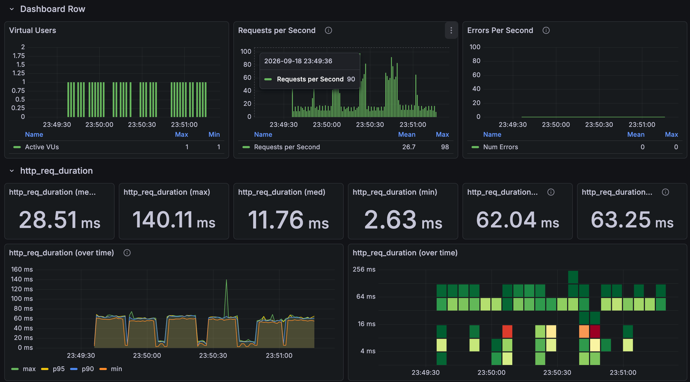
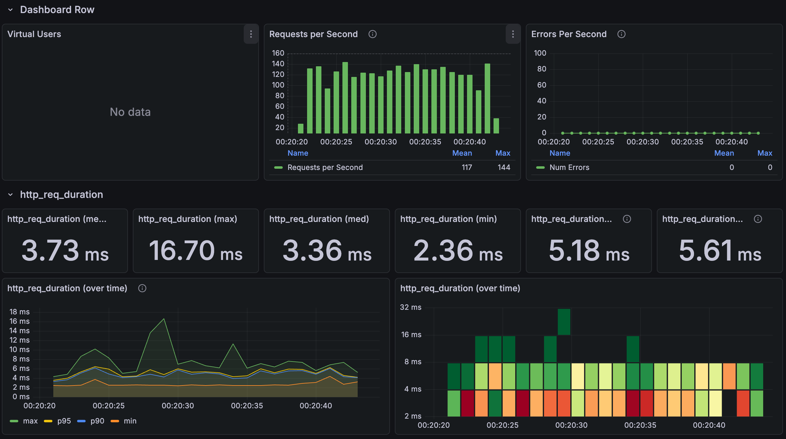
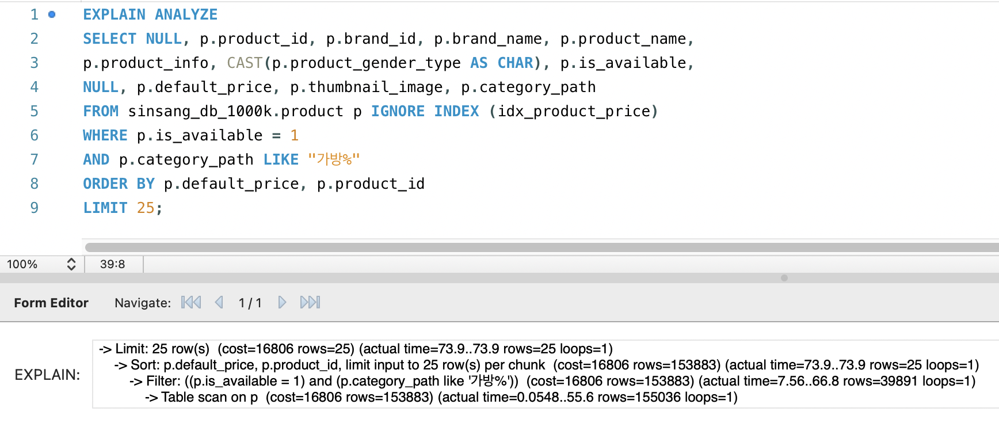
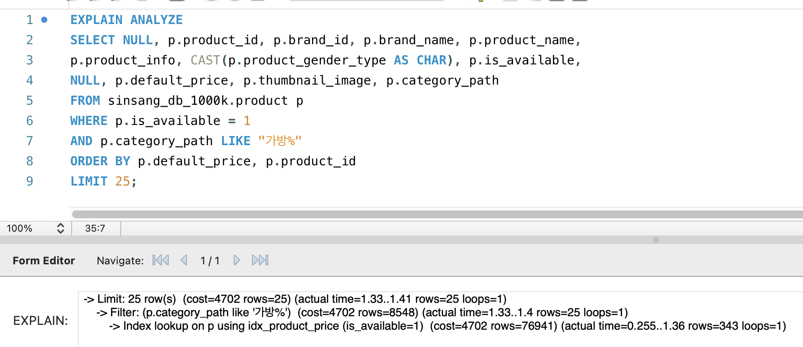

# Product filters: composite indexes verified with execution plans

[한국어](../../ko/improvements/filter-indexes.md) · [README](../../../README.md)

---

## Problem and test conditions

The product list supports category, brand, and gender filters, sorted by default order, lowest price, or highest price.<br>
Even after the representative price was stored, there was no index matching the price sort, so filtered lists sorted by price were still slow.

I requested the first page of `GET /api/products?limit=24` under 30 conditions: 10 filters × 3 sort orders.<br>
For each condition, one batch was 1 first request → 4 warm-up requests → 30 measured requests at 1 VU, and the batch was run 4 times.

---

## Repeated measurements

| Run | Before mean | Before p95 | After mean | After p95 |
| --- | --- |---| --- |---|
| Run 1 | 31.15ms | 64.33ms | 8.35ms | 11.20ms |
| Run 2 | 31.57ms | 65.28ms | 8.14ms | 11.04ms |
| Run 3 | 30.17ms | 63.28ms | 7.94ms | 11.08ms |
| Run 4 | 28.51ms | 63.25ms | 3.73ms | 5.61ms |
| Mean of 4 runs | 30.35ms | — | 7.04ms | — |


The 4-run mean went from 30.35ms to 7.04ms, a 76.8% reduction.<br>
The p95 for the 4-run mean is recalculated from all request records across the four runs combined.

**Before the indexes**



**After the indexes**



<details>
<summary>Results by filter and sort</summary>

The category is Bags, the leaf category is Tote Bags, the multi-category filter is Tote Bags plus Crossbody Bags, the brand is one fixed brand, and the gender is unisex (`ALL`).<br>
Each condition has 270 results from runs 1–3 combined.

| Filter / sort | Before mean (ms) | Before p95 (ms) | After mean (ms) | After p95 (ms) |
| --- | --- | --- | --- | --- |
| No filter / default ID | 8.33 | 12.03 | 7.50 | 10.21 |
| No filter / lowest price | 63.08 | 67.30 | 7.29 | 10.21 |
| No filter / highest price | 63.30 | 66.59 | 7.87 | 10.36 |
| Top category / default ID | 9.71 | 12.64 | 9.38 | 11.74 |
| Top category / lowest price | 59.53 | 63.07 | 8.36 | 10.51 |
| Top category / highest price | 59.27 | 62.17 | 7.96 | 10.34 |
| Brand / default ID | 7.99 | 10.38 | 7.49 | 10.01 |
| Brand / lowest price | 14.07 | 17.16 | 7.64 | 9.99 |
| Brand / highest price | 14.07 | 17.43 | 7.37 | 9.41 |
| Gender / default ID | 7.71 | 10.03 | 7.20 | 9.72 |
| Gender / lowest price | 63.56 | 66.97 | 7.64 | 10.24 |
| Gender / highest price | 63.79 | 67.05 | 7.49 | 11.19 |
| Top category + brand / default ID | 8.31 | 11.58 | 9.36 | 11.74 |
| Top category + brand / lowest price | 13.89 | 16.90 | 7.19 | 9.65 |
| Top category + brand / highest price | 13.80 | 16.26 | 7.74 | 10.07 |
| Top category + gender / default ID | 9.58 | 11.66 | 9.29 | 12.01 |
| Top category + gender / lowest price | 61.30 | 65.24 | 7.93 | 11.12 |
| Top category + gender / highest price | 62.28 | 68.44 | 7.76 | 10.53 |
| Brand + gender / default ID | 7.48 | 10.43 | 7.73 | 10.43 |
| Brand + gender / lowest price | 14.17 | 18.03 | 7.13 | 9.83 |
| Brand + gender / highest price | 13.87 | 16.54 | 7.41 | 10.07 |
| Top category + brand + gender / default ID | 8.39 | 11.09 | 9.27 | 11.33 |
| Top category + brand + gender / lowest price | 14.49 | 17.12 | 7.96 | 10.41 |
| Top category + brand + gender / highest price | 13.95 | 16.79 | 7.78 | 10.35 |
| Leaf category / default ID | 10.02 | 13.17 | 9.62 | 12.00 |
| Leaf category / lowest price | 54.85 | 58.51 | 8.28 | 10.78 |
| Leaf category / highest price | 55.61 | 59.70 | 8.34 | 11.45 |
| Multiple categories / default ID | 10.86 | 13.84 | 10.20 | 13.04 |
| Multiple categories / lowest price | 60.87 | 64.57 | 8.81 | 11.09 |
| Multiple categories / highest price | 60.79 | 64.40 | 9.27 | 12.38 |

</details>

---

## Why it was slow and what changed

A filtered list sorted by price has to find the matching products, sort them by price, and take the top 24.<br>
Taking the Bags category sorted by lowest price as an example, there was no index for the price sort, so MySQL read the whole product table (155,036 rows), sorted all 39,891 matching rows, and then returned just 25.

So I added a composite index ordered by availability, price, and product ID, plus a second one with the same order and brand in front.<br>
MySQL now reads the index in price order and stops as soon as it finds 25 matching rows, so the rows read dropped from 155,036 to 343 and the separate sort disappeared.<br>
The highest-price sort reads the same index backwards, and the default ID sort barely changed because it was already a fast lookup on the primary key.

```sql
CREATE INDEX idx_product_price
    ON product (is_available, default_price, product_id);
CREATE INDEX idx_product_brand_price
    ON product (brand_id, is_available, default_price, product_id);
```

| Item | Without index | With index |
| --- | --- | --- |
| Access method | Full scan of the product table | Range scan on the price composite index |
| Rows read | 155,036 | 343 |
| Rows that matched | 39,891 | 25 |
| Separate sort | 39,891 rows sorted | None |
| Execution time | 73.9ms | 1.41ms |

**Execution plan without the price index**



**Execution plan with the price index**



---

## Choices and trade-offs

- **Write cost**: More indexes mean every product insert or price change also has to update them, and they take more storage.
  So instead of covering every filter combination, I only built the two price-sort paths with the biggest impact.<br>


- **No category index**: I also compared an index that included the category, but filtering on a top-level category has to read several subcategories together, so it can't produce one overall price order directly.
  For the Bags condition, the price index read only 343 rows while the category index still had to sort 39,891, and it only helped when a single subcategory was selected, so I left it out.<br>


- **Edge cases**: When few products match a filter such as category or gender, MySQL has to read further along the index to fill 25 rows.<br>
