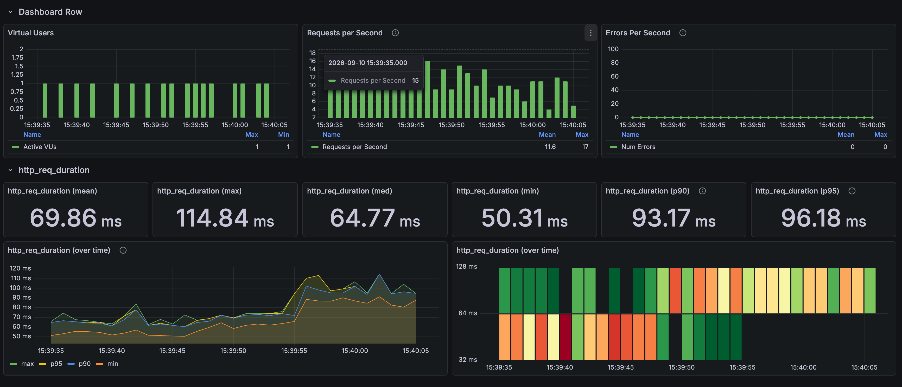
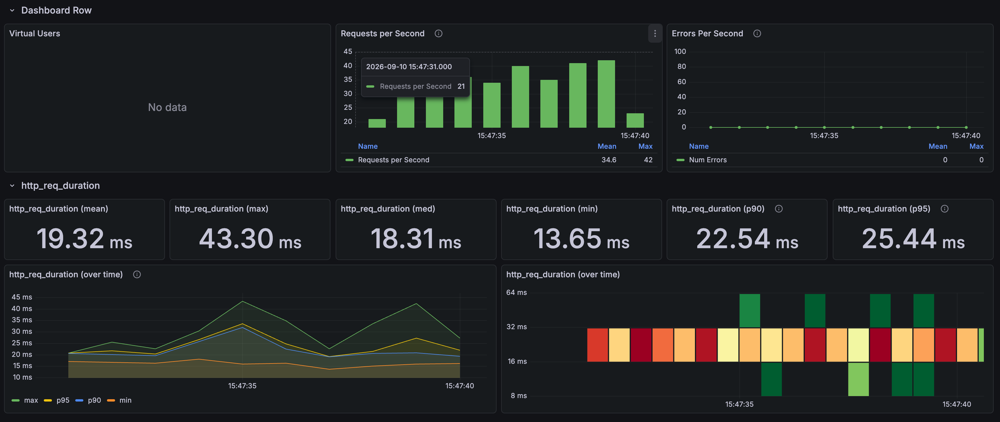

# Product scroll: dropping COUNT and switching to keyset pagination

[한국어](../../ko/improvements/list-keyset.md) · [README](../../../README.md)

---

## Problem and test conditions

Even after the representative price was stored, the list still used page numbers, so every request ran a COUNT over all products and used OFFSET to skip the earlier pages.

I queried available products in ID order, 24 at a time, and prepared cursors for the four positions below in advance so each position could be read directly.<br>
For each position, one batch was 1 first request → 4 warm-up requests → 30 measured requests at 1 VU, and the batch was run 4 times.

| Position | Products skipped by OFFSET | Prepared cursor |
| --- | --- | --- |
| page 0 | 0 | none (first page) |
| page 100 | 2,400 | 2454 |
| page 1000 | 24,000 | 24700 |
| page 5000 | 120,000 | 123177 |

---

## Repeated measurements

| Run | Before mean | Before p95 | After mean | After p95 |
| --- | --- | --- | --- | --- |
| Run 1 | 74.90ms | 98.94ms | 17.51ms | 22.48ms |
| Run 2 | 73.82ms | 98.63ms | 16.17ms | 18.86ms |
| Run 3 | 73.70ms | 97.22ms | 15.88ms | 17.95ms |
| Run 4 | 69.86ms | 96.18ms | 19.26ms | 25.02ms |
| Mean of 4 runs | 73.07ms | — | 17.21ms | — |

The 4-run mean went from 73.07ms to 17.21ms, a 76.5% reduction.

### Mean by depth

| Position | OFFSET mean | Keyset mean |
| --- | --- | --- |
| page 0 | 65.23ms | 16.86ms |
| page 100 | 64.90ms | 16.46ms |
| page 1000 | 70.69ms | 16.63ms |
| page 5000 | 95.75ms | 16.13ms |

The means by depth combine runs 1–3.

**COUNT + OFFSET**



**Keyset**



---

## Why it was slow and what changed

The original list was paginated by page number.<br>
To work out the total number of pages, every request counted all matching products with COUNT, then used OFFSET to skip the earlier pages before reading 24 products.<br>
So even the first page paid for counting every product, and because OFFSET reads the skipped rows before throwing them away, deeper pages took longer.

With infinite scroll, the total page count is not needed; the client only needs to know whether there is a next page.<br>
So I removed COUNT and switched to keyset pagination, which reads from just after the last product ID the user has seen.<br>
The query returns 24 products and uses whether a 25th exists to decide `hasNext`, and the last ID becomes the cursor for the next request.<br>
As a result, OFFSET slowed to about 96ms at page 5,000, while keyset stayed at about 16ms on both the first page and page 5,000.

```sql
-- Before (page 1,000)
SELECT COUNT(*) FROM product WHERE is_available = true;
SELECT ... FROM product WHERE is_available = true
ORDER BY product_id ASC LIMIT 24 OFFSET 24000;

-- After (page 1,000)
SELECT ... FROM product
WHERE is_available = true AND product_id > 24700
ORDER BY product_id ASC LIMIT 25;
```

---

## Choices and trade-offs

- **Page position**: The user can't tell which page they are on or how many pages there are, and can't jump straight to a specific page.
  Infinite scroll doesn't need any of that, but this approach can't be used for a screen with page numbers.<br>


- **Data changes while scrolling**: Keyset continues from the last product the user saw, so products added earlier in the order don't appear until the page is refreshed.
  OFFSET reflects changes immediately, but when products are added to or removed from the earlier part of the list, everything after them shifts by one, so the user either sees a product again or skips one.
  In infinite scroll, the same product appearing twice in one list is easy to notice, so I chose a stable, continuous list over reflecting changes in real time.<br>
