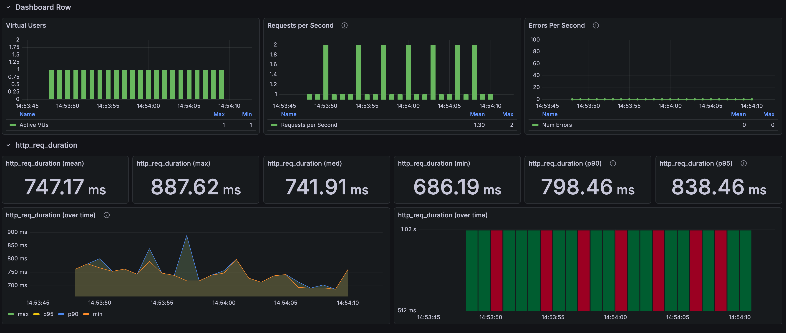
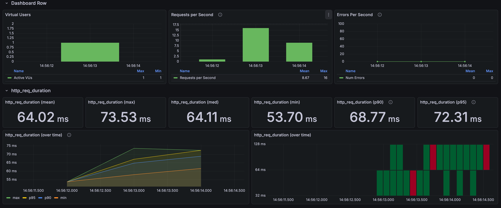

# Product list: stored representative price, no stock calculation

[한국어](../../ko/improvements/list-price.md) · [README](../../../README.md)

---

## Problem and test conditions

The list only needs one representative price per product, but the original response assembly walked each product's options and inventory to work out the lowest price and whether the product was in stock.

The request was `GET /api/products?page=0&size=24`: a plain list with no keyword and no price sort. 
For each version, one batch was 1 first request → 4 more warm-up requests → 30 measured requests at 1 VU, and the batch was run 4 times.

---

## Repeated measurements

| Run | Before mean | Before p95 | After mean | After p95 |
| --- | --- | --- | --- | --- |
| Run 1 | 852.25ms | 955.68ms | 63.88ms | 73.83ms |
| Run 2 | 880.45ms | 1,032.82ms | 63.15ms | 70.65ms |
| Run 3 | 848.70ms | 957.91ms | 62.16ms | 66.78ms |
| Run 4 | 747.17ms | 838.46ms | 64.02ms | 72.31ms |
| Mean of 4 runs | 832.14ms | — | 63.30ms | — |

The 4-run mean went from 832.14ms to 63.30ms, a 92.4% reduction. 

**List before the change**

**List after the change**

---

## Why it was slow and what changed

Each product has about 72 options on average, and the list has to show the lowest of those prices as the representative price. 
So the original implementation read every option and its inventory for each product and compared the prices. 
Even for the 24 products on the first page, it ran extra queries for each product's options, and reading the options of every product on screen on every request was the bottleneck.

To cut this, I denormalized the lowest price into a `default_price` column on the product table. 
The list now reads only the product table without touching options, which removes the extra SQL round trip per product and the cost of reading and comparing option and inventory rows. 
For the same reason, I also removed the stock-availability calculation from the list.

---

## Choices and trade-offs

- **Consistency**: The representative price is a copy of an option price, so it has to be kept in sync whenever an option is added or changed.
  A new, cheaper option only takes one comparison, but if the cheapest option's price goes up, or it is deleted or sold out, the remaining options have to be read again to find the new minimum.  

- **Transactions and locking**: Updating the option and the representative price in one transaction keeps them consistent, but concurrent edits to options of the same product then contend for a lock on the product row.
  Updating asynchronously reduces that contention but can briefly show a stale price, so the update strategy and lock scope still need more design work. 
