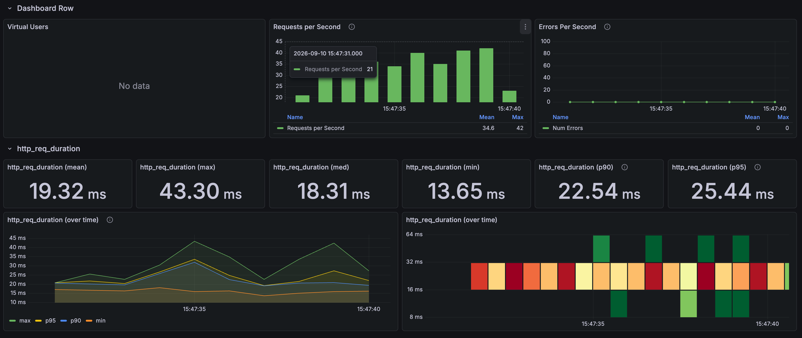
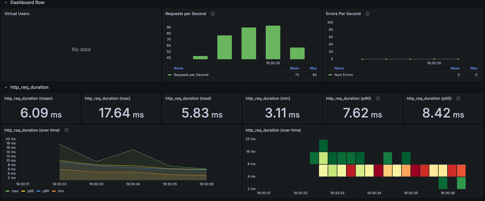

# Product list: stored thumbnail and direct DTO projection

[한국어](../../ko/improvements/list-thumbnail-dto.md) · [README](../../../README.md)

---

## Problem and test conditions

Even with the representative price and keyset in place, the list still loaded product entities, looked up each product's thumbnail from its image list, and then copied everything into the response DTO.

I used the same four cursor positions as the keyset test. For each position, one batch was 1 first request → 4 warm-up requests → 30 measured requests at 1 VU, and the batch was run 4 times.<br>
The "before" values are the "after" values from the [keyset measurements](list-keyset.md).

---

## Repeated measurements

| Run | Before mean | Before p95 | After mean | After p95 |
| --- | --- | --- | --- | --- |
| Run 1 | 17.51ms | 22.48ms | 5.35ms | 7.92ms |
| Run 2 | 16.17ms | 18.86ms | 4.73ms | 6.22ms |
| Run 3 | 15.88ms | 17.95ms | 4.20ms | 5.36ms |
| Run 4 | 19.26ms | 25.02ms | 6.09ms | 8.42ms |
| Mean of 4 runs | 17.21ms | — | 5.09ms | — |

The 4-run mean went from 17.21ms to 5.09ms, a 70.4% reduction.

**Before the thumbnail and DTO change**



**After the thumbnail and DTO change**



---

## Why it was slow and what changed

The list only needs a few values such as the product name, price, and thumbnail, but the original implementation loaded whole product entities and walked each product's image list to pick the thumbnail.<br>
When the image relationship wasn't loaded yet, this ran an extra query per product, and every response also repeated the step of building entities and then copying them into DTOs.

To cut this, I denormalized the main image URL into a `thumbnail_image` column on the product table, and changed the query to select only the columns the list needs straight into a DTO with QueryDSL.<br>
The extra lookups through the image table and the intermediate entities are gone, and the query reads only the columns it needs from the product table.

```text
Before: DB → product entity → find thumbnail in image list → ProductSummary → JSON
After:  required columns from DB → ProductSummary → JSON
```

```java
// The real response has more fields.
.select(Projections.constructor(
    ProductSummary.class,
    product.productId,
    product.productName,
    product.defaultPrice,
    product.thumbnailImage
)).from(product)
```

---

## Choices and trade-offs

- **Consistency**: The thumbnail URL is also a copy of a value in the image table, so it has to be updated whenever the main image is changed or deleted.
  Otherwise the list and the detail page show different images.<br>


- **Query tied to the response**: The selected columns are tied to the DTO constructor's field order and types, so adding or changing a response field means changing the query too.<br>
