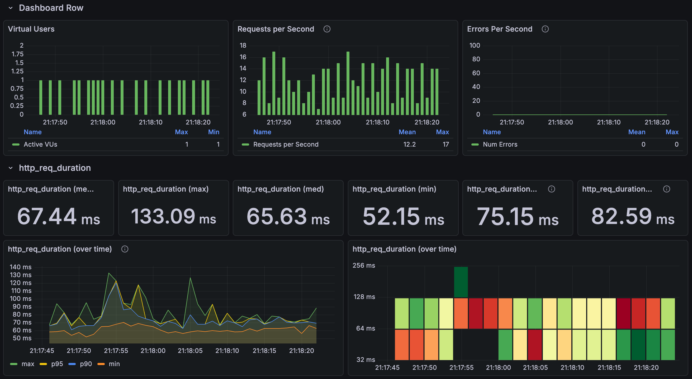
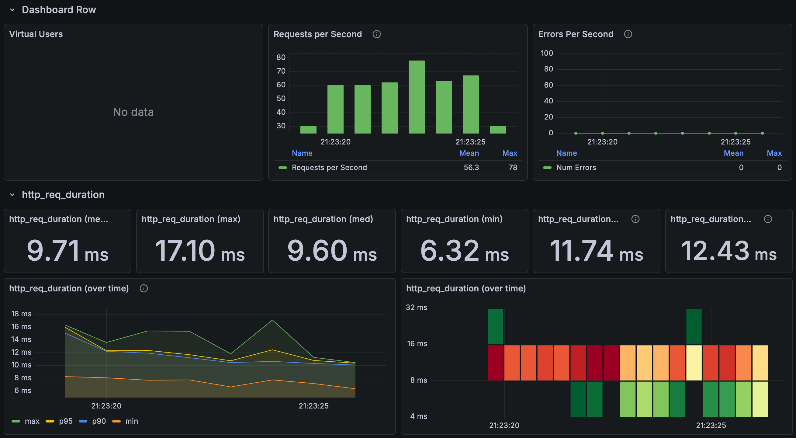
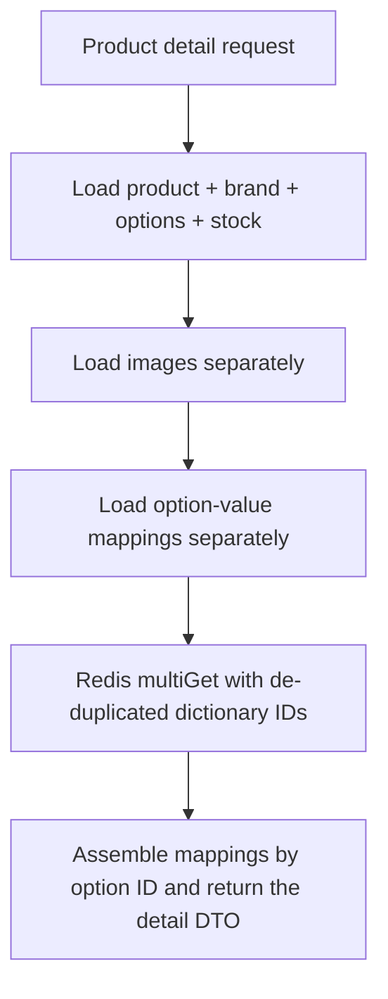

# Product detail: same response, different way of loading relationships

[한국어](../../ko/improvements/product-detail.md) · [README](../../../README.md)

---

## Problem and test conditions

The detail page has to show all of a product's options, with price, stock, and color and size names, in the first response. 
The original implementation loaded the product, brand, and images together, then followed the relationships to load stock and option values one option at a time.

I repeatedly requested 5 products with 60–72 options each. For each product, one batch was 1 first request → 4 warm-up requests → 30 measured requests at 1 VU, and the batch was run 4 times.

---

## Repeated measurements

| Run | Before mean | Before p95 | After mean | After p95 |
| --- | --- | --- | --- | --- |
| Run 1 | 71.33ms | 89.70ms | 9.75ms | 13.21ms |
| Run 2 | 70.69ms | 87.94ms | 8.36ms | 9.50ms |
| Run 3 | 68.41ms | 80.94ms | 8.62ms | 10.61ms |
| Run 4 | 67.44ms | 82.59ms | 9.71ms | 12.43ms |
| Mean of 4 runs | 69.47ms | — | 9.11ms | — |

The 4-run mean went from 69.47ms to 9.11ms, an 86.9% reduction. 
Separately from the measurements, I compared the response JSON of the same 5 products before and after the change and confirmed that the fields, values, and array order were identical.

### Mean by product

| Product | Options | Before mean | After mean |
| --- | --- | --- | --- |
| Product 1 | 60 | 63.49ms | 9.27ms |
| Product 2 | 72 | 74.01ms | 9.14ms |
| Product 3 | 65 | 68.52ms | 8.51ms |
| Product 4 | 67 | 69.41ms | 8.75ms |
| Product 5 | 72 | 75.30ms | 8.86ms |

The means by product combine runs 1–3.

**Detail before the change**

**Detail after the change**

---

## Why it was slow and what changed

While building the detail response, the original implementation followed the relationships to load stock and option values separately for each of the 60–72 options. 
That was an N+1 pattern, with a small query repeated once per option, and the color and size names shared by many options were also read from the DB again for every option.

I split the data into what to load together and what to load separately. 
The product, brand, options, and stock are loaded in one query, and the images and the option-value mappings are each loaded in one separate query. 
Color and size names come from a dictionary of only 60 entries, so I fetch them from Redis in one call (`multiGet`) using the de-duplicated IDs and assemble them per option.

Images are loaded separately because options and images are independent lists. 
Joining both in one query multiplies the result rows: 3 images and 60 options come back as 180 rows.

---

## Choices and trade-offs

- **Query count and assembly**: Splitting the queries instead of joining everything at once avoids the multiplied rows, but it adds a few DB round trips and code that assembles the results in the application. 

- **Dependency on Redis**: Color and size names are now read from Redis, and there is currently no TTL or DB fallback, so if Redis is empty or not responding, the response can go out without those names. 

Current implementation: [ProductQueryService](../../../src/main/java/com/mudosa/musinsa/product/application/ProductQueryService.java) · [ProductQueryMapper](../../../src/main/java/com/mudosa/musinsa/product/application/mapper/ProductQueryMapper.java)
