# Search design: from product-name strings to options and search intent

[한국어](../../ko/improvements/product-search.md) · [README](../../../README.md)

---

## Problem and test conditions

The original search used LIKE to find products whose name contained the keyword as one continuous string. 
So a query like "블랙 스커트" (black skirt), where the color lives in the options and the item type lives in the category, returned nothing at all.

I requested the first 10 results the same number of times for four keywords: `스커트` (skirt), `블랙 스커트` (black skirt), `나이키` (Nike), and `나이키 후드` (Nike hoodie). 
For each keyword, one batch was 1 first request → 4 warm-up requests → 30 measured requests at 1 VU, and the batch was run 4 times.

---

## Repeated measurements

| Run | Before mean | Before p95 | After mean | After p95 |
| --- | --- | --- | --- | --- |
| Run 1 | 89.96ms | 174.35ms | 25.75ms | 60.19ms |
| Run 2 | 90.19ms | 175.78ms | 22.95ms | 54.48ms |
| Run 3 | 89.91ms | 176.34ms | 22.37ms | 53.50ms |
| Run 4 | 87.06ms | 168.54ms | 22.14ms | 47.06ms |
| Mean of 4 runs | 89.28ms | — | 23.30ms | — |

The 4-run mean went from 89.28ms to 23.30ms, a 73.9% reduction. 
LIKE and ES don't find the same results, so this is the response time after changing how search works, not a speed-up of the same feature.

**LIKE search**

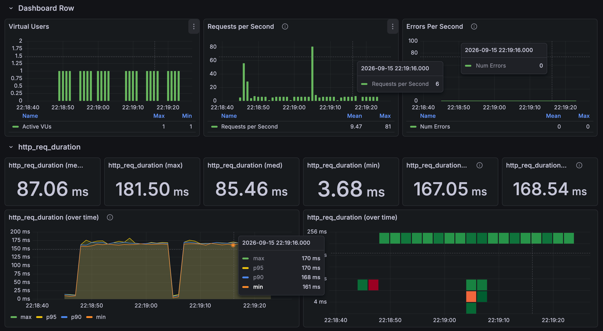

**ES search**

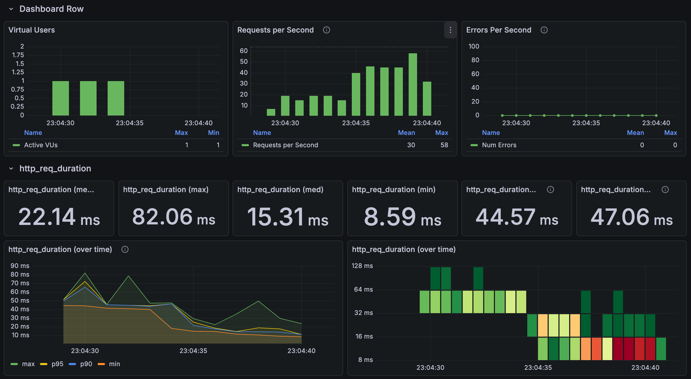

---

## Differences in the results

블랙 스커트 (black skirt): LIKE / Elasticsearch

LIKE returned nothing because no product name contained the continuous string "블랙 스커트". 
ES split the query into 블랙 and 스커트, searched for each word across several fields, and returned results.

**블랙 스커트 LIKE results**

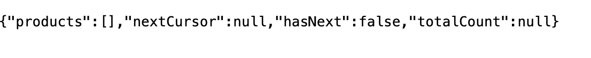

**블랙 스커트 ES results**

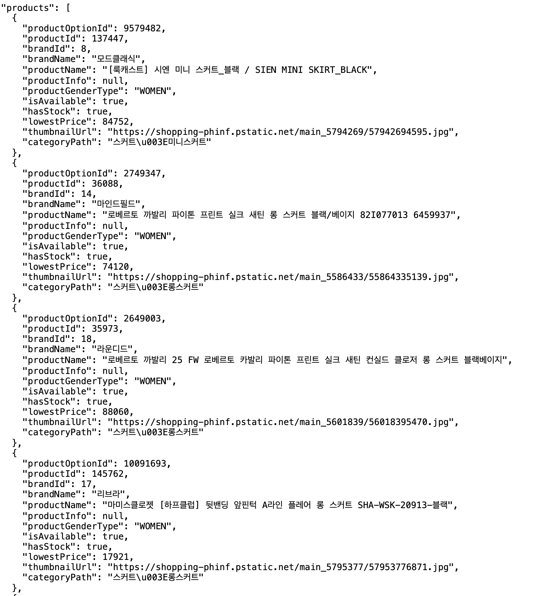

스커트 (skirt): LIKE / Elasticsearch

LIKE returns products with 스커트 in the name in ID order, while ES returns them ranked by relevance across several fields, including the category.

**스커트 LIKE results**

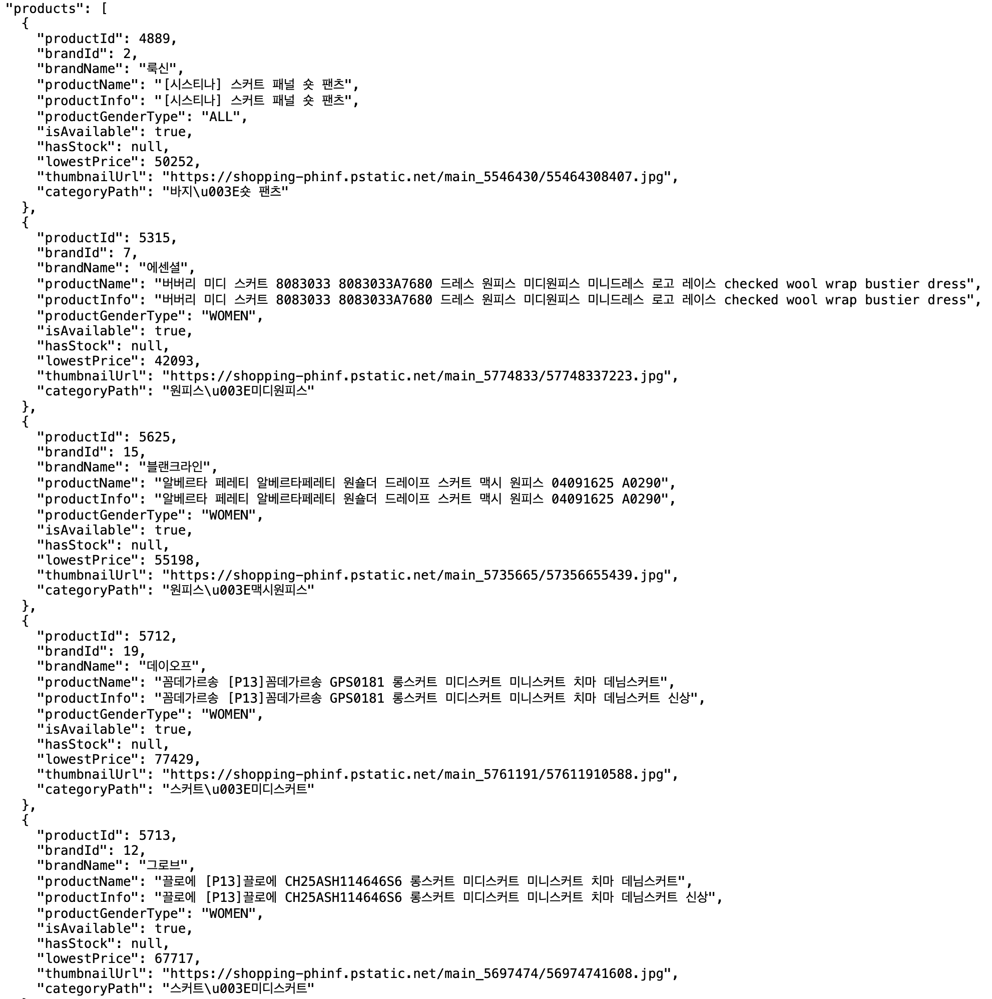

**스커트 ES results**

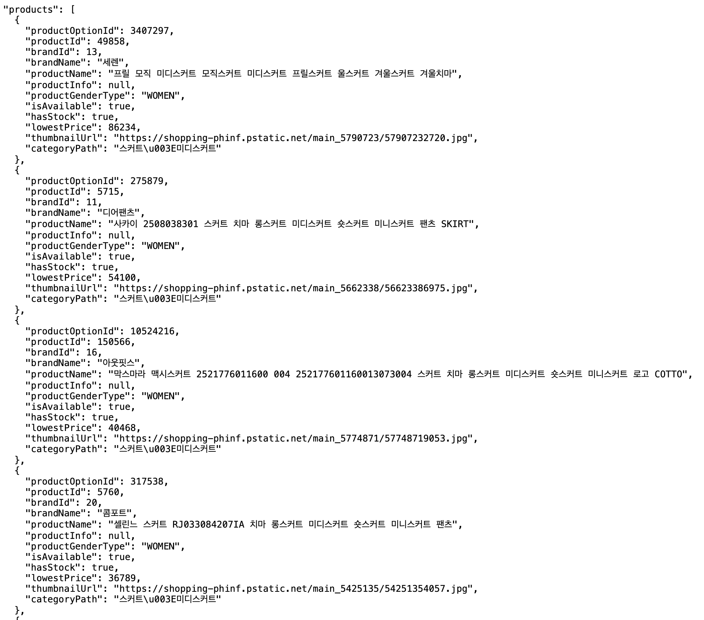

나이키 (Nike): LIKE / Elasticsearch

LIKE only returns products with 나이키 in the name, while ES ranks results by scores across several fields, including the product name and brand.

**나이키 LIKE results**

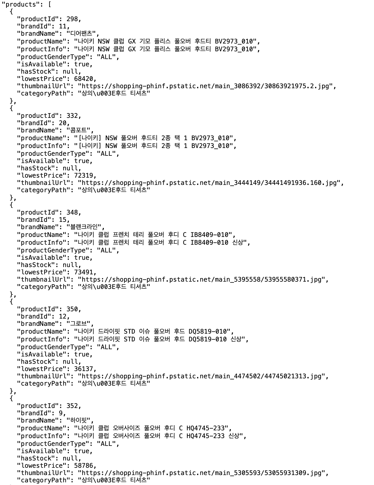

**나이키 ES results**

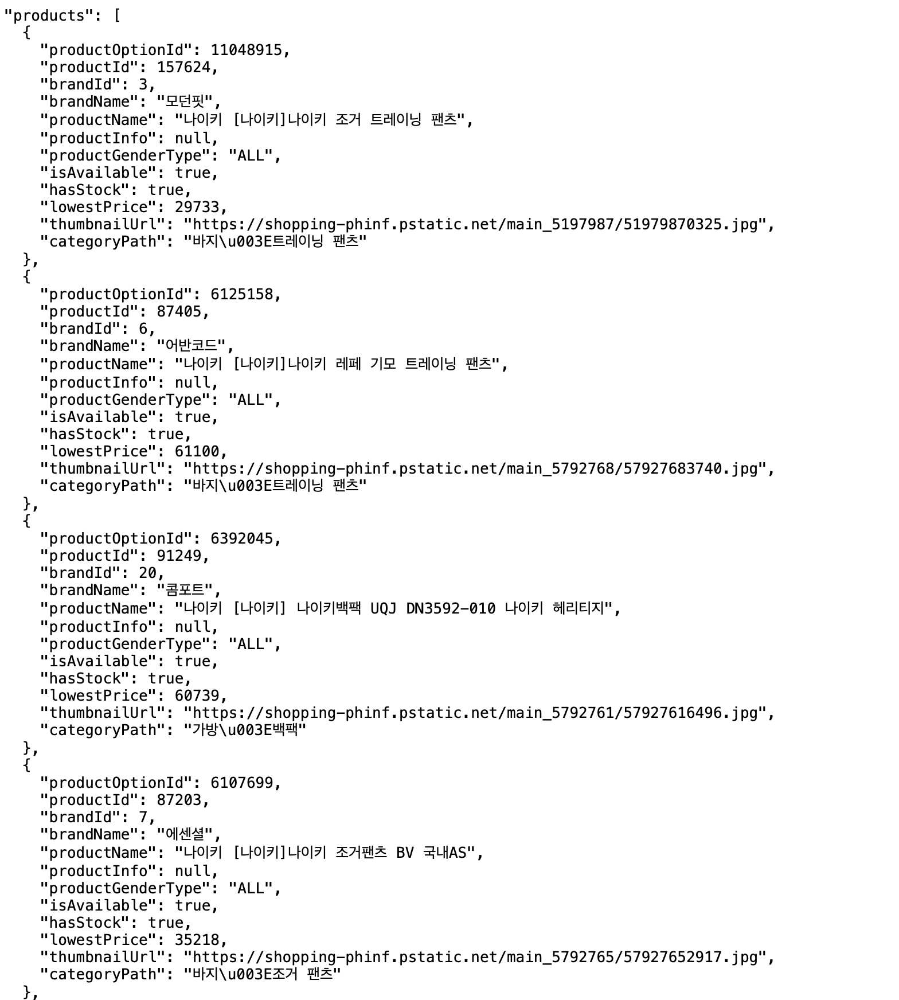

나이키 후드 (Nike hoodie): LIKE / Elasticsearch

LIKE misses product names with another word in between, such as "나이키 클럽 후드" (Nike Club hoodie). 
ES finds those products too, and the hoodie category score moves them toward the top.

**나이키 후드 LIKE results**

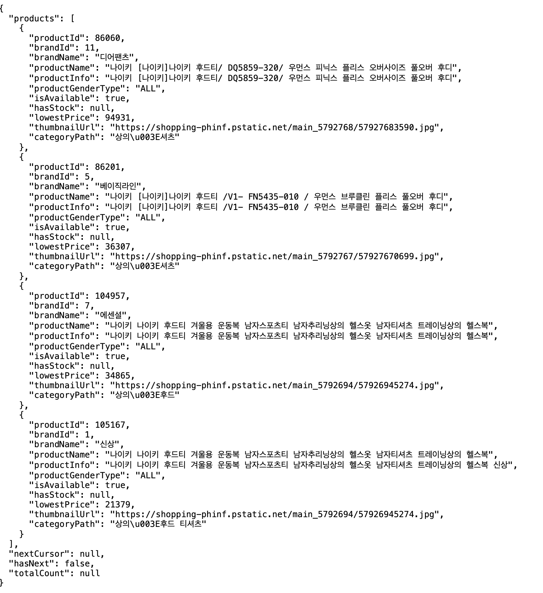

**나이키 후드 ES results**

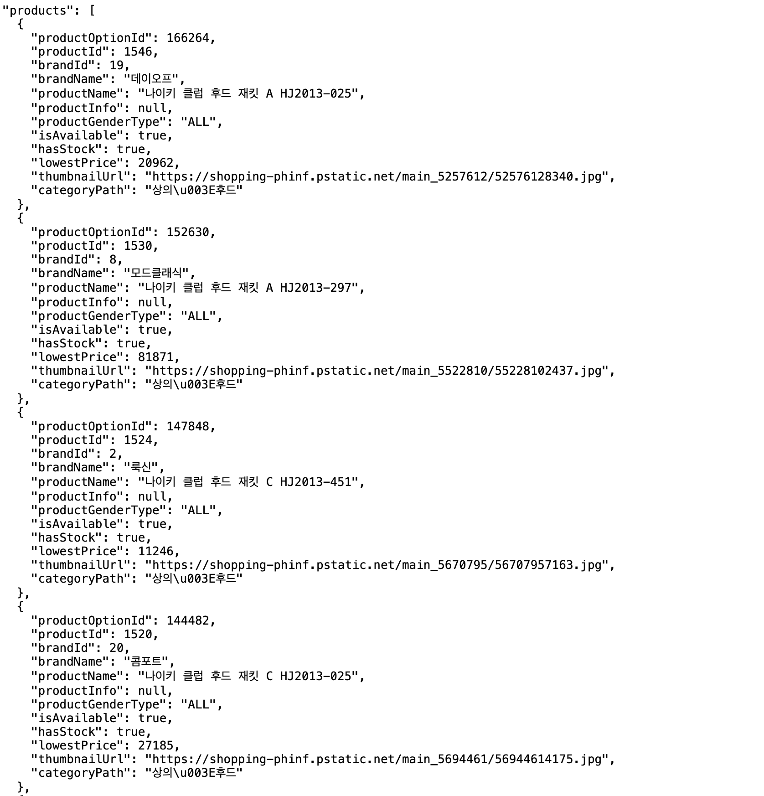

---

## Why I changed it and how it is designed

User queries mix color, item type, and brand, and that information is spread across the product name, options, category, and brand. 
LIKE can't search for those parts separately, so I moved to Elasticsearch, which can search several fields together and sort by relevance.

**One document per option**

If a product document only stores its colors and sizes as lists, a product that sells only black/S and red/M still matches a search for "black M". 
To match only the combinations that are actually for sale, I made one document per option and grouped options of the same product by `productId` (collapse) so results come back per product. 
The product name, representative price, and thumbnail are stored in the document as well, so building the search response doesn't read the DB again.

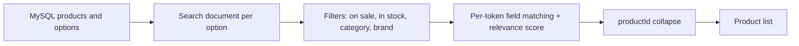

**Korean analysis and synonyms**

Product names and brands are split into words with the Korean morphological analyzer (Nori), and colors and sizes are linked to synonyms. 
For example, 블랙, black, 검정색, and blk all match the same color, and M, 미디엄, and medium all match the same size.

| Field | Setting |
| --- | --- |
| Product name, Korean brand | Nori analysis |
| English brand | Standard text analysis |
| Category | Exact path filter + Nori-analyzed search |
| Color, size | Original value + search with synonyms |

**Separating match conditions from scoring**

Every word in the query has to match at least one of the product name, category, color, size, or brand for a product to be included. 
Ranking then gives different weights depending on which field the whole query matched.

| Field the query matched | Weight |
| --- | ---: |
| Category, color | 3 |
| Product name | 2 |
| Size, brand | 1 |

I set the weights by going through the collected product data myself, then tuned them by checking the results for representative queries. 
Product names collected from Naver Shopping often bundle several items into one name or include sales copy, so I weighted the category, which classifies each product precisely, above the product name. 
Users tend to look for products by color more than by size, so among option attributes, color is weighted above size. 
Many sellers resell well-known brands, so the brand field often holds the seller's name instead of the actual brand, which is why brand is weighted below the product name.

**Field weight settings**

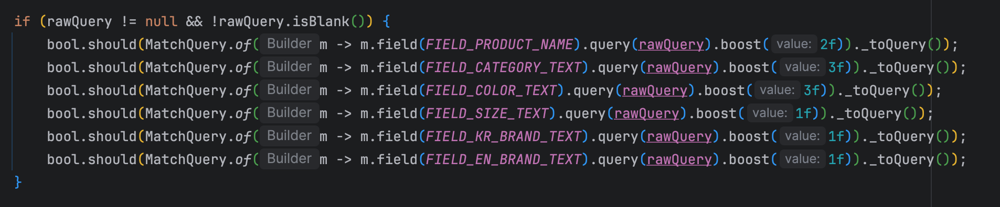

---

## Choices and trade-offs

- **Document count and duplication**: 150,000 products become about 11 million option documents, and shared information such as the product name and brand is repeated in every option document.
  When product information changes, all of that product's option documents have to be rewritten. 

- **Cost of grouping by product**: Every search has the extra step of grouping option documents by product, and with the current sort, `search_after` can't be used with collapse, so paging uses `from/size`, which gets more expensive on deeper pages.
  Search results are rarely paged through thousands of pages the way a list is, so I judged this cost to be small for the first few pages users actually look at. 

- **Sync and operations**: A separate search server has to be operated, and DB changes need a path into ES.
  Changing synonym rules requires a full reindex to apply them to existing documents. 

Related: [Search quality](../troubleshooting/search-quality.md) · [Search pagination](../troubleshooting/search-pagination.md) · [Search bottleneck investigation](../troubleshooting/search-capacity.md)

Current query: [ProductIndexSearchQueryRepositoryImpl](../../../src/main/java/com/mudosa/musinsa/product/infrastructure/search/repository/ProductIndexSearchQueryRepositoryImpl.java)
