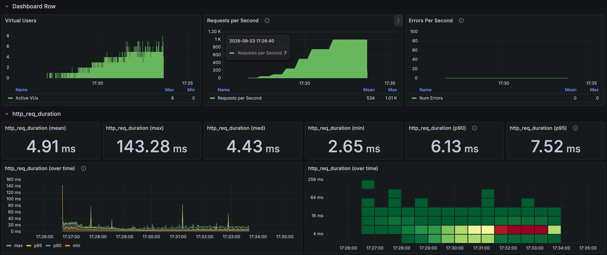
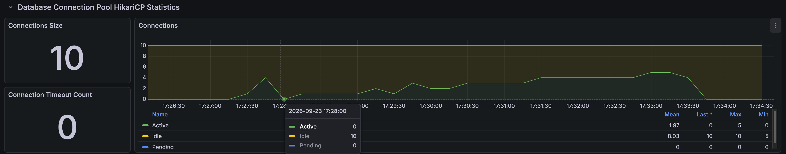
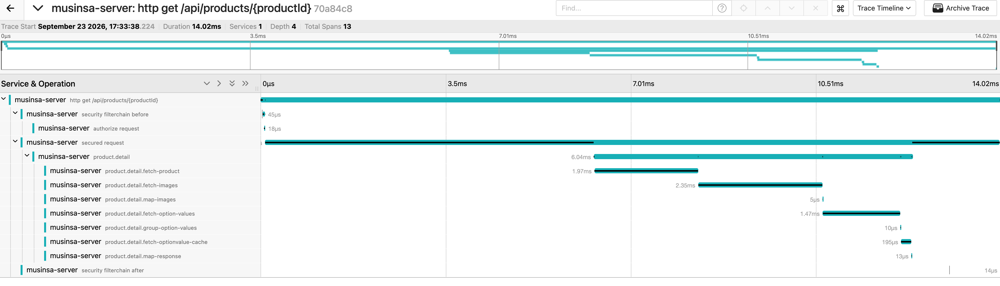

# Product detail under high load

[한국어](../../ko/load-tests/product-detail.md) · [README](../../../README.md)

I rotated through 5 products and called the full detail path: product, images, option mappings, the dictionary cache lookup, and response assembly. 
The API held 1,000 RPS for 120 seconds at p95 7.21ms, with no HTTP failures or drops.

**k6 results**

---

## Test conditions

After a 10 RPS warm-up, the load was held at 50, 100, 250, and 500 RPS for 30 seconds each, 750 RPS for 60 seconds, and 1,000 RPS for 120 seconds, with a 15-second ramp between stages. 
Only the detail API was called, with a 200 VU limit, a 5-second HTTP timeout, and 10 Hikari connections.

---

## Results by load stage

| Stage | Duration | Responses | Mean | p95 |
| --- | --- | --- | --- | --- |
| 50 RPS | 30s | 1,500 | 10.09ms | 12.88ms |
| 100 RPS | 30s | 3,000 | 7.17ms | 9.95ms |
| 250 RPS | 30s | 7,500 | 4.44ms | 5.92ms |
| 500 RPS | 30s | 15,001 | 4.20ms | 5.40ms |
| 750 RPS | 60s | 44,999 | 4.47ms | 5.99ms |
| 1,000 RPS | 120s | 119,993 | 5.07ms | 7.21ms |

Across all 224,621 requests, including the warm-up and ramps, the mean was 4.91ms, p95 7.52ms, and max 143.28ms.

### Results by product at 1,000 RPS

| Product | Responses | Mean | p95 |
| --- | --- | --- | --- |
| Product 1 | 23,999 | 4.96ms | 7.12ms |
| Product 2 | 23,998 | 5.13ms | 7.26ms |
| Product 3 | 23,998 | 5.06ms | 7.22ms |
| Product 4 | 23,999 | 5.08ms | 7.17ms |
| Product 5 | 23,999 | 5.13ms | 7.27ms |

The p95 per product ranged from 7.12ms to 7.27ms, with almost no difference between products.

---

## Connections and resources

**Spring Boot and Hikari connections**

| Metric | Max |
| --- | --- |
| Hikari connection limit | 10 |
| Hikari active / pending | 10 / 18 |
| Hikari connection timeouts | 0 |
| JVM / system CPU | 25.45% / 72.06% |
| MySQL running threads | 3 |

These are the maximums sampled every second during the run, and system CPU covers every process running on the same machine. 
All 10 connections were in use and pending requests briefly reached 18, but there were no connection timeouts.

---

## Request trace

**Jaeger request trace**

| Span | Time |
| --- | --- |
| Whole HTTP request | 14.02ms |
| Service method entry | 6.30ms after the request started |
| Service method | 6.04ms |
| Product query | 1.97ms |
| Image query | 2.35ms |
| Option value query | 1.47ms |
| Option dictionary cache lookup | 0.195ms |
| Final response mapping | 0.013ms |

Inside the service method, the product, image, and option value queries took most of the time, and 6.30ms had already passed before the method was entered.

---

## Assessment

Detail stayed under p95 8ms at 1,000 RPS and met the target. 
However, all connections were in use with requests queuing, and time was spent before the service method was even entered, so I investigated the connection pool and threads at higher load. 
→ [Pool and thread troubleshooting](../troubleshooting/hikari.md)
