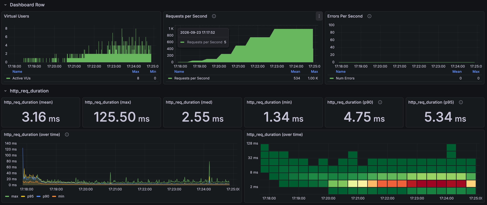
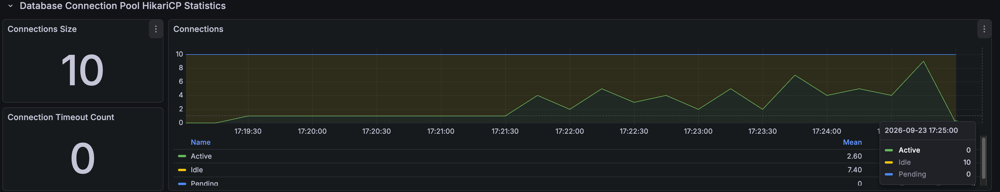
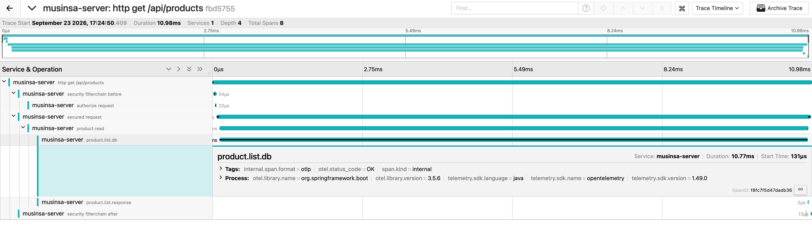

# Product filters under high load

[한국어](../../ko/load-tests/product-filter.md) · [README](../../../README.md)

I requested the first 24 products for 10 filter conditions, including category, brand, and gender, each combined with default, lowest-price, and highest-price sorting. 
The API held 1,000 RPS for 120 seconds at p95 5.03ms, with no HTTP failures or drops.

**k6 results**

---

## Test conditions

After a 10 RPS warm-up, the load was held at 50, 100, 250, and 500 RPS for 30 seconds each, 750 RPS for 60 seconds, and 1,000 RPS for 120 seconds, with a 15-second ramp between stages. 
Only the filter API was called, with a 200 VU limit, a 5-second HTTP timeout, and 10 Hikari connections.

---

## Results by load stage

| Stage | Duration | Responses | Mean | p95 |
| --- | --- | --- | --- | --- |
| 50 RPS | 30s | 1,500 | 6.85ms | 10.43ms |
| 100 RPS | 30s | 3,000 | 5.32ms | 8.46ms |
| 250 RPS | 30s | 7,500 | 3.44ms | 5.39ms |
| 500 RPS | 30s | 15,001 | 2.99ms | 4.84ms |
| 750 RPS | 60s | 45,000 | 2.97ms | 4.80ms |
| 1,000 RPS | 120s | 119,995 | 3.05ms | 5.03ms |

Across all 224,624 requests, including the warm-up and ramps, the mean was 3.16ms, p95 5.34ms, and max 125.50ms.

### p95 by filter and sort at 1,000 RPS

| Filter | Default sort | Lowest price | Highest price |
| --- | --- | --- | --- |
| No filter | 3.57ms | 3.58ms | 3.66ms |
| Category | 5.62ms | 4.60ms | 3.56ms |
| Brand | 3.49ms | 3.35ms | 3.42ms |
| Gender | 3.35ms | 3.30ms | 3.33ms |
| Category + brand | 5.47ms | 3.99ms | 3.97ms |
| Category + gender | 5.80ms | 4.78ms | 3.78ms |
| Brand + gender | 3.53ms | 3.35ms | 3.55ms |
| Category + brand + gender | 5.47ms | 4.08ms | 3.90ms |
| Subcategory | 6.88ms | 5.64ms | 5.19ms |
| Multiple categories | 6.09ms | 5.05ms | 4.41ms |

The category is Bags, the subcategory is Tote Bags, the multi-category filter is Tote Bags plus Crossbody Bags, the brand is one fixed brand, and the gender is unisex (ALL). Each combination has about 4,000 requests.

---

## Connections and resources

**Spring Boot and Hikari connections**

| Metric | Max |
| --- | --- |
| Hikari connection limit | 10 |
| Hikari active / pending | 10 / 10 |
| Hikari connection timeouts | 0 |
| JVM / system CPU | 33.35% / 57.67% |
| MySQL running threads | 3 |

These are the maximums sampled every second during the run, and system CPU covers every process running on the same machine. 
Pending connections peaked at only 10, and there were no connection timeouts.

---

## Request trace

**Jaeger request trace**

| Span | Time |
| --- | --- |
| Whole HTTP request | 10.98ms |
| Service method | 10.78ms |
| DB query call | 10.77ms |
| Service method entry | 0.129ms after the request started |

In this request, the DB query call took up most of the time, and building the response took only about 0.002ms.

---

## Assessment

All 30 filter combinations stayed under p95 7ms at 1,000 RPS, so there was no bottleneck at this load. 
The default sort on the subcategory and multi-category filters, which have to look further for matching products, was the slowest, and even that was p95 6.88ms.
