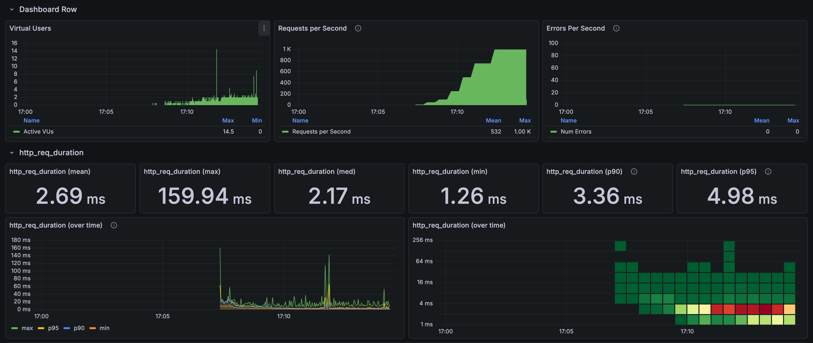
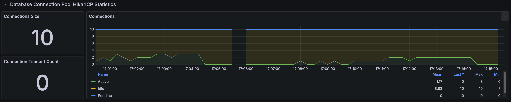
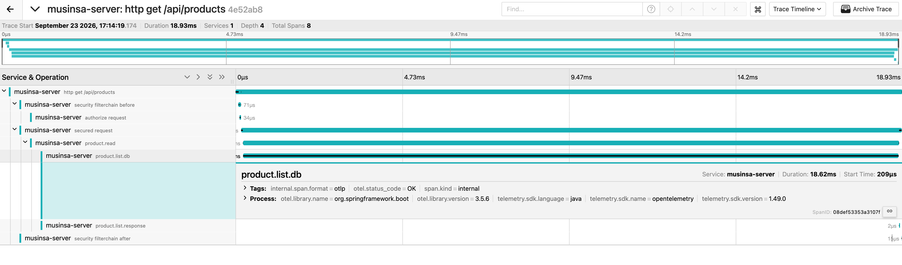

# Product scroll under high load

[한국어](../../ko/load-tests/product-scroll.md) · [README](../../../README.md)

Each virtual user followed the next cursor in the response through pages 1 to 5, with one request per page. 
The API held 1,000 RPS for 120 seconds at p95 3.95ms, with no HTTP failures or drops.

**k6 results**

---

## Test conditions

After a 10 RPS warm-up, the load was held at 50, 100, 250, and 500 RPS for 30 seconds each, 750 RPS for 60 seconds, and 1,000 RPS for 120 seconds, with a 15-second ramp between stages. 
Only the scroll API was called, with a 200 VU limit, a 5-second HTTP timeout, and 10 Hikari connections.

---

## Results by load stage

| Stage | Duration | Responses | Mean | p95 |
| --- | --- | --- | --- | --- |
| 50 RPS | 30s | 1,500 | 6.63ms | 9.40ms |
| 100 RPS | 30s | 2,999 | 4.71ms | 7.17ms |
| 250 RPS | 30s | 7,498 | 2.89ms | 4.23ms |
| 500 RPS | 30s | 14,997 | 2.33ms | 3.21ms |
| 750 RPS | 60s | 44,983 | 3.03ms | 4.72ms |
| 1,000 RPS | 120s | 119,967 | 2.44ms | 3.95ms |

Across all 224,564 requests, including the warm-up and ramps, the mean was 2.69ms, p95 4.98ms, and max 159.94ms.

### Results by page at 1,000 RPS

| Page | Responses | Mean | p95 |
| --- | --- | --- | --- |
| Page 1 | 23,994 | 2.72ms | 6.29ms |
| Page 2 | 23,995 | 2.43ms | 3.71ms |
| Page 3 | 23,998 | 2.29ms | 3.26ms |
| Page 4 | 23,997 | 2.23ms | 2.86ms |
| Page 5 | 23,983 | 2.51ms | 4.53ms |

Latency did not grow as the pages got deeper.

---

## Connections and resources

**Spring Boot and Hikari connections**

| Metric | Max |
| --- | --- |
| Hikari connection limit | 10 |
| Hikari active / pending | 10 / 7 |
| Hikari connection timeouts | 0 |
| JVM / system CPU | 10.44% / 77.66% |
| MySQL running threads | 3 |

These are the maximums sampled every second during the run, and system CPU covers every process running on the same machine. 
Pending connections peaked at only 7, and there were no connection timeouts.

---

## Request trace

**Jaeger request trace**

| Span | Time |
| --- | --- |
| Whole HTTP request | 18.93ms |
| DB query call | 18.62ms |
| DB call start | 0.209ms after the request started |

In this request, the DB query call took up most of the time.

---

## Assessment

Scroll stayed under p95 4ms even at 1,000 RPS, so there was no bottleneck at this load. 
Latency was the same across pages 1 to 5, which confirms that keyset pagination behaves consistently under load regardless of page depth.
