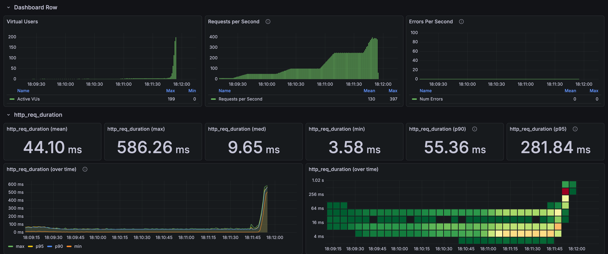
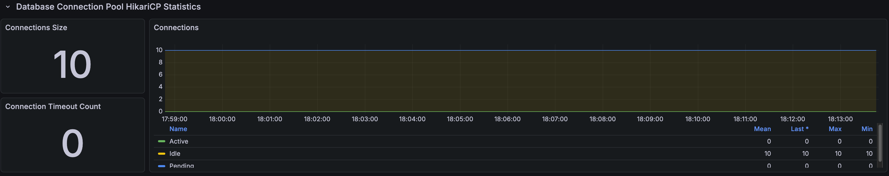
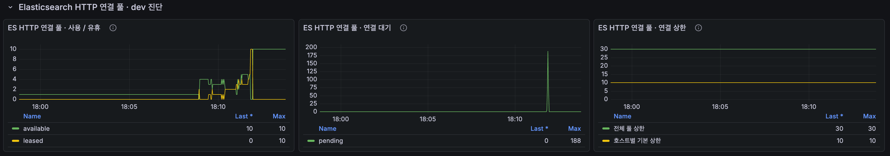
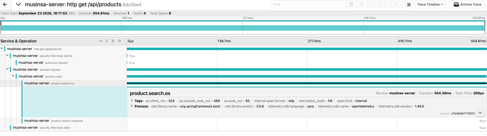

# Product search under high load

[한국어](../../ko/load-tests/product-search.md) · [README](../../../README.md)

I rotated through four keywords, `스커트` (skirt), `블랙 스커트` (black skirt), `나이키` (Nike), and `나이키 후드` (Nike hoodie), requesting the first 10 results. 
Up to 250 RPS the API held p95 40.53ms, but 179 iterations were dropped while ramping to 500 RPS and the test stopped. There were no HTTP failures.

**k6 results**

---

## Test conditions

The plan was the same 7-minute scenario as the other APIs (a 10 RPS warm-up, then 50, 100, 250, 500, 750, and 1,000 RPS), set to stop as soon as any iteration was dropped. 
Only the search API was called, with a 200 VU limit, a 5-second HTTP timeout, 10 Hikari connections, and an ES client pool of 30 connections in total and 10 per host.

---

## Results by load stage

| Stage | Responses | Mean | p95 |
| --- | --- | --- | --- |
| Hold at 50 RPS | 1,500 | 16.91ms | 41.13ms |
| Hold at 100 RPS | 3,000 | 15.98ms | 39.95ms |
| Hold at 250 RPS | 7,500 | 15.39ms | 40.53ms |
| Stopped while ramping 250 → 500 RPS | 5,229 | 132.05ms | 504.68ms |

Across all 21,728 requests, including the warm-up and ramps, the mean was 44.03ms, p95 279.62ms, and max 586.26ms.

---

## Connections and resources

**Spring Boot and Hikari connections**

**ES HTTP connection pool**

| Metric | Max |
| --- | --- |
| Hikari active / pending | 0 / 0 |
| ES connection limit (total / per host) | 30 / 10 |
| ES connections in use (leased) | 10 |
| ES connections waiting (pending) | 189 |
| Tomcat busy | 199 |
| JVM / system CPU | 11.70% / 95.99% |

These are the maximums sampled every second during the run, and system CPU covers every process running on the same machine. 
No DB connections were used. All 10 per-host connections in the ES client were in use, and up to 189 requests were waiting for one.

---

## Request trace

**Jaeger request trace**

| Span | Time |
| --- | --- |
| Whole HTTP request | 554.81ms |
| ES search call | 554.39ms |
| Time measured by the ES client (`es.client_ms`) | 554ms |
| Processing time reported by ES (`es.took_ms`) | 65ms |
| Everything else (`es.outside_took_ms`) | 489ms |

ES itself spent 65ms on the request, and most of the time, 489ms, was spent outside ES, including waiting for a connection and transfer.

---

## Assessment

Search was stable up to 250 RPS, but as responses slowed on the way to 500 RPS, k6 ran out of VUs to start new requests and the test stopped. 
This wasn't an API error: search had reached what it could handle in this environment, and the first thing visible at that point was requests waiting for ES client connections. 
→ [Search bottleneck troubleshooting](../troubleshooting/search-capacity.md)
