# Product detail: growing Hikari and the MySQL connection limit

[한국어](../../ko/troubleshooting/hikari.md) · [README](../../../README.md)

---

## Problem and test conditions

With Hikari at 10, pushing the detail API to 1,500 RPS raised the average number of requests waiting for a connection to about 188 and the busy Tomcat threads to about 198. 
Busy threads include threads stuck waiting for a DB connection, so I treated DB connection waits, rather than a shortage of Tomcat threads, as the cause, fixed Tomcat at 200, and changed only Hikari.

I rotated through 5 products and ran each setting once with a 1,000 VU limit and a 5-second timeout. 

| Experiment | Load stages | Settings compared |
| --- | --- | --- |
| 1 | 50 → 1,000 → 1,500 → 2,000 → 50 RPS (5 min) | Hikari 10, 20, 30, 50 |
| 2 | Same stages plus 3,000 RPS for 60s (6 min 15s) | Hikari 50, 100, 200 |

---

## 1. Hikari 10 → 50: fewer connection waits and less thread blocking

| 2,000 RPS, 75s | Hikari 10 | 20 | 30 | 50 |
| --- | ---: | ---: | ---: | ---: |
| Throughput (RPS) | 1,381 | 1,686 | 1,814 | 1,999 |
| p95 (ms) | 875.2 | 786.3 | 731.1 | 58.6 |
| Avg. waiting for a connection | 189.8 | 179.8 | 169.9 | 10.9 |
| Avg. Tomcat busy | 200 | 200 | 200 | 34.7 |
| Avg. connection acquire (ms) | 137.1 | 106.4 | 93.2 | 4.5 |
| Total drops | 55,382 | 22,948 | 13,281 | 571 |

With Hikari at 50, the API handled the full 2,000 RPS and p95 dropped from 875ms to 59ms. 
Busy threads fell from 200 to 35 without any change to Tomcat, which confirmed that the threads had been tied up waiting for DB connections. 
Even at 50, though, connection waits rose to 150 for a few seconds during the run, leaving 571 drops.

Results by setting

**Hikari 10, k6**

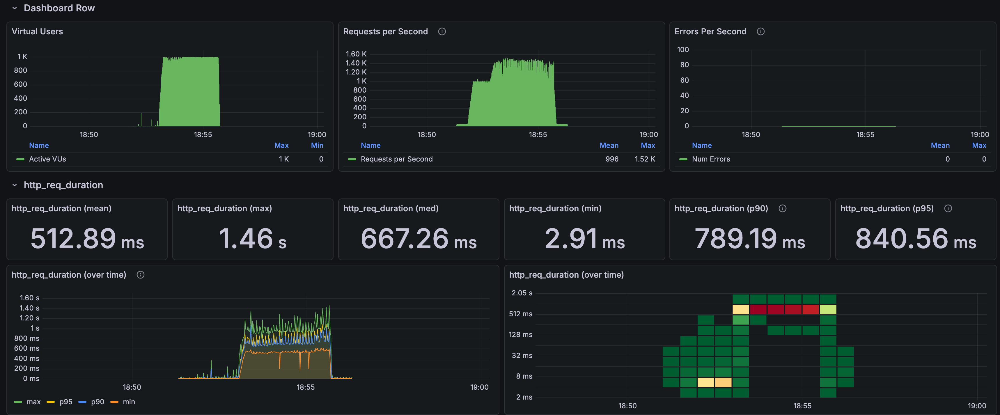

**Hikari 10, connection pool**

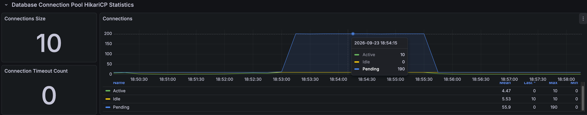

**Hikari 20, k6**

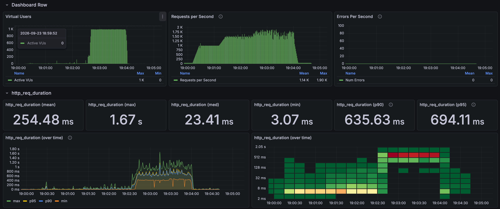

**Hikari 20, connection pool**

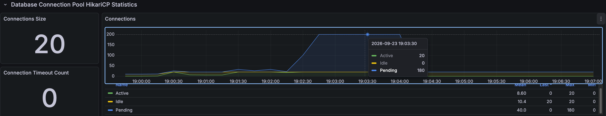

**Hikari 30, k6**

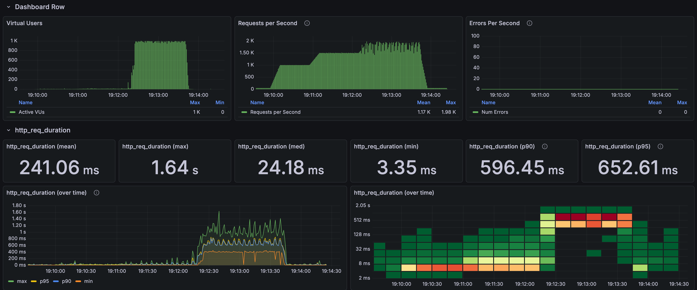

**Hikari 30, connection pool**

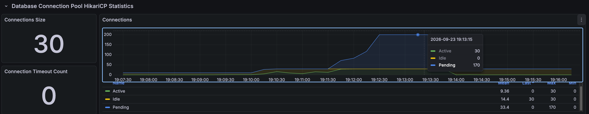

**Hikari 50, k6**

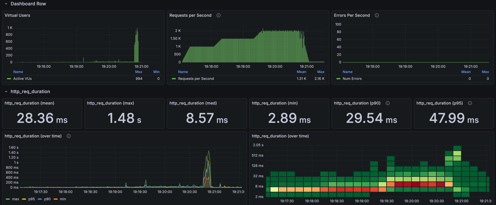

**Hikari 50, connection pool**

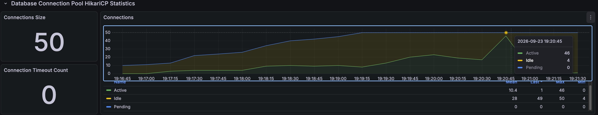

---

## 2. Hikari 50 → 100 → 200: throughput plateau and the DB connection limit

| 3,000 RPS, 60s | Hikari 50 | 100 | 200 (configured) |
| --- | ---: | ---: | ---: |
| Max actual connections | 50 | 100 | 152 |
| Throughput (RPS) | 2,121 | 2,134 | 2,058 |
| Mean (ms) | 469.4 | 466.9 | 483.8 |
| p95 (ms) | 632.6 | 604.9 | 597.2 |
| Avg. connection acquire (ms) | 70.4 | 46.6 | 23.1 |
| Avg. connection hold (ms) | 23.4 | 46.6 | 73.5 |
| Avg. waiting for a connection | 149.8 | 99.8 | 47.8 |
| Avg. host CPU | 96.6% | 97.0% | 97.5% |
| Total drops | 57,291 | 56,050 | 62,819 |

More connections cut the wait to get a connection, but the time each connection was held grew from 23ms to 74ms. 
Throughput stayed at about 2,100 RPS, and the host CPU shared by the application and the DB went above 96%. 
Adding connections didn't increase how much the DB could process at once; the wait just moved from in front of the pool to inside the DB.

Hikari 200 ran into the MySQL connection limit (`max_connections=151`), so actual connections stopped at 152 and `Too many connections` errors appeared. 
At that point the exporter collecting MySQL metrics couldn't connect to the DB either (`mysql_up=0`), so its graphs went blank.

Even with the same Hikari 50, p95 in the 2,000 RPS stage of this run was 265.9ms, very different from 58.6ms in experiment 1. 

Results by setting

**Hikari 100, k6**

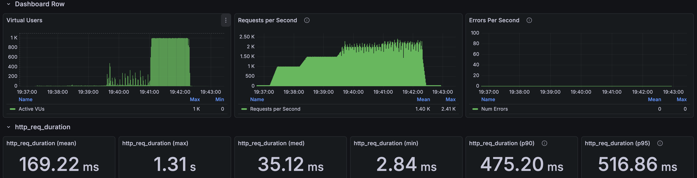

**Hikari 100, connection pool**

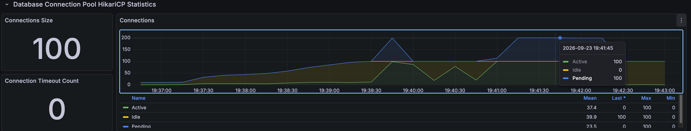

**Hikari 200, k6**

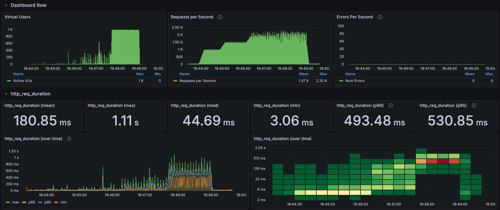

**Hikari 200, 152 actual connections**

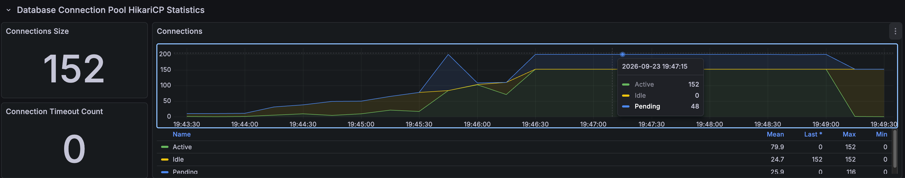

---

## Assessment

I settled on Hikari 50. 
At 10, connection waits tied up threads and capped throughput, but from 50 upward, more connections didn't raise throughput; they only increased connection hold time and CPU use. 
This showed that shorter connection waits and higher processing capacity are not the same thing, so next I changed the number of request threads in the [Tomcat experiment](tomcat.md).

It also showed that when growing a connection pool, the pools of every application instance plus admin and monitoring connections all have to fit within the DB connection limit.
