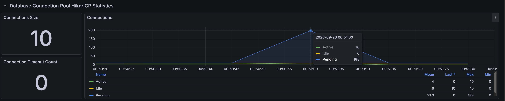
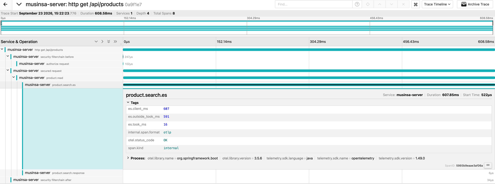
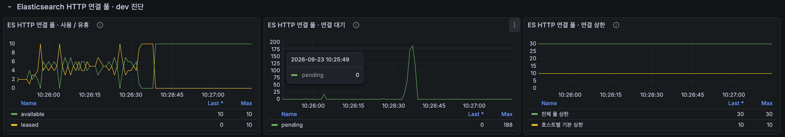
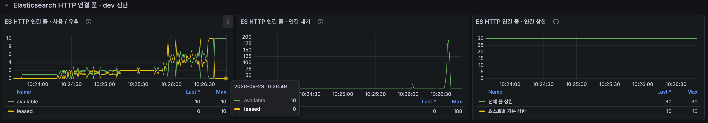
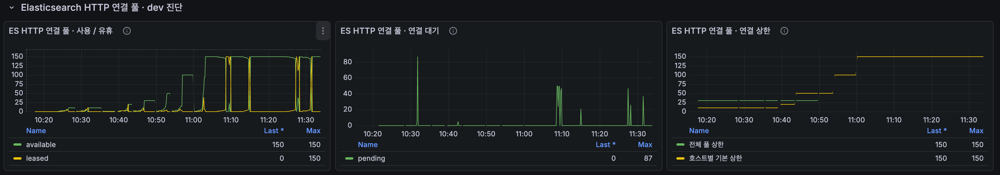
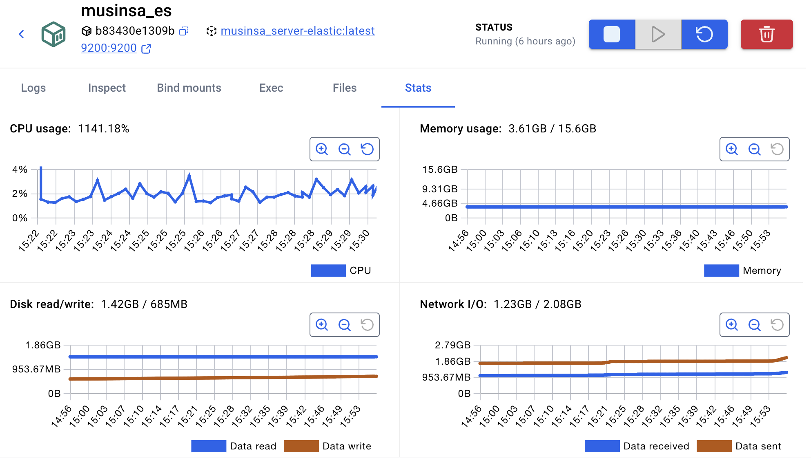
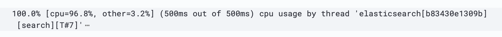
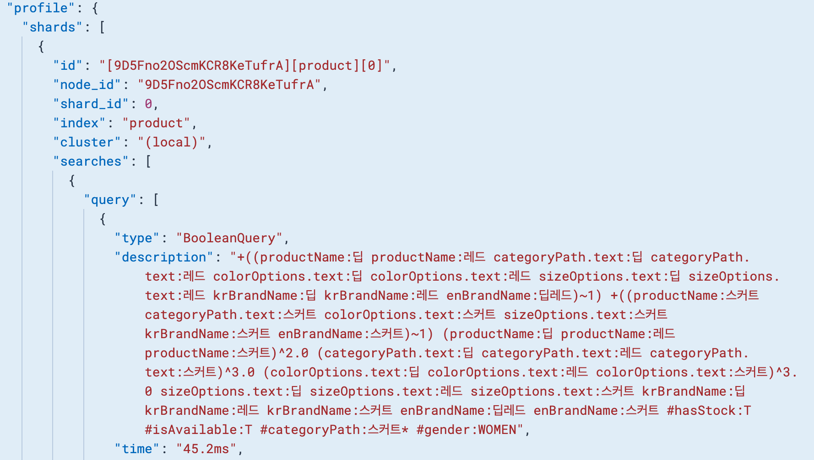

# Search under high load: narrowing it down from transactions to the HTTP pool to ES itself

[한국어](../../ko/troubleshooting/search-capacity.md) · [README](../../../README.md)

---

## Problem and test conditions

The search load test stopped with 179 drops while ramping to 500 RPS.<br>
In Jaeger, the first thing that stood out was a long wait before the service method was entered, and once that was fixed, the ES client call itself took a long time.<br>
So I narrowed down the cause in order: the DB transaction scope → the ES HTTP connection pool → processing inside ES.

I rotated through the four keywords with Hikari 10, a 200 VU limit, and a 5-second timeout.

| First diagnostic run | Completed requests | Mean | p95 |
| --- | --- | --- | --- |
| Hold at 50 RPS | 1,500 | 19.50ms | 46.62ms |
| Hold at 100 RPS | 3,000 | 19.01ms | 47.09ms |
| Hold at 250 RPS | 7,500 | 19.29ms | 48.13ms |
| Stopped while ramping to 500 RPS | 3,369 | 208.46ms | 618.87ms |

---

## 1. A DB transaction wrapped around the ES search

The `@Transactional(readOnly = true)` on the search service class also applied to the ES search, so a search that never touched the DB held a DB connection for as long as it ran.<br>
In the first trace, 608ms of the 623ms total passed before the service method was entered, and the ES call took 10ms.<br>
In the same run, all 10 Hikari connections were in use and up to 188 requests were waiting, so requests were waiting for a DB connection before they even reached the service.

I applied `Propagation.NOT_SUPPORTED` to the search method (`searchProducts`) only, so the ES search runs outside a transaction, while the keyword-less MySQL query and the detail query keep theirs.

| Comparison | Before | After |
| --- | ---: | ---: |
| Max Hikari pending | 188 | 0 |
| Max ES HTTP connection pending | — | 185 |
| p95 at 250 RPS | 48.13ms | 45.31ms |
| p95 while ramping to 500 RPS | 618.87ms | 513.87ms |
| Total drops | 179 | 55 |
| Held 1,000 RPS | No | No |

The DB connection wait disappeared, but a wait of about the same size moved to the ES client's HTTP connection pool, and the test still stopped at the same stage.

<details>
<summary>Results</summary>

**Hikari connections before the transaction change**



</details>

---

## 2. Breaking down the ES call time

To tell whether the slow ES call was spending its time inside or outside ES, I recorded three timings.

| Tag | Meaning |
| --- | --- |
| `es.client_ms` | Total time from the client sending the search to receiving the result |
| `es.took_ms` | Server-side processing time that ES includes in its response |
| `es.outside_took_ms` | The difference between the two: connection wait, transfer, and response conversion |

In one request, ES processing took 16ms but the total was 607ms, so 591ms was spent outside ES.<br>
That pointed to the ES client's connection pool.

<details>
<summary>Results</summary>

**Client time and ES processing time**



</details>

---

## 3. Instrumenting and enlarging the ES HTTP connection pool

The ES client's connection pool used the defaults of 10 per host and 30 in total, so I added instrumentation to collect connections in use and pending requests every second.<br>
In the first run, all 10 connections were in use and up to 188 requests were waiting, so I compared several larger limits.

| Tomcat | ES per host / total | Max in use / pending | Overall p95 | Drops |
| ---: | --- | --- | ---: | ---: |
| 200 | 10 / 30 | 10 / 188 | 118.46ms | 132 |
| 300 | 10 / 30 | 10 / 157 | 214.40ms | 31 |
| 200 | 20 / 30 | 20 / 175 | 288.50ms | 162 |
| 200 | 50 / 30 | 30 / 166 | 173.89ms | 55 |
| 200 | 50 / 50 | 50 / 133 | 295.43ms | 97 |
| 200 | 100 / 100 | 100 / 15 | 127.67ms | 12 |
| 200 | 150 / 150 | 150 / 30 | 114.33ms | 18 |

When only the per-host limit was raised to 50, the total limit of 30 capped it, so only 30 connections were used.<br>
At 100/100, connection waits and drops fell sharply, but even at 150/150 the test still stopped.<br>
To find what was left once connections were no longer short, I looked inside ES.

<details>
<summary>Results</summary>

**ES HTTP connection pool, up to 188 pending**



**Initial ES HTTP connection pool**



**Runs with different limits**



</details>

---

## 4. Inside ES: CPU and the search queue

I changed the test so it would keep running after drops and ran it again at 150/150.<br>
Over about 250 seconds, drops piled up to 23,419 and system CPU reached 99.9%, so I stopped it manually.<br>
At that point ES was using about 11.4 cores of CPU (1141%).

Hot threads showed the search threads using 96.8% CPU on document matching (`ConjunctionDISI`), score calculation (`RelevanceComparator`), and grouping by product (`SinglePassGroupingCollector`).<br>
The search queue had 22 active and 176 queued tasks, so even with more HTTP connections, search tasks were lining up inside ES.

```http
GET /_nodes/hot_threads?type=cpu&threads=10&ignore_idle_threads=true
GET /_cat/thread_pool/search?v&h=node_name,name,active,queue,rejected,completed
```

<details>
<summary>Results</summary>

**ES CPU (docker stats)**



**Search thread CPU (hot threads)**



**Search queue**


</details>

---

## 5. Profile: which query is expensive

Profiling a search for `딥 레드 스커트` (deep red skirt) showed 45.2ms spent on a `BooleanQuery` in one shard.<br>
The per-word conditions across several fields overlapped with the whole-query weighting conditions, so combining the match results and scores from several fields was expensive.

<details>
<summary>Results</summary>

**BooleanQuery profile for 딥 레드 스커트**



</details>

---

## Assessment

Separating the transaction removed the DB connection wait and enlarging the HTTP pool cut the connection wait, but in the end, CPU and the search queue inside ES remained.<br>
The cost comes from multi-field matching, scoring, and grouping by product over about 11 million option documents, so the next step is to reduce the search fields and conditions or move to a nested, product-level structure.<br>
Reducing fields can change search results and ranking, though, so speed and search quality have to be compared together.
