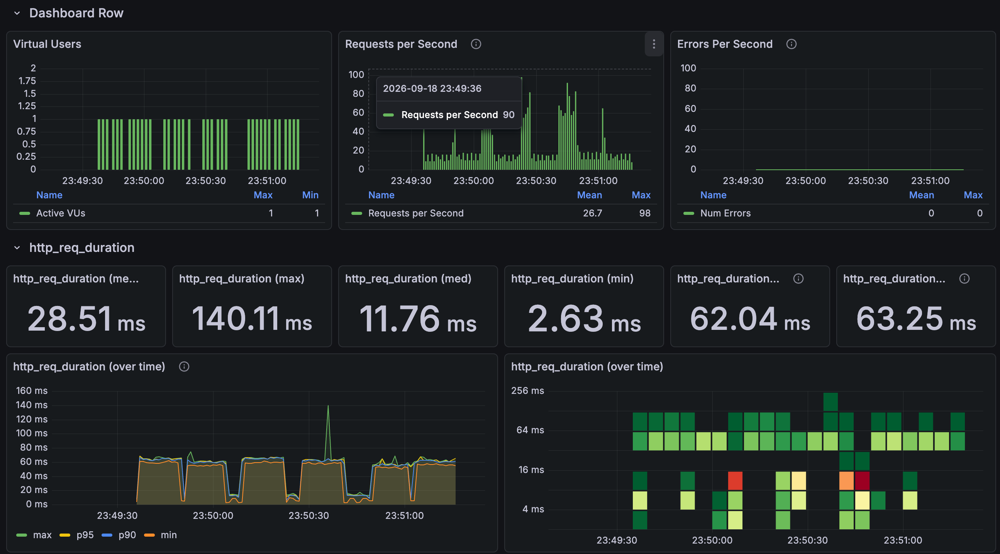
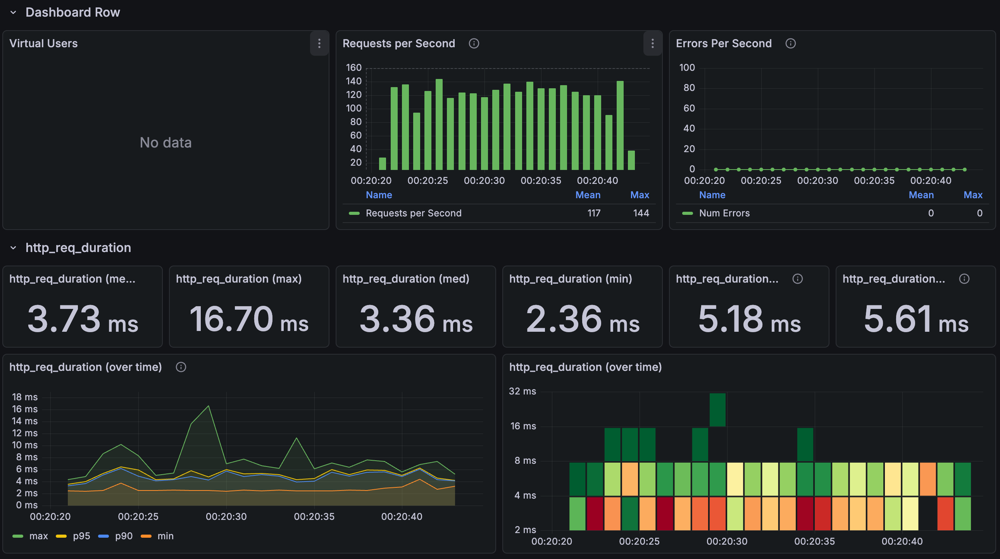
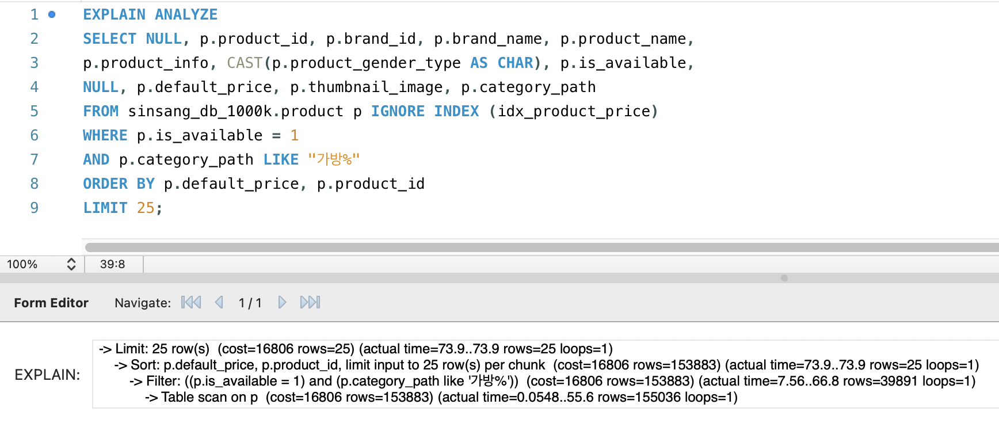
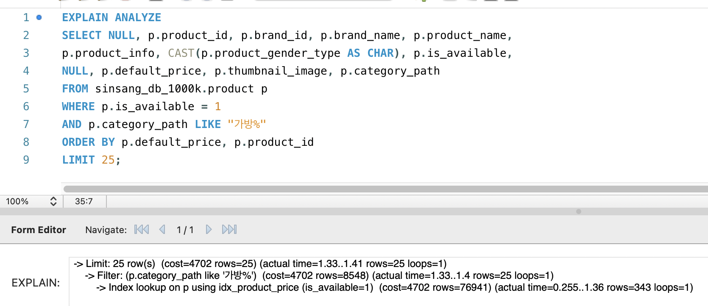

# 상품 필터: 실행 계획으로 검증한 복합 인덱스

[English](../../en/improvements/filter-indexes.md) · [README](../../../README.ko.md)

---

## 문제와 비교 조건

상품 목록에는 카테고리, 브랜드, 성별 필터와 기본순, 최저가순, 최고가순 정렬이 붙습니다.<br>
대표 가격을 저장한 뒤에도 가격순 정렬에 맞는 인덱스가 없어, 필터를 걸고 가격순으로 보면 여전히 느렸습니다.

`GET /api/products?limit=24`의 첫 페이지를 필터 10가지 × 정렬 3가지, 총 30개 조건으로 조회했습니다.<br>
조건별 첫 요청 1회 → 워밍업 4회 → 1 VU 본 측정 30회를 한 묶음으로 4번 실행했습니다.

---

## 반복 측정 결과

| 구분 | 변경 전 평균 | 변경 전 p95 | 변경 후 평균 | 변경 후 p95 |
| --- | --- |---| --- |---|
| 1회 | 31.15ms | 64.33ms | 8.35ms | 11.20ms |
| 2회 | 31.57ms | 65.28ms | 8.14ms | 11.04ms |
| 3회 | 30.17ms | 63.28ms | 7.94ms | 11.08ms |
| 4회 | 28.51ms | 63.25ms | 3.73ms | 5.61ms |
| 4회 평균 | 30.35ms | — | 7.04ms | — |


4회 평균 30.35→7.04ms, 76.8% 감소입니다.<br>
4회 평균의 p95는 네 번의 요청 기록을 모두 합쳐 다시 계산한 값입니다.

**인덱스 변경 전**



**인덱스 변경 후**



<details>
<summary>조건, 정렬별 결과</summary>

카테고리는 가방, 최종 카테고리는 토트백, 복수 카테고리는 토트백과 크로스 백, 브랜드는 고정 1개, 성별은 공용(`ALL`)입니다.<br>
조건마다 1~3회를 합친 270건씩의 결과입니다.

| 조건 / 정렬 | 전 mean (ms) | 전 p95 (ms) | 후 mean (ms) | 후 p95 (ms) |
| --- | --- | --- | --- | --- |
| 필터 없음 / 기본 ID순 | 8.33 | 12.03 | 7.50 | 10.21 |
| 필터 없음 / 최저가순 | 63.08 | 67.30 | 7.29 | 10.21 |
| 필터 없음 / 최고가순 | 63.30 | 66.59 | 7.87 | 10.36 |
| 상위 카테고리 / 기본 ID순 | 9.71 | 12.64 | 9.38 | 11.74 |
| 상위 카테고리 / 최저가순 | 59.53 | 63.07 | 8.36 | 10.51 |
| 상위 카테고리 / 최고가순 | 59.27 | 62.17 | 7.96 | 10.34 |
| 브랜드 / 기본 ID순 | 7.99 | 10.38 | 7.49 | 10.01 |
| 브랜드 / 최저가순 | 14.07 | 17.16 | 7.64 | 9.99 |
| 브랜드 / 최고가순 | 14.07 | 17.43 | 7.37 | 9.41 |
| 성별 / 기본 ID순 | 7.71 | 10.03 | 7.20 | 9.72 |
| 성별 / 최저가순 | 63.56 | 66.97 | 7.64 | 10.24 |
| 성별 / 최고가순 | 63.79 | 67.05 | 7.49 | 11.19 |
| 상위 카테고리 + 브랜드 / 기본 ID순 | 8.31 | 11.58 | 9.36 | 11.74 |
| 상위 카테고리 + 브랜드 / 최저가순 | 13.89 | 16.90 | 7.19 | 9.65 |
| 상위 카테고리 + 브랜드 / 최고가순 | 13.80 | 16.26 | 7.74 | 10.07 |
| 상위 카테고리 + 성별 / 기본 ID순 | 9.58 | 11.66 | 9.29 | 12.01 |
| 상위 카테고리 + 성별 / 최저가순 | 61.30 | 65.24 | 7.93 | 11.12 |
| 상위 카테고리 + 성별 / 최고가순 | 62.28 | 68.44 | 7.76 | 10.53 |
| 브랜드 + 성별 / 기본 ID순 | 7.48 | 10.43 | 7.73 | 10.43 |
| 브랜드 + 성별 / 최저가순 | 14.17 | 18.03 | 7.13 | 9.83 |
| 브랜드 + 성별 / 최고가순 | 13.87 | 16.54 | 7.41 | 10.07 |
| 상위 카테고리 + 브랜드 + 성별 / 기본 ID순 | 8.39 | 11.09 | 9.27 | 11.33 |
| 상위 카테고리 + 브랜드 + 성별 / 최저가순 | 14.49 | 17.12 | 7.96 | 10.41 |
| 상위 카테고리 + 브랜드 + 성별 / 최고가순 | 13.95 | 16.79 | 7.78 | 10.35 |
| 최종 카테고리 / 기본 ID순 | 10.02 | 13.17 | 9.62 | 12.00 |
| 최종 카테고리 / 최저가순 | 54.85 | 58.51 | 8.28 | 10.78 |
| 최종 카테고리 / 최고가순 | 55.61 | 59.70 | 8.34 | 11.45 |
| 복수 카테고리 / 기본 ID순 | 10.86 | 13.84 | 10.20 | 13.04 |
| 복수 카테고리 / 최저가순 | 60.87 | 64.57 | 8.81 | 11.09 |
| 복수 카테고리 / 최고가순 | 60.79 | 64.40 | 9.27 | 12.38 |

</details>

---

## 왜 느렸고 무엇을 줄였는가

필터를 건 가격순 목록은 조건에 맞는 상품을 찾은 뒤 가격순으로 정렬해 상위 24개를 골라야 합니다.<br>
가방 카테고리의 최저가순을 예로 들면, 기존에는 가격 정렬에 쓸 인덱스가 없어 상품 테이블 전체(155,036행)를 읽고 조건에 맞는 39,891행을 모두 정렬한 다음 25개만 반환했습니다.

그래서 판매 여부, 가격, 상품 ID 순서로 정렬된 복합 인덱스와, 같은 순서에 브랜드를 앞에 둔 복합 인덱스를 추가했습니다.<br>
인덱스를 가격순으로 읽다가 조건에 맞는 25개를 찾으면 바로 멈추기 때문에, 읽는 행이 155,036개에서 343개로 줄고 별도 정렬이 사라졌습니다.<br>
최고가순은 같은 인덱스를 거꾸로 읽고, 기본 ID순은 원래 기본 키로 빠르게 찾던 조회라 차이가 거의 없었습니다.

```sql
CREATE INDEX idx_product_price
    ON product (is_available, default_price, product_id);
CREATE INDEX idx_product_brand_price
    ON product (brand_id, is_available, default_price, product_id);
```

| 항목 | 인덱스 미사용 | 인덱스 사용 |
| --- | --- | --- |
| 조회 방식 | 상품 테이블 전체 스캔 | 가격 복합 인덱스 범위 탐색 |
| 읽은 행 | 155,036행 | 343행 |
| 조건을 통과한 행 | 39,891행 | 25행 |
| 별도 정렬 | 39,891행 정렬 | 없음 |
| 실행 시간 | 73.9ms | 1.41ms |

**가격 인덱스 미사용 실행 계획**



**가격 인덱스 사용 실행 계획**



---

## 선택과 트레이드오프

- **쓰기 비용**: 인덱스가 늘면 상품 등록이나 가격 변경 때마다 인덱스도 함께 갱신해야 하고 저장 공간도 늘어납니다.
  그래서 모든 필터 조합이 아니라 효과가 가장 큰 가격 정렬 경로 두 개만 만들었습니다.<br>


- **카테고리 인덱스 제외**: 카테고리까지 넣은 인덱스도 비교했지만, 상위 카테고리로 조회하면 여러 하위 카테고리를 함께 읽어야 해서 전체 가격순을 바로 얻을 수 없었습니다.
  가방 조건에서 가격 인덱스는 343행만 읽었지만 카테고리 인덱스는 39,891행을 정렬해야 했고, 하위 카테고리 하나만 고를 때만 효과가 있어 제외했습니다.<br>


- **엣지 케이스**: 카테고리나 성별처럼 조건에 맞는 상품이 드물면, 25개를 채우기 위해 인덱스를 더 길게 읽어야 합니다.<br>
