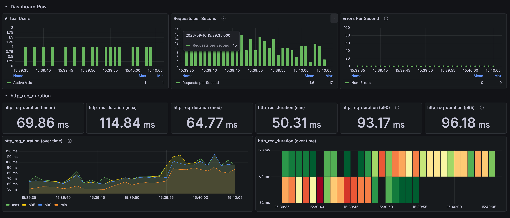
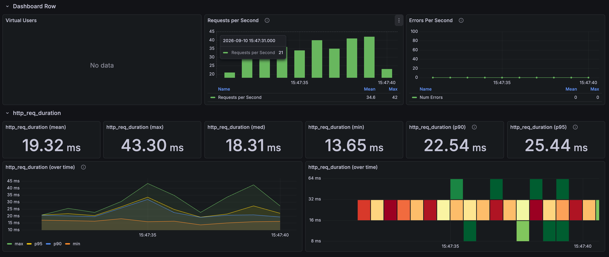

# 상품 스크롤: COUNT 제거와 keyset 페이지네이션

[English](../../en/improvements/list-keyset.md) · [README](../../../README.ko.md)

---

## 문제와 비교 조건

대표 가격을 적용한 뒤에도 목록은 페이지 번호 방식이라, 요청마다 COUNT로 전체 상품 수를 세고 OFFSET으로 앞 페이지를 건너뛰고 있었습니다.

판매 가능한 상품을 ID 순으로 24개씩 조회했고, 아래 네 위치의 커서를 미리 준비해 그 위치를 바로 읽었습니다.<br>
위치별 첫 요청 1회 → 워밍업 4회 → 1 VU 본 측정 30회를 한 묶음으로 4번 실행했습니다.

| 비교 위치 | OFFSET으로 건너뛰는 상품 | 준비한 커서 |
| --- | --- | --- |
| page 0 | 0개 | 없음 (첫 페이지) |
| page 100 | 2,400개 | 2454 |
| page 1000 | 24,000개 | 24700 |
| page 5000 | 120,000개 | 123177 |

---

## 반복 측정 결과

| 구분 | 변경 전 평균 | 변경 전 p95 | 변경 후 평균 | 변경 후 p95 |
| --- | --- | --- | --- | --- |
| 1회 | 74.90ms | 98.94ms | 17.51ms | 22.48ms |
| 2회 | 73.82ms | 98.63ms | 16.17ms | 18.86ms |
| 3회 | 73.70ms | 97.22ms | 15.88ms | 17.95ms |
| 4회 | 69.86ms | 96.18ms | 19.26ms | 25.02ms |
| 4회 평균 | 73.07ms | — | 17.21ms | — |

4회 평균 73.07→17.21ms, 76.5% 감소입니다.

### 깊이별 평균

| 비교 위치 | OFFSET 평균 | keyset 평균 |
| --- | --- | --- |
| page 0 | 65.23ms | 16.86ms |
| page 100 | 64.90ms | 16.46ms |
| page 1000 | 70.69ms | 16.63ms |
| page 5000 | 95.75ms | 16.13ms |

깊이별 평균은 1~3회를 합친 값입니다.

**COUNT, OFFSET 방식**



**keyset 방식**



---

## 왜 느렸고 무엇을 줄였는가

기존 목록은 페이지 번호 방식이었습니다.<br>
전체 페이지 수를 계산하기 위해 요청마다 COUNT로 조건에 맞는 상품을 전부 세고, OFFSET으로 앞 페이지의 상품을 건너뛴 뒤 24개를 읽었습니다.<br>
그래서 첫 페이지부터 전체 상품을 세는 비용이 들었고, OFFSET은 건너뛸 행도 읽은 뒤 버리기 때문에 페이지가 깊어질수록 더 오래 걸렸습니다.

목록을 무한 스크롤로 바꾸면 전체 페이지 수는 필요 없고, 다음 페이지가 있는지만 알면 됩니다.<br>
그래서 COUNT를 없애고, 마지막으로 본 상품 ID 다음부터 읽는 keyset 방식으로 바꿨습니다.<br>
24개를 반환하면서 25번째가 있는지로 다음 페이지 여부(`hasNext`)를 판단하고, 마지막 ID를 다음 요청의 커서로 넘깁니다.<br>
그 결과 OFFSET은 5,000페이지에서 약 96ms까지 느려졌지만, keyset은 첫 페이지와 5,000페이지 모두 약 16ms였습니다.

```sql
-- 변경 전 (1,000페이지)
SELECT COUNT(*) FROM product WHERE is_available = true;
SELECT ... FROM product WHERE is_available = true
ORDER BY product_id ASC LIMIT 24 OFFSET 24000;

-- 변경 후 (1,000페이지)
SELECT ... FROM product
WHERE is_available = true AND product_id > 24700
ORDER BY product_id ASC LIMIT 25;
```

---

## 선택과 트레이드오프

- **페이지 위치**: 지금 보고 있는 페이지가 몇 번째인지, 전체가 몇 페이지인지 알 수 없고 특정 페이지로 바로 이동할 수도 없습니다.
  무한 스크롤에는 필요 없지만, 페이지 번호가 있는 화면에는 쓸 수 없는 방식입니다.<br>


- **스크롤 중 데이터 변경**: keyset은 마지막으로 본 상품 다음부터 이어서 읽기 때문에, 스크롤하는 사이 앞쪽에 추가된 상품은 새로고침하기 전까지 보이지 않습니다.
  반대로 OFFSET은 변경이 바로 반영되지만, 앞쪽에 상품이 추가되거나 빠지면 뒤 상품이 한 칸씩 밀려 이미 본 상품이 다시 나오거나 다른 상품을 건너뛰게 됩니다.
  무한 스크롤에서는 같은 목록에 같은 상품이 두 번 보여 눈에 띄기 때문에, 실시간 반영보다 이어지는 목록의 안정성을 택했습니다.<br>
