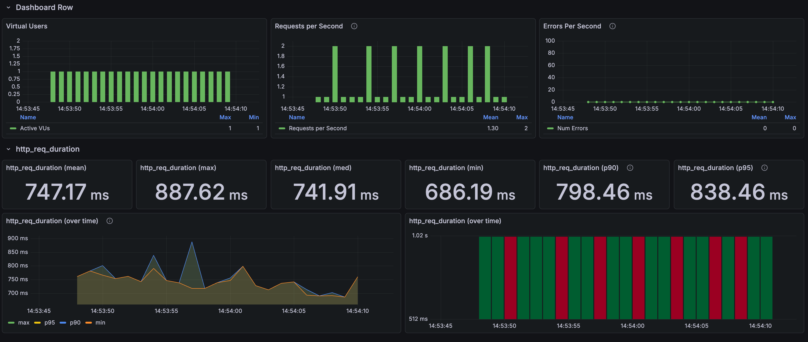
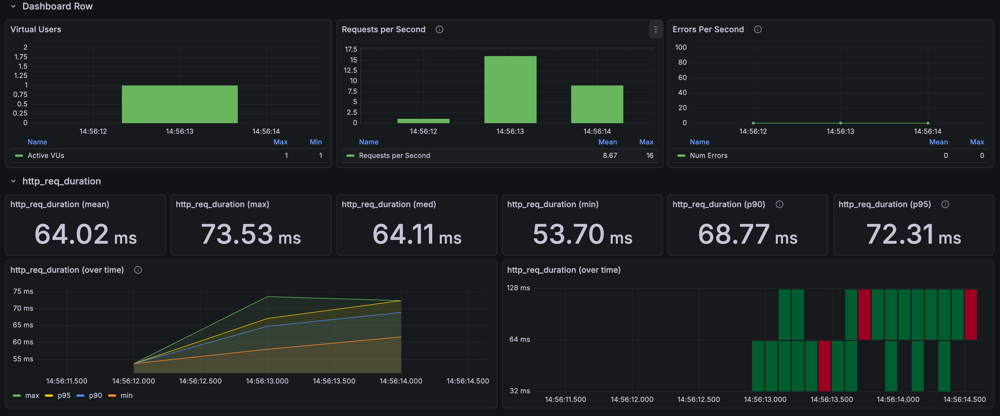

# 상품 목록: 대표 가격 저장과 재고 계산 제거

[English](../../en/improvements/list-price.md) · [README](../../../README.ko.md)

---

## 문제와 비교의 조건

목록에는 대표 가격 하나가 필요하지만 기존 응답 조립은 상품별 옵션, 재고 관계를 따라 최저가와 재고 유무를 계산하여 표시했습니다.

요청은 `GET /api/products?page=0&size=24`로, 검색어, 가격 정렬이 없는 일반 목록입니다. 
버전별 첫 요청 1회 → 추가 워밍업 4회 → 1 VU 본 측정 30회를 한 묶음으로 4번 실행했습니다.

---

## 반복 측정 결과

| 구분 | 변경 전 평균 | 변경 전 p95 | 변경 후 평균 | 변경 후 p95 |
|----| --- | --- | --- | --- |
| 1회 | 852.25ms | 955.68ms | 63.88ms | 73.83ms |
| 2회 | 880.45ms | 1,032.82ms | 63.15ms | 70.65ms |
| 3회 | 848.70ms | 957.91ms | 62.16ms | 66.78ms |
| 4회 | 747.17ms | 838.46ms | 64.02ms | 72.31ms |
| 4회 평균 | 832.14ms | — | 63.30ms | — |

4회 평균 832.14→63.30ms, 92.4% 감소입니다. 

**목록 변경 전**

**목록 변경 후**

---

## 왜 느렸고 무엇을 줄였는가

상품 하나에는 옵션이 평균 약 72개 있고, 목록에는 그중 가장 낮은 가격을 대표 가격으로 보여줘야 했습니다. 
그래서 기존 구현은 상품마다 모든 옵션과 재고를 읽어 가격을 비교했습니다. 
첫 페이지 24개만 보여줘도 상품마다 옵션을 추가로 조회하게 되어, 화면에 나오는 모든 상품의 옵션을 매번 읽는 것이 병목이었습니다.

이를 줄이기 위해 최저가를 상품의 `default_price` 컬럼에 미리 저장하는 역정규화를 적용했습니다. 
목록은 옵션을 읽지 않고 상품 테이블 하나만 조회하므로, 상품마다 반복되던 추가 SQL 왕복과 옵션, 재고 행을 읽어 비교하는 비용이 사라졌습니다. 
같은 이유로 목록에서 재고 유무를 계산하던 부분도 뺐습니다.

---

## 선택과 트레이드오프

- **정합성**: 대표 가격은 옵션 가격을 복사해 둔 값이라, 옵션이 추가되거나 수정될 때마다 상품의 대표 가격도 함께 맞춰야 합니다.
  더 싼 옵션이 추가되면 비교 한 번으로 끝나지만, 최저가 옵션의 가격이 오르거나 삭제, 품절되면 남은 옵션을 다시 읽어 최저가를 계산해야 합니다.  

- **트랜잭션과 락**: 옵션 수정과 대표 가격 갱신을 한 트랜잭션으로 묶으면 일관성은 지키기 쉽지만, 같은 상품의 옵션을 동시에 수정할 때 상품 행에 락 경합이 생깁니다.
  비동기로 갱신하면 경합은 줄지만 잠시 오래된 가격이 보일 수 있어, 갱신 방식과 락 범위에 대한 추가 설계가 필요합니다. 
