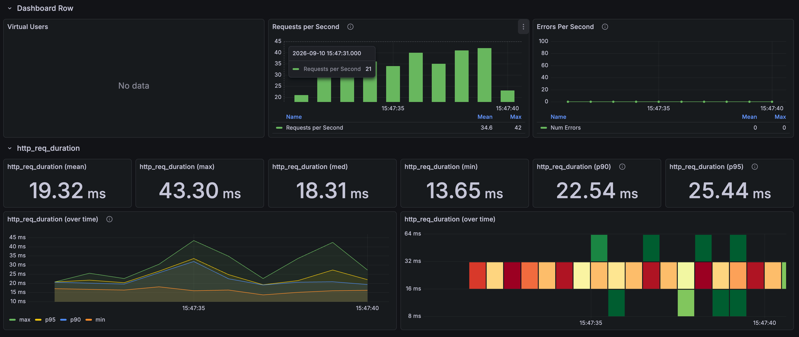
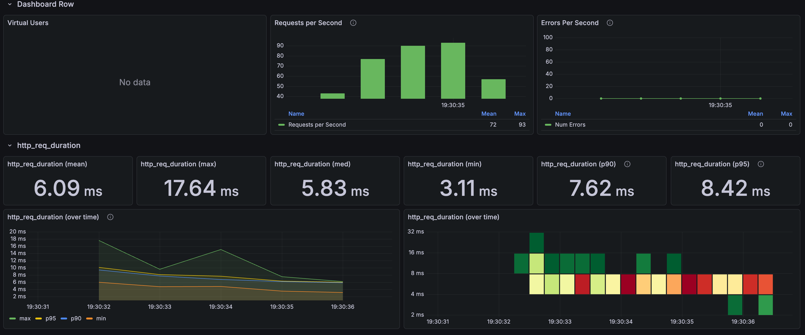

# 상품 목록: 썸네일 저장과 DTO 직접 조회

[English](../../en/improvements/list-thumbnail-dto.md) · [README](../../../README.ko.md)

---

## 문제와 비교 조건

대표 가격과 keyset을 적용한 뒤에도 목록은 상품 엔티티를 읽고, 상품마다 이미지 목록에서 썸네일을 찾은 다음 응답 DTO로 옮기고 있었습니다.

keyset과 같은 네 위치의 커서로 조회했고, 위치별 첫 요청 1회 → 워밍업 4회 → 1 VU 본 측정 30회를 한 묶음으로 4번 실행했습니다.<br>
변경 전 값은 [keyset 측정 결과](list-keyset.md)의 변경 후 값을 그대로 사용했습니다.

---

## 반복 측정 결과

| 구분 | 변경 전 평균 | 변경 전 p95 | 변경 후 평균 | 변경 후 p95 |
| --- | --- | --- | --- | --- |
| 1회 | 17.51ms | 22.48ms | 5.35ms | 7.92ms |
| 2회 | 16.17ms | 18.86ms | 4.73ms | 6.22ms |
| 3회 | 15.88ms | 17.95ms | 4.20ms | 5.36ms |
| 4회 | 19.26ms | 25.02ms | 6.09ms | 8.42ms |
| 4회 평균 | 17.21ms | — | 5.09ms | — |

4회 평균 17.21→5.09ms, 70.4% 감소입니다.

**썸네일, DTO 변경 전**



**썸네일, DTO 변경 후**



---

## 왜 느렸고 무엇을 줄였는가

목록에 필요한 건 상품 이름, 가격, 썸네일 같은 몇 개의 값인데, 기존 구현은 상품 엔티티를 통째로 읽고 상품마다 이미지 목록을 따라가 썸네일을 골랐습니다.<br>
이미지 관계가 로딩되지 않은 상태면 상품마다 추가 SQL이 발생했고, 엔티티를 만든 뒤 다시 DTO로 옮기는 변환도 반복됐습니다.

이를 줄이기 위해 대표 이미지 URL을 상품의 `thumbnail_image` 컬럼에 함께 저장하는 역정규화를 적용하고, 목록에 필요한 컬럼만 QueryDSL로 바로 DTO에 담아 조회하도록 바꿨습니다.<br>
이미지 테이블을 따라가는 추가 조회와 중간 엔티티 생성이 사라지고, 상품 테이블에서 필요한 컬럼만 읽게 됐습니다.

```text
변경 전: DB → 상품 엔티티 → 이미지 목록에서 썸네일 탐색 → ProductSummary → JSON
변경 후: DB의 필요한 컬럼 → ProductSummary → JSON
```

```java
// 실제 응답에는 더 많은 필드가 있습니다.
.select(Projections.constructor(
    ProductSummary.class,
    product.productId,
    product.productName,
    product.defaultPrice,
    product.thumbnailImage
)).from(product)
```

---

## 선택과 트레이드오프

- **정합성**: 썸네일 URL도 이미지 테이블의 값을 복사해 둔 것이라, 대표 이미지를 바꾸거나 지울 때 상품의 썸네일도 함께 맞춰야 합니다.
  그렇지 않으면 목록과 상세에 서로 다른 이미지가 보입니다.<br>


- **조회와 응답의 결합**: 조회하는 컬럼과 DTO 생성자의 필드 순서, 타입이 묶여 있어, 응답에 필드를 추가하거나 바꾸면 조회 코드도 함께 수정해야 합니다.<br>
