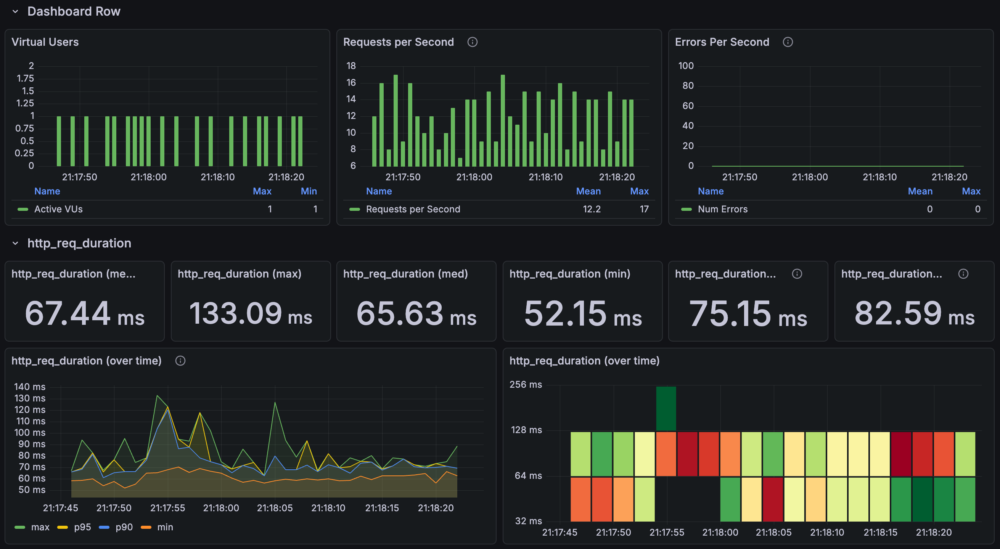
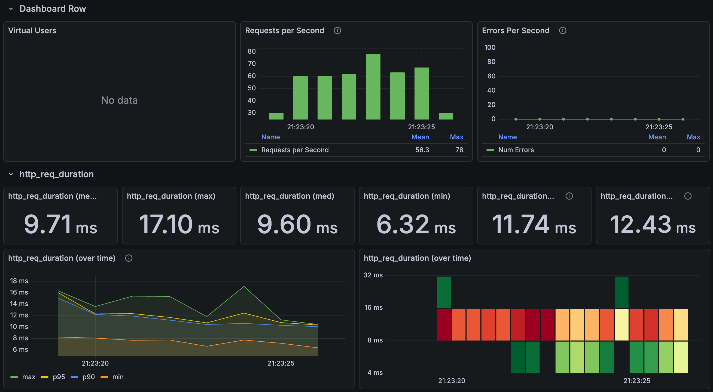
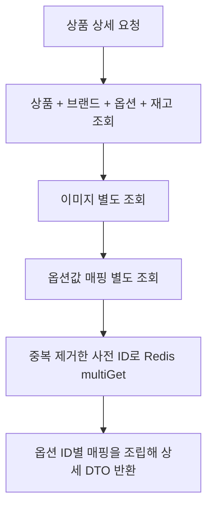

# 상세 조회: 정보는 유지하고 관계를 읽는 방법을 바꾸기

[English](../../en/improvements/product-detail.md) · [README](../../../README.ko.md)

---

## 문제와 비교 조건

상세 화면은 첫 응답에서 상품의 모든 옵션과 가격, 재고, 색상과 사이즈 이름을 한 번에 보여줘야 합니다. 
기존에는 상품, 브랜드, 이미지를 함께 읽은 뒤 옵션마다 재고와 옵션값을 관계를 따라 하나씩 읽고 있었습니다.

옵션이 60~72개인 상품 5개를 반복 조회했고, 상품별 첫 요청 1회 → 워밍업 4회 → 1 VU 본 측정 30회를 한 묶음으로 4번 실행했습니다.

---

## 반복 측정 결과

| 구분 | 변경 전 평균 | 변경 전 p95 | 변경 후 평균 | 변경 후 p95 |
| --- | --- | --- | --- | --- |
| 1회 | 71.33ms | 89.70ms | 9.75ms | 13.21ms |
| 2회 | 70.69ms | 87.94ms | 8.36ms | 9.50ms |
| 3회 | 68.41ms | 80.94ms | 8.62ms | 10.61ms |
| 4회 | 67.44ms | 82.59ms | 9.71ms | 12.43ms |
| 4회 평균 | 69.47ms | — | 9.11ms | — |

4회 평균 69.47→9.11ms, 86.9% 감소입니다. 
측정과 별도로 같은 상품 5개의 응답 JSON을 변경 전후로 비교해, 필드와 값, 배열 순서가 같은 것을 확인했습니다.

### 상품별 평균

| 상품 | 옵션 수 | 변경 전 평균 | 변경 후 평균 |
| --- | --- | --- | --- |
| 상품 1 | 60개 | 63.49ms | 9.27ms |
| 상품 2 | 72개 | 74.01ms | 9.14ms |
| 상품 3 | 65개 | 68.52ms | 8.51ms |
| 상품 4 | 67개 | 69.41ms | 8.75ms |
| 상품 5 | 72개 | 75.30ms | 8.86ms |

상품별 평균은 1~3회를 합친 값입니다.

**상세 조회 변경 전**

**상세 조회 변경 후**

---

## 왜 느렸고 무엇을 줄였는가

기존 구현은 상세 응답을 만들면서 옵션 60~72개마다 재고와 옵션값을 관계를 따라 하나씩 읽었습니다. 
작은 SQL이 옵션 수만큼 반복되는 N+1 형태였고, 여러 옵션이 같이 쓰는 색상과 사이즈 이름도 옵션마다 DB에서 다시 읽었습니다.

이를 함께 읽을 것과 따로 읽을 것으로 나눴습니다. 
상품, 브랜드, 옵션, 재고는 한 번에 조회하고, 이미지와 옵션값 매핑은 각각 한 번씩 따로 조회했습니다. 
색상과 사이즈 이름은 60개뿐인 사전 데이터라, 중복을 뺀 ID로 Redis에서 한 번에(`multiGet`) 가져와 옵션별로 조립했습니다.

이미지를 따로 읽은 이유는 옵션과 이미지가 서로 독립된 목록이기 때문입니다. 
한 쿼리로 함께 조인하면 결과 행이 곱으로 늘어나, 이미지 3개와 옵션 60개면 180행을 받게 됩니다.

---

## 선택과 트레이드오프

- **쿼리 수와 조립**: 한 번에 모두 조인하는 대신 쿼리를 나눠 행이 곱으로 늘어나는 것은 막았지만, DB 왕복이 몇 번 늘고 결과를 애플리케이션에서 조립하는 코드가 생겼습니다. 

- **Redis 의존**: 색상과 사이즈 이름을 Redis에서 읽게 되면서, 지금은 TTL이나 DB 대체 경로가 없어 Redis가 비어 있거나 응답하지 않으면 이름이 빠진 응답이 나갈 수 있습니다. 

현재 구현: [ProductQueryService](../../../src/main/java/com/mudosa/musinsa/product/application/ProductQueryService.java) · [ProductQueryMapper](../../../src/main/java/com/mudosa/musinsa/product/application/mapper/ProductQueryMapper.java)
