# 검색 설계: 상품명 문자열에서 옵션과 검색 의도로

[English](../../en/improvements/product-search.md) · [README](../../../README.ko.md)

---

## 문제와 비교 조건

기존 검색은 상품명에 검색어가 연속으로 들어 있는 상품을 LIKE로 찾았습니다. 
그래서 "블랙 스커트"처럼 색상은 옵션에, 종류는 카테고리에 있는 검색어는 결과가 하나도 나오지 않았습니다.

`스커트`, `블랙 스커트`, `나이키`, `나이키 후드` 네 검색어로 첫 페이지 10개를 같은 횟수로 조회했습니다. 
검색어별 첫 요청 1회 → 워밍업 4회 → 1 VU 본 측정 30회를 한 묶음으로 4번 실행했습니다.

---

## 반복 측정 결과

| 구분 | 변경 전 평균 | 변경 전 p95 | 변경 후 평균 | 변경 후 p95 |
| --- | --- | --- | --- | --- |
| 1회 | 89.96ms | 174.35ms | 25.75ms | 60.19ms |
| 2회 | 90.19ms | 175.78ms | 22.95ms | 54.48ms |
| 3회 | 89.91ms | 176.34ms | 22.37ms | 53.50ms |
| 4회 | 87.06ms | 168.54ms | 22.14ms | 47.06ms |
| 4회 평균 | 89.28ms | — | 23.30ms | — |

4회 평균 89.28→23.30ms, 73.9% 감소입니다. 
LIKE와 ES는 찾아내는 결과 자체가 달라서, 같은 기능의 속도 개선이라기보다 검색 방식을 바꾼 뒤의 응답 시간입니다.

**LIKE 검색**

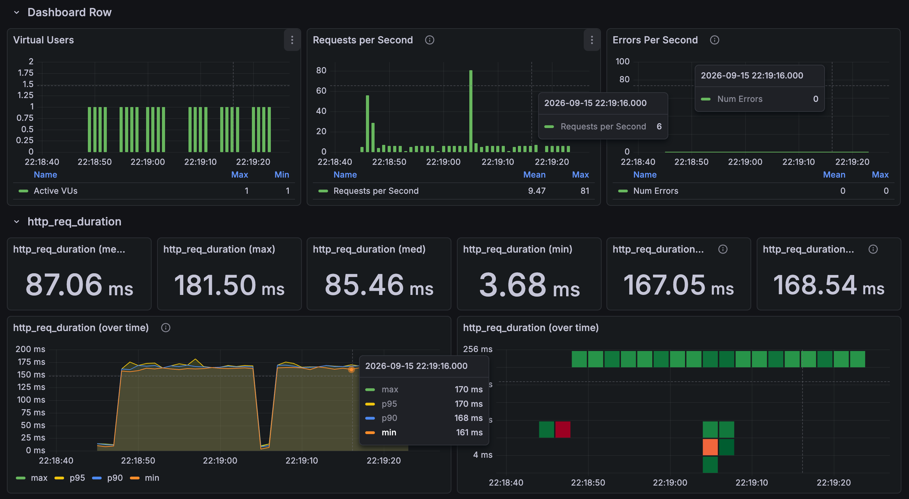

**ES 검색**

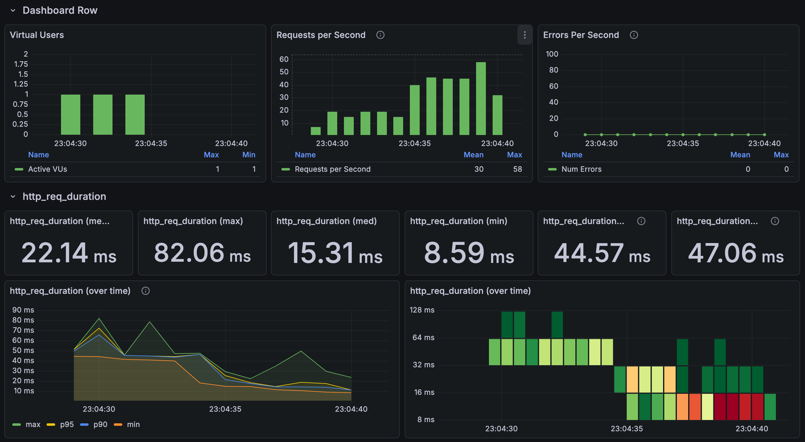

---

## 검색 결과에서 확인한 차이

블랙 스커트: LIKE / Elasticsearch

LIKE는 상품명에 "블랙 스커트"라는 연속된 문자열이 없어 결과가 없었습니다. 
ES는 블랙과 스커트를 단어별로 나눠 여러 필드에서 찾아 결과를 반환했습니다.

**블랙 스커트 LIKE 결과**

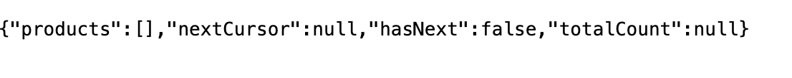

**블랙 스커트 ES 결과**

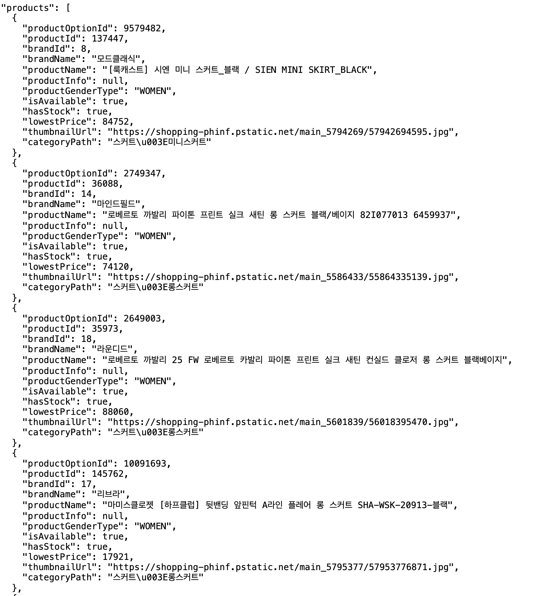

스커트: LIKE / Elasticsearch

LIKE는 상품명에 스커트가 들어간 상품을 ID 순으로 반환하고, ES는 카테고리 등 여러 필드의 관련도 순으로 반환합니다.

**스커트 LIKE 결과**

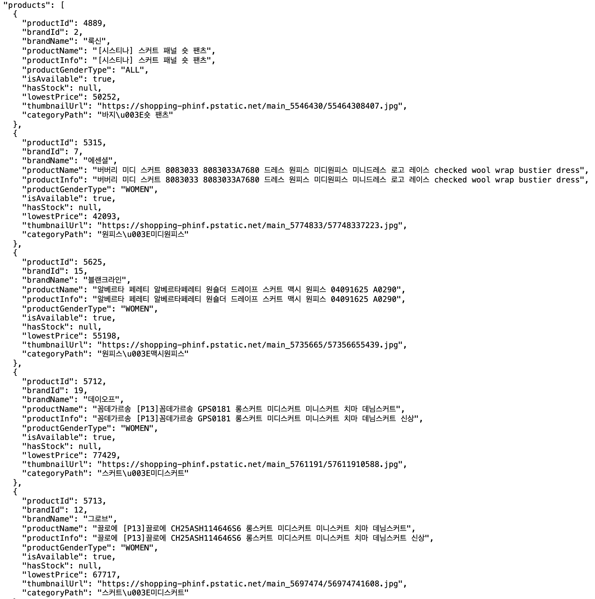

**스커트 ES 결과**

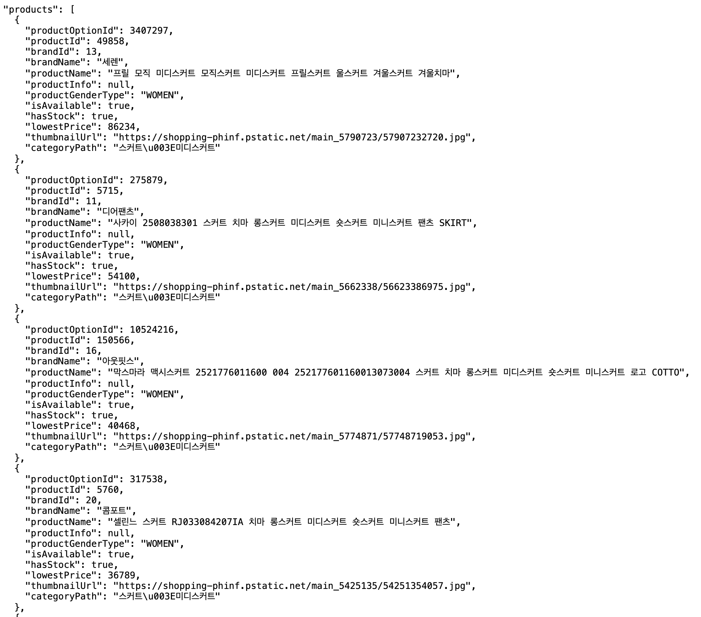

나이키: LIKE / Elasticsearch

LIKE는 상품명에 나이키가 들어간 상품만, ES는 상품명과 브랜드 등 여러 필드의 점수로 결과를 반환합니다.

**나이키 LIKE 결과**

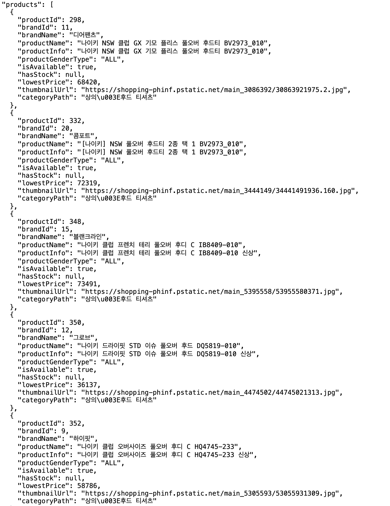

**나이키 ES 결과**

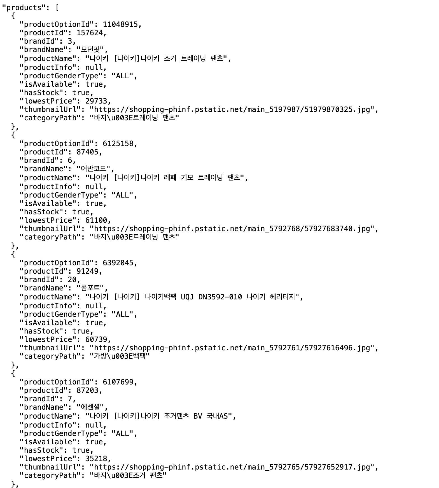

나이키 후드: LIKE / Elasticsearch

LIKE는 "나이키 클럽 후드"처럼 중간에 다른 단어가 있는 상품명을 놓칩니다. 
ES는 이런 상품도 찾고, 후드 카테고리 점수가 더해져 앞쪽에 보여줍니다.

**나이키 후드 LIKE 결과**

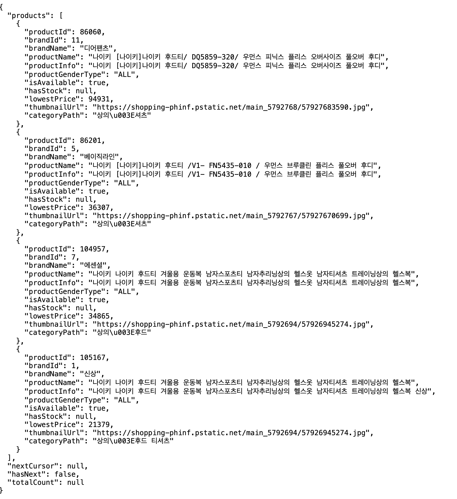

**나이키 후드 ES 결과**

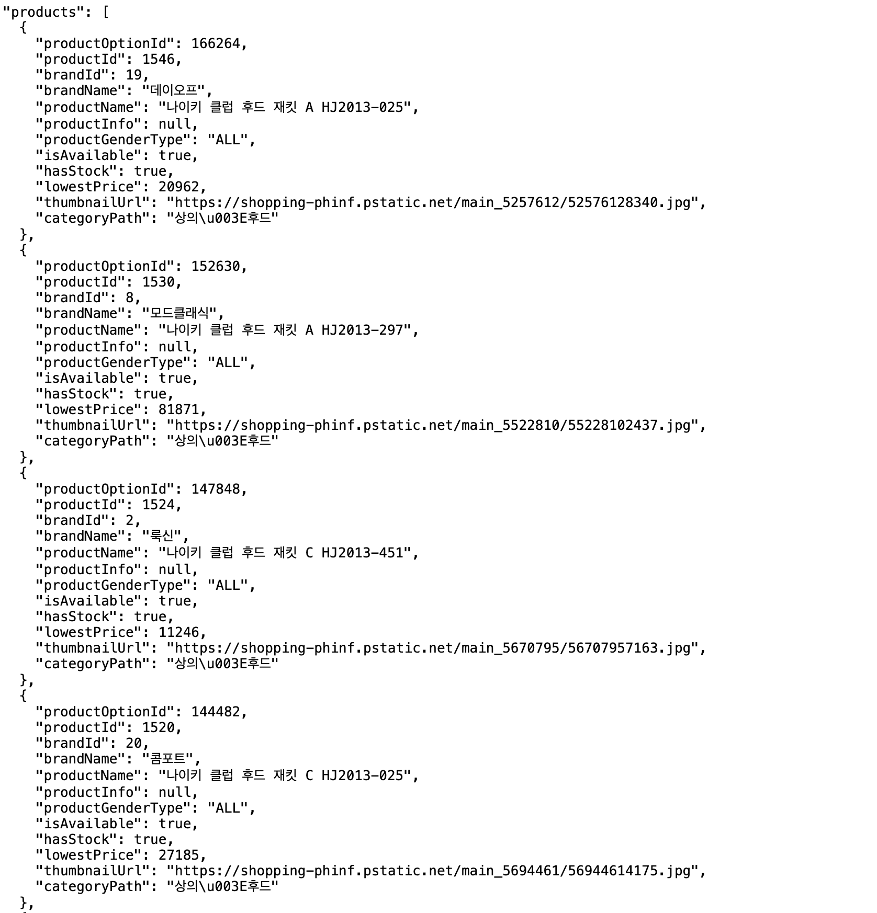

---

## 왜 바꿨고 어떻게 설계했는가

사용자의 검색어에는 색상, 종류, 브랜드가 섞여 있고, 이 정보는 상품명, 옵션, 카테고리, 브랜드에 흩어져 있습니다. 
LIKE로는 이를 나눠 찾을 수 없어, 여러 필드를 함께 검색하고 관련도 순으로 정렬할 수 있는 Elasticsearch로 바꿨습니다.

**옵션 하나를 문서 하나로**

상품 문서에 색상과 사이즈를 목록으로만 모아 두면, 검정/S와 빨강/M만 파는 상품이 "검정 M" 검색에도 걸립니다. 
그래서 실제로 판매하는 조합만 찾도록 옵션마다 문서를 만들고, 같은 상품의 옵션은 `productId`로 묶어(collapse) 상품 단위로 반환했습니다. 
상품명, 대표 가격, 썸네일도 문서에 함께 담아, 검색 결과를 만들 때 DB를 다시 읽지 않습니다.

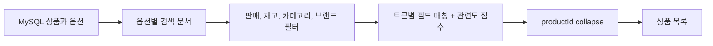

**한글 분석과 동의어**

상품명과 브랜드는 한글 형태소 분석기(Nori)로 단어 단위로 나눠 검색하고, 색상과 사이즈에는 동의어를 연결했습니다. 
예를 들어 블랙, black, 검정색, blk을 같은 색상으로, M, 미디엄, medium을 같은 사이즈로 찾습니다.

| 필드 | 설정 |
| --- | --- |
| 상품명, 한글 브랜드 | Nori 분석 |
| 영문 브랜드 | 기본 텍스트 분석 |
| 카테고리 | 정확한 경로 필터 + Nori 분석 검색 |
| 색상, 사이즈 | 원래 값 + 동의어를 적용한 검색 |

**매칭 조건과 점수를 나누기**

검색어의 단어마다 상품명, 카테고리, 색상, 사이즈, 브랜드 중 적어도 한 곳에는 맞아야 결과에 포함되도록 했습니다. 
그리고 순위는 검색어 전체가 어느 필드에 맞았는지에 따라 가중치를 다르게 줘서 정했습니다.

| 검색어가 맞은 필드 | 가중치 |
| --- | ---: |
| 카테고리, 색상 | 3 |
| 상품명 | 2 |
| 사이즈, 브랜드 | 1 |

가중치는 수집한 상품 데이터를 직접 살펴보고 정했고, 대표 검색어의 결과를 확인하며 다듬었습니다. 
네이버 쇼핑에서 수집한 상품명에는 여러 상품을 묶어 놓은 이름이나 판매 문구가 많아, 상품명보다 상품마다 정확히 분류된 카테고리를 더 높게 두었습니다. 
사용자는 사이즈보다 색상으로 상품을 찾는 경우가 많다고 보고, 같은 옵션 속성이라도 색상을 사이즈보다 높게 두었습니다. 
브랜드는 유명 브랜드 상품을 가져와 파는 판매자가 많아 브랜드 필드에 실제 브랜드 대신 판매처 정보가 섞여 있어서, 상품명보다 낮게 두었습니다.

**필드별 가중치 설정**

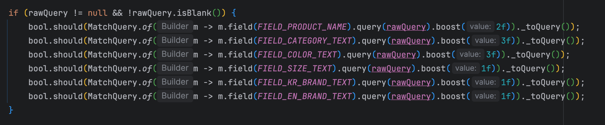

---

## 선택과 트레이드오프

- **문서 수와 중복**: 상품 15만 개가 옵션 문서 약 1,100만 개로 늘고, 상품명이나 브랜드 같은 공통 정보가 옵션 문서마다 반복됩니다.
  상품 정보가 바뀌면 그 상품의 옵션 문서를 모두 다시 써야 합니다. 

- **상품 단위로 묶는 비용**: 검색할 때마다 옵션 문서를 상품별로 묶는 처리가 더해지고, 현재 정렬로는 collapse와 함께 쓸 수 없는 `search_after` 대신 `from/size`로 페이지를 넘겨 깊은 페이지일수록 비용이 커집니다.
  다만 검색 결과는 목록처럼 수천 페이지까지 넘겨 보는 경우가 드물어, 사용자가 주로 보는 앞쪽 몇 페이지에서는 이 비용이 크지 않다고 판단했습니다. 

- **동기화와 운영**: 별도 검색 서버를 운영해야 하고, DB 변경을 ES에 반영하는 경로가 필요합니다.
  동의어 규칙을 바꾸면 기존 문서에 적용하기 위해 전체 재색인이 필요합니다. 

관련 문서: [검색 품질](../troubleshooting/search-quality.md) · [검색 페이지네이션](../troubleshooting/search-pagination.md) · [검색 병목 조사](../troubleshooting/search-capacity.md)

현재 쿼리: [ProductIndexSearchQueryRepositoryImpl](../../../src/main/java/com/mudosa/musinsa/product/infrastructure/search/repository/ProductIndexSearchQueryRepositoryImpl.java)
