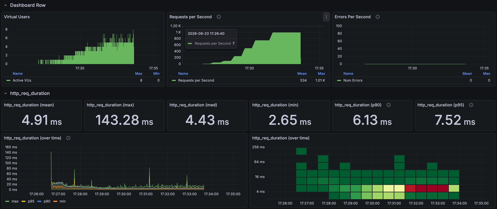
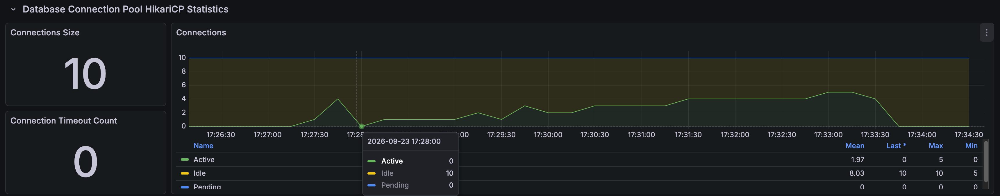
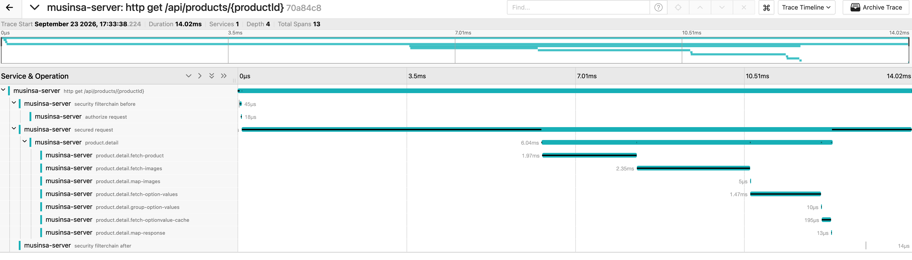

# 상품 상세 고부하 결과

[English](../../en/load-tests/product-detail.md) · [README](../../../README.ko.md)

상품 5개를 번갈아 조회하며 상품, 이미지, 옵션 매핑, 사전 캐시 조회와 응답 조립을 모두 거치는 상세를 호출했습니다. 
1,000 RPS를 120초 동안 p95 7.21ms로 유지했고, HTTP 실패와 drop은 없었습니다.

**k6 결과**

---

## 측정 조건

10 RPS 워밍업 뒤 50, 100, 250, 500 RPS를 각 30초, 750 RPS를 60초, 1,000 RPS를 120초 유지했고, 단계 사이에는 15초씩 부하를 올렸습니다. 
VU 상한 200, HTTP timeout 5초, Hikari 연결 10개로 상세 API만 단독으로 호출했습니다.

---

## 부하 단계별 결과

| 유지 구간 | 유지 시간 | 응답 수 | 평균 | p95 |
| --- | --- | --- | --- | --- |
| 50 RPS | 30초 | 1,500 | 10.09ms | 12.88ms |
| 100 RPS | 30초 | 3,000 | 7.17ms | 9.95ms |
| 250 RPS | 30초 | 7,500 | 4.44ms | 5.92ms |
| 500 RPS | 30초 | 15,001 | 4.20ms | 5.40ms |
| 750 RPS | 60초 | 44,999 | 4.47ms | 5.99ms |
| 1,000 RPS | 120초 | 119,993 | 5.07ms | 7.21ms |

워밍업과 증가 구간까지 포함한 전체 224,621건은 평균 4.91ms, p95 7.52ms, 최대 143.28ms였습니다.

### 1,000 RPS 상품별 결과

| 상품 | 응답 수 | 평균 | p95 |
| --- | --- | --- | --- |
| 상품 1 | 23,999 | 4.96ms | 7.12ms |
| 상품 2 | 23,998 | 5.13ms | 7.26ms |
| 상품 3 | 23,998 | 5.06ms | 7.22ms |
| 상품 4 | 23,999 | 5.08ms | 7.17ms |
| 상품 5 | 23,999 | 5.13ms | 7.27ms |

상품별 p95는 7.12~7.27ms로 차이가 거의 없었습니다.

---

## 연결과 자원

**Spring Boot, Hikari 연결**

| 관측 항목 | 최대값 |
| --- | --- |
| Hikari 연결 상한 | 10 |
| Hikari active / pending | 10 / 18 |
| Hikari 연결 타임아웃 | 0건 |
| JVM / 시스템 CPU | 25.45% / 72.06% |
| MySQL 실행 스레드 | 3 |

실행 중 1초 간격으로 조회한 최대값이고, 시스템 CPU는 같은 장비에서 돌아간 모든 프로세스를 합친 값입니다. 
연결 10개가 모두 쓰이며 대기가 순간적으로 18건까지 쌓였지만, 연결 타임아웃은 없었습니다.

---

## 요청 트레이스

**Jaeger 요청 트레이스**

| 구간 | 시간 |
| --- | --- |
| HTTP 전체 | 14.02ms |
| 서비스 본문 진입 | 요청 시작 후 6.30ms |
| 서비스 본문 | 6.04ms |
| 상품 조회 | 1.97ms |
| 이미지 조회 | 2.35ms |
| 옵션값 조회 | 1.47ms |
| 옵션 사전 캐시 조회 | 0.195ms |
| 최종 응답 매핑 | 0.013ms |

서비스 본문에서는 상품, 이미지, 옵션값 조회가 대부분을 차지했고, 본문에 들어가기 전에도 6.30ms가 걸렸습니다.

---

## 판단

상세는 1,000 RPS에서 p95 8ms 안쪽으로 목표를 통과했습니다. 
다만 연결이 모두 쓰이며 대기가 생기고 본문 진입 전 시간도 보여, 더 높은 부하에서 연결 풀과 스레드를 조사했습니다. 
→ [풀과 스레드 트러블슈팅](../troubleshooting/hikari.md)
