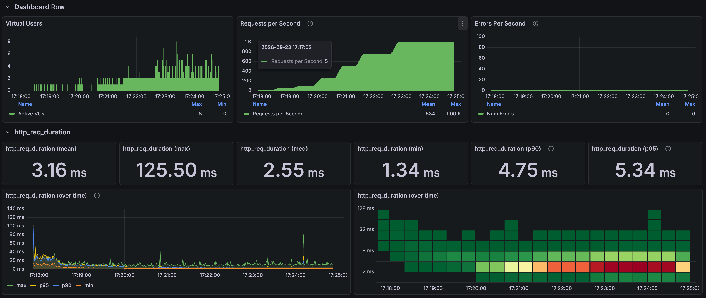
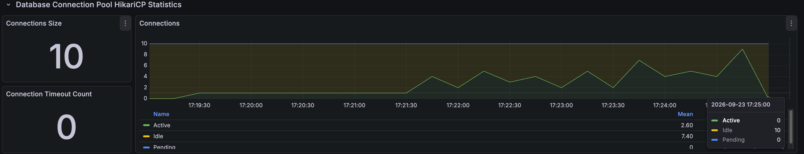
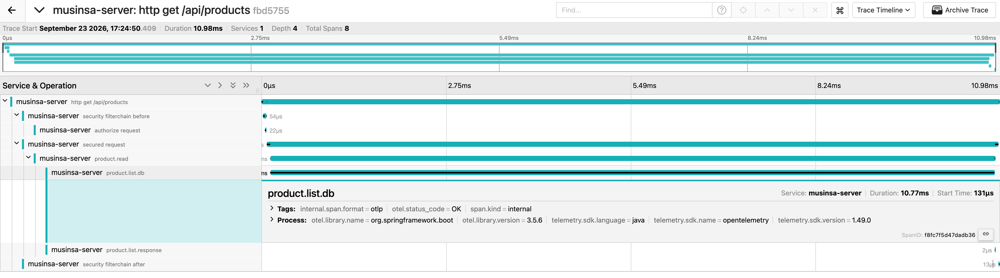

# 상품 필터 고부하 결과

[English](../../en/load-tests/product-filter.md) · [README](../../../README.ko.md)

카테고리, 브랜드, 성별 등 10가지 필터 조건에 기본순, 최저가순, 최고가순 정렬을 조합해 첫 24개를 조회했습니다. 
1,000 RPS를 120초 동안 p95 5.03ms로 유지했고, HTTP 실패와 drop은 없었습니다.

**k6 결과**

---

## 측정 조건

10 RPS 워밍업 뒤 50, 100, 250, 500 RPS를 각 30초, 750 RPS를 60초, 1,000 RPS를 120초 유지했고, 단계 사이에는 15초씩 부하를 올렸습니다. 
VU 상한 200, HTTP timeout 5초, Hikari 연결 10개로 필터 API만 단독으로 호출했습니다.

---

## 부하 단계별 결과

| 유지 구간 | 유지 시간 | 응답 수 | 평균 | p95 |
| --- | --- | --- | --- | --- |
| 50 RPS | 30초 | 1,500 | 6.85ms | 10.43ms |
| 100 RPS | 30초 | 3,000 | 5.32ms | 8.46ms |
| 250 RPS | 30초 | 7,500 | 3.44ms | 5.39ms |
| 500 RPS | 30초 | 15,001 | 2.99ms | 4.84ms |
| 750 RPS | 60초 | 45,000 | 2.97ms | 4.80ms |
| 1,000 RPS | 120초 | 119,995 | 3.05ms | 5.03ms |

워밍업과 증가 구간까지 포함한 전체 224,624건은 평균 3.16ms, p95 5.34ms, 최대 125.50ms였습니다.

### 1,000 RPS 조건, 정렬별 p95

| 조건 | 기본 정렬 | 최저가 정렬 | 최고가 정렬 |
| --- | --- | --- | --- |
| 필터 없음 | 3.57ms | 3.58ms | 3.66ms |
| 카테고리 | 5.62ms | 4.60ms | 3.56ms |
| 브랜드 | 3.49ms | 3.35ms | 3.42ms |
| 성별 | 3.35ms | 3.30ms | 3.33ms |
| 카테고리+브랜드 | 5.47ms | 3.99ms | 3.97ms |
| 카테고리+성별 | 5.80ms | 4.78ms | 3.78ms |
| 브랜드+성별 | 3.53ms | 3.35ms | 3.55ms |
| 카테고리+브랜드+성별 | 5.47ms | 4.08ms | 3.90ms |
| 하위 카테고리 | 6.88ms | 5.64ms | 5.19ms |
| 복수 카테고리 | 6.09ms | 5.05ms | 4.41ms |

카테고리는 가방, 하위 카테고리는 토트백, 복수 카테고리는 토트백과 크로스 백, 브랜드는 고정 1개, 성별은 공용(ALL)이고, 조합마다 약 4,000건씩입니다.

---

## 연결과 자원

**Spring Boot, Hikari 연결**

| 관측 항목 | 최대값 |
| --- | --- |
| Hikari 연결 상한 | 10 |
| Hikari active / pending | 10 / 10 |
| Hikari 연결 타임아웃 | 0건 |
| JVM / 시스템 CPU | 33.35% / 57.67% |
| MySQL 실행 스레드 | 3 |

실행 중 1초 간격으로 조회한 최대값이고, 시스템 CPU는 같은 장비에서 돌아간 모든 프로세스를 합친 값입니다. 
연결 대기는 최대 10건으로 짧았고, 연결 타임아웃은 없었습니다.

---

## 요청 트레이스

**Jaeger 요청 트레이스**

| 구간 | 시간 |
| --- | --- |
| HTTP 전체 | 10.98ms |
| 서비스 본문 | 10.78ms |
| DB 조회 호출 | 10.77ms |
| 서비스 본문 진입 | 요청 시작 후 0.129ms |

이 요청에서는 시간 대부분을 DB 조회 호출이 차지했고, 응답을 만드는 데는 0.002ms 정도만 걸렸습니다.

---

## 판단

필터는 30개 조합 모두 1,000 RPS에서 p95 7ms 안쪽으로, 이 부하에서는 병목이 없었습니다. 
조건에 맞는 상품을 더 찾아야 하는 하위, 복수 카테고리의 기본 정렬이 가장 느렸지만 그래도 p95 6.88ms였습니다.
