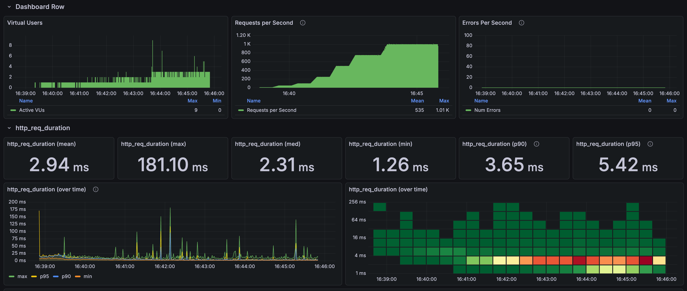
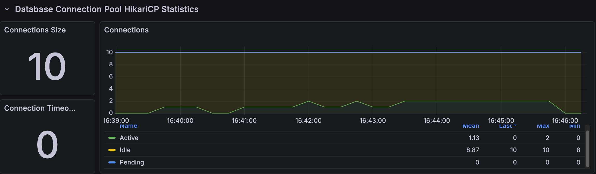
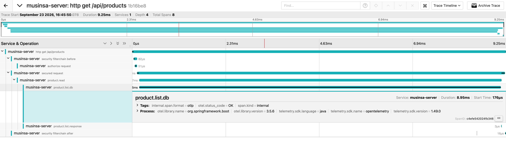

# 상품 목록 고부하 결과

[English](../../en/load-tests/product-list.md) · [README](../../../README.ko.md)

검색어, 필터, 가격 정렬 없이 목록 첫 페이지 24개를 반복 조회했습니다. 
1,000 RPS를 120초 동안 p95 4.26ms로 유지했고, HTTP 실패와 drop은 없었습니다.

**k6 결과**

---

## 측정 조건

10 RPS 워밍업 뒤 50, 100, 250, 500 RPS를 각 30초, 750 RPS를 60초, 1,000 RPS를 120초 유지했고, 단계 사이에는 15초씩 부하를 올렸습니다. 
VU 상한 200, HTTP timeout 5초, Hikari 연결 10개로 목록 API만 단독으로 호출했습니다.

---

## 부하 단계별 결과

| 유지 구간 | 유지 시간 | 응답 수 | 평균 | p95 |
| --- | --- | --- | --- | --- |
| 50 RPS | 30초 | 1,500 | 7.02ms | 10.30ms |
| 100 RPS | 30초 | 2,997 | 5.07ms | 7.38ms |
| 250 RPS | 30초 | 7,496 | 3.58ms | 5.28ms |
| 500 RPS | 30초 | 14,995 | 4.22ms | 5.50ms |
| 750 RPS | 60초 | 44,983 | 2.68ms | 3.92ms |
| 1,000 RPS | 120초 | 119,955 | 2.64ms | 4.26ms |

워밍업과 증가 구간까지 포함한 전체 224,540건은 평균 2.94ms, p95 5.42ms, 최대 181.10ms였습니다.

---

## 연결과 자원

**Spring Boot, Hikari 연결**

| 관측 항목 | 최대값 |
| --- | --- |
| Hikari 연결 상한 | 10 |
| Hikari active / pending | 10 / 53 |
| Hikari 연결 타임아웃 | 0건 |
| JVM / 시스템 CPU | 18.80% / 87.57% |
| MySQL 실행 스레드 | 4 |

실행 중 1초 간격으로 조회한 최대값이고, 시스템 CPU는 같은 장비에서 돌아간 모든 프로세스를 합친 값입니다. 
연결 10개가 모두 쓰이며 대기가 순간적으로 53건까지 쌓였지만, 연결 타임아웃은 없었습니다.

---

## 요청 트레이스

**Jaeger 요청 트레이스**

| 구간 | 시간 |
| --- | --- |
| HTTP 전체 | 9.25ms |
| DB 조회 호출 | 8.95ms |
| DB 호출 시작 | 요청 시작 후 0.176ms |

이 요청에서는 시간 대부분을 DB 조회 호출이 차지했습니다.

---

## 판단

목록은 1,000 RPS에서도 p95 5ms 안쪽으로, 이 부하에서는 병목이 없었습니다. 
연결 대기가 순간적으로 생겼지만 타임아웃이나 지연 증가로 이어지지 않아, 연결 풀을 늘릴 정도는 아니라고 봤습니다.
