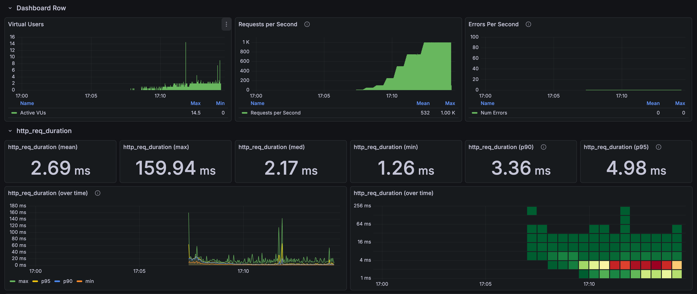
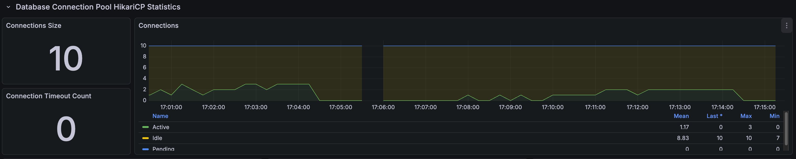
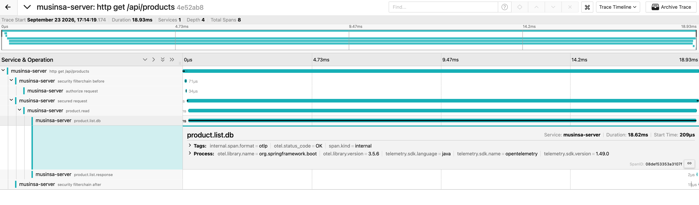

# 상품 스크롤 고부하 결과

[English](../../en/load-tests/product-scroll.md) · [README](../../../README.ko.md)

응답의 다음 커서로 1~5페이지를 이어서 조회했고, 요청 하나가 한 페이지입니다. 
1,000 RPS를 120초 동안 p95 3.95ms로 유지했고, HTTP 실패와 drop은 없었습니다.

**k6 결과**

---

## 측정 조건

10 RPS 워밍업 뒤 50, 100, 250, 500 RPS를 각 30초, 750 RPS를 60초, 1,000 RPS를 120초 유지했고, 단계 사이에는 15초씩 부하를 올렸습니다. 
VU 상한 200, HTTP timeout 5초, Hikari 연결 10개로 스크롤 API만 단독으로 호출했습니다.

---

## 부하 단계별 결과

| 유지 구간 | 유지 시간 | 응답 수 | 평균 | p95 |
| --- | --- | --- | --- | --- |
| 50 RPS | 30초 | 1,500 | 6.63ms | 9.40ms |
| 100 RPS | 30초 | 2,999 | 4.71ms | 7.17ms |
| 250 RPS | 30초 | 7,498 | 2.89ms | 4.23ms |
| 500 RPS | 30초 | 14,997 | 2.33ms | 3.21ms |
| 750 RPS | 60초 | 44,983 | 3.03ms | 4.72ms |
| 1,000 RPS | 120초 | 119,967 | 2.44ms | 3.95ms |

워밍업과 증가 구간까지 포함한 전체 224,564건은 평균 2.69ms, p95 4.98ms, 최대 159.94ms였습니다.

### 1,000 RPS 페이지별 결과

| 페이지 | 응답 수 | 평균 | p95 |
| --- | --- | --- | --- |
| 1페이지 | 23,994 | 2.72ms | 6.29ms |
| 2페이지 | 23,995 | 2.43ms | 3.71ms |
| 3페이지 | 23,998 | 2.29ms | 3.26ms |
| 4페이지 | 23,997 | 2.23ms | 2.86ms |
| 5페이지 | 23,983 | 2.51ms | 4.53ms |

페이지가 깊어져도 지연이 커지지 않았습니다.

---

## 연결과 자원

**Spring Boot, Hikari 연결**

| 관측 항목 | 최대값 |
| --- | --- |
| Hikari 연결 상한 | 10 |
| Hikari active / pending | 10 / 7 |
| Hikari 연결 타임아웃 | 0건 |
| JVM / 시스템 CPU | 10.44% / 77.66% |
| MySQL 실행 스레드 | 3 |

실행 중 1초 간격으로 조회한 최대값이고, 시스템 CPU는 같은 장비에서 돌아간 모든 프로세스를 합친 값입니다. 
연결 대기는 최대 7건으로 짧았고, 연결 타임아웃은 없었습니다.

---

## 요청 트레이스

**Jaeger 요청 트레이스**

| 구간 | 시간 |
| --- | --- |
| HTTP 전체 | 18.93ms |
| DB 조회 호출 | 18.62ms |
| DB 호출 시작 | 요청 시작 후 0.209ms |

이 요청에서는 시간 대부분을 DB 조회 호출이 차지했습니다.

---

## 판단

스크롤은 1,000 RPS에서도 p95 4ms 안쪽으로, 이 부하에서는 병목이 없었습니다. 
1~5페이지 사이에 지연 차이가 없어, keyset 방식이 부하 상황에서도 페이지 깊이와 상관없이 일정하게 동작하는 것을 확인했습니다.
