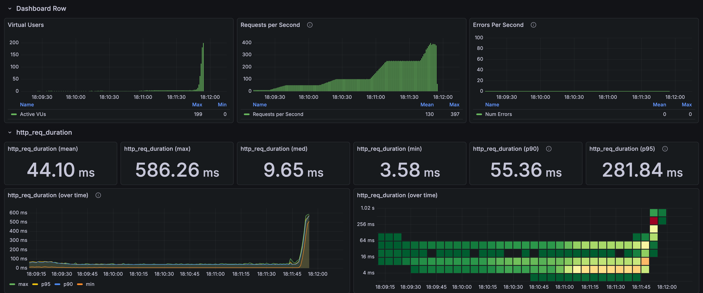
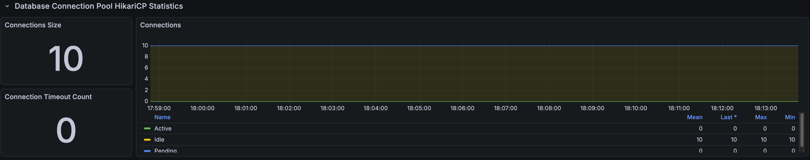
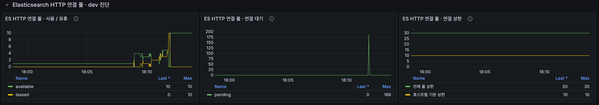
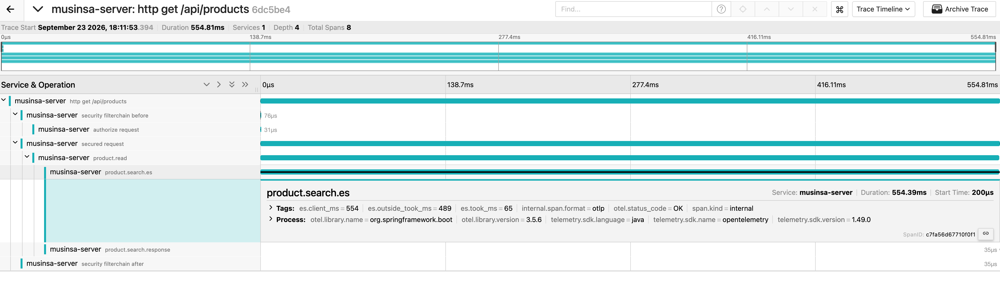

# 상품 검색 고부하 결과

[English](../../en/load-tests/product-search.md) · [README](../../../README.ko.md)

`스커트`, `블랙 스커트`, `나이키`, `나이키 후드` 네 검색어로 첫 10개를 번갈아 조회했습니다. 
250 RPS까지는 p95 40.53ms로 유지했지만, 500 RPS로 올리는 구간에서 drop 179건이 생겨 테스트가 중단됐습니다. HTTP 실패는 없었습니다.

**k6 결과**

---

## 측정 조건

다른 API와 같은 7분 시나리오(10 RPS 워밍업 뒤 50, 100, 250, 500, 750, 1,000 RPS)로 계획했고, drop이 생기면 바로 중단하도록 했습니다. 
VU 상한 200, HTTP timeout 5초, Hikari 연결 10개, ES 클라이언트 연결은 전체 30개, 호스트별 10개로 검색 API만 단독으로 호출했습니다.

---

## 부하 단계별 결과

| 구간 | 응답 수 | 평균 | p95 |
| --- | --- | --- | --- |
| 50 RPS 유지 | 1,500 | 16.91ms | 41.13ms |
| 100 RPS 유지 | 3,000 | 15.98ms | 39.95ms |
| 250 RPS 유지 | 7,500 | 15.39ms | 40.53ms |
| 250 → 500 RPS 증가 중 중단 | 5,229 | 132.05ms | 504.68ms |

워밍업과 증가 구간까지 포함한 전체 21,728건은 평균 44.03ms, p95 279.62ms, 최대 586.26ms였습니다.

---

## 연결과 자원

**Spring Boot, Hikari 연결**

**ES HTTP 연결 풀**

| 관측 항목 | 최대값 |
| --- | --- |
| Hikari active / pending | 0 / 0 |
| ES 연결 상한 (전체 / 호스트별) | 30 / 10 |
| ES 연결 사용 (leased) | 10 |
| ES 연결 대기 (pending) | 189 |
| Tomcat busy | 199 |
| JVM / 시스템 CPU | 11.70% / 95.99% |

실행 중 1초 간격으로 조회한 최대값이고, 시스템 CPU는 같은 장비에서 돌아간 모든 프로세스를 합친 값입니다. 
DB 연결은 쓰이지 않았고, ES 클라이언트의 호스트별 연결 10개가 모두 쓰이며 대기가 189건까지 쌓였습니다.

---

## 요청 트레이스

**Jaeger 요청 트레이스**

| 구간 | 시간 |
| --- | --- |
| HTTP 전체 | 554.81ms |
| ES 검색 호출 | 554.39ms |
| ES 클라이언트에서 잰 시간 (`es.client_ms`) | 554ms |
| ES가 보고한 처리 시간 (`es.took_ms`) | 65ms |
| 그 밖의 시간 (`es.outside_took_ms`) | 489ms |

ES가 직접 처리한 시간은 65ms였고, 연결 대기와 전송을 포함한 ES 밖의 시간이 489ms로 대부분이었습니다.

---

## 판단

검색은 250 RPS까지 안정적이었지만, 500 RPS로 올리면서 응답이 느려지자 요청을 시작할 VU가 부족해져 중단됐습니다. 
API 오류가 아니라 이 환경에서 검색이 처리할 수 있는 한계에 도달한 것이고, 그 시점에는 ES 클라이언트의 연결 대기가 가장 먼저 보였습니다. 
→ [검색 병목 트러블슈팅](../troubleshooting/search-capacity.md)
