# 상품 상세: Hikari 증설과 MySQL 연결 제한

[English](../../en/troubleshooting/hikari.md) · [README](../../../README.ko.md)

---

## 문제와 비교 조건

Hikari 10에서 상세 API를 1,500 RPS로 올리자 평균 연결 대기가 약 188건, Tomcat busy 스레드가 약 198개가 됐습니다. 
busy 스레드에는 DB 연결을 기다리며 묶여 있는 스레드도 포함되기 때문에, Tomcat 스레드 부족보다 DB 연결 대기를 원인으로 보고 Tomcat을 200으로 고정한 채 Hikari만 바꿔 비교했습니다.

상품 5개를 번갈아 조회했고, VU 상한 1,000, timeout 5초로 설정마다 1회씩 실행했습니다. 

| 실험 | 부하 단계 | 비교한 설정 |
| --- | --- | --- |
| 1 | 50 → 1,000 → 1,500 → 2,000 → 50 RPS (5분) | Hikari 10, 20, 30, 50 |
| 2 | 위 단계에 3,000 RPS 60초 추가 (6분 15초) | Hikari 50, 100, 200 |

---

## 1. Hikari 10 → 50: 연결 대기와 스레드 점유 감소

| 2,000 RPS, 75초 | Hikari 10 | 20 | 30 | 50 |
| --- | ---: | ---: | ---: | ---: |
| 처리량 (RPS) | 1,381 | 1,686 | 1,814 | 1,999 |
| p95 (ms) | 875.2 | 786.3 | 731.1 | 58.6 |
| 평균 연결 대기 | 189.8 | 179.8 | 169.9 | 10.9 |
| 평균 Tomcat busy | 200 | 200 | 200 | 34.7 |
| 연결 획득 평균 (ms) | 137.1 | 106.4 | 93.2 | 4.5 |
| 전체 drop | 55,382 | 22,948 | 13,281 | 571 |

Hikari를 50으로 늘리자 2,000 RPS를 모두 처리했고, p95는 875ms에서 59ms로 줄었습니다. 
Tomcat 설정을 바꾸지 않았는데 busy 스레드가 200개에서 35개로 줄어, 스레드가 DB 연결을 기다리며 묶여 있었던 것을 확인했습니다. 
다만 50에서도 실행 중 몇 초 동안 연결 대기가 150건까지 늘어 drop 571건이 남았습니다.

설정별 결과 화면

**Hikari 10, k6**

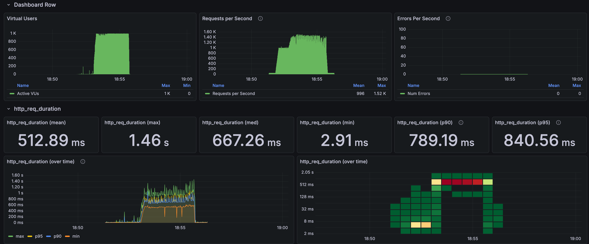

**Hikari 10, 연결 풀**

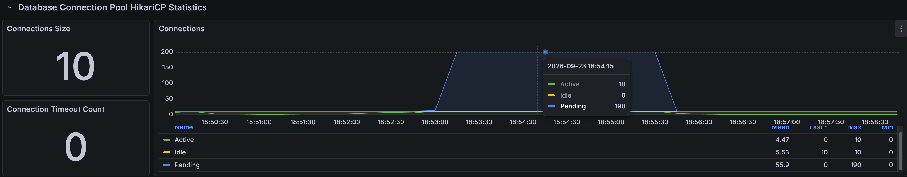

**Hikari 20, k6**

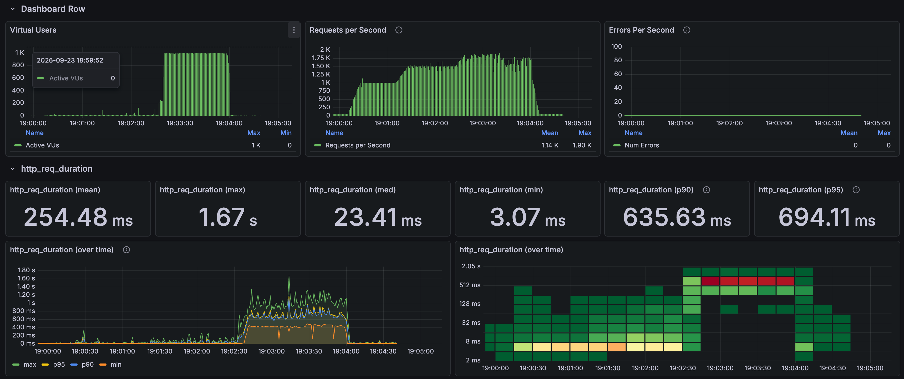

**Hikari 20, 연결 풀**

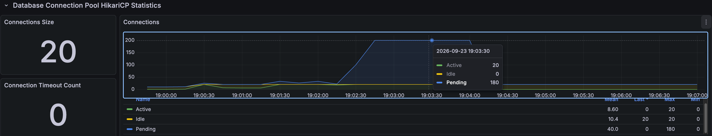

**Hikari 30, k6**

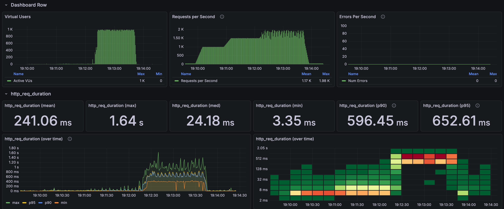

**Hikari 30, 연결 풀**

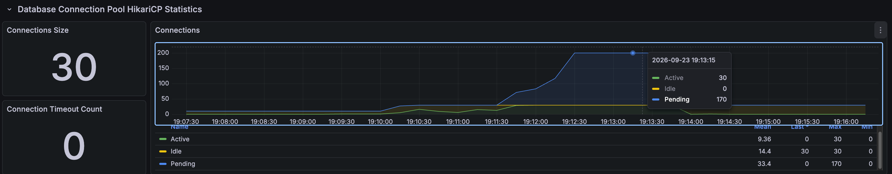

**Hikari 50, k6**

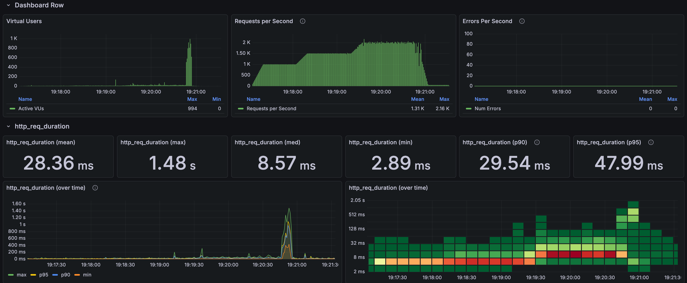

**Hikari 50, 연결 풀**

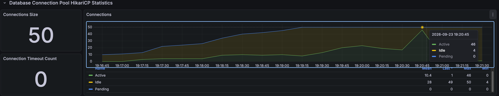

---

## 2. Hikari 50 → 100 → 200: 처리량 정체와 DB 연결 한도

| 3,000 RPS, 60초 | Hikari 50 | 100 | 200 설정 |
| --- | ---: | ---: | ---: |
| 실제 연결 최대 | 50 | 100 | 152 |
| 처리량 (RPS) | 2,121 | 2,134 | 2,058 |
| 평균 (ms) | 469.4 | 466.9 | 483.8 |
| p95 (ms) | 632.6 | 604.9 | 597.2 |
| 연결 획득 평균 (ms) | 70.4 | 46.6 | 23.1 |
| 연결 점유 평균 (ms) | 23.4 | 46.6 | 73.5 |
| 평균 연결 대기 | 149.8 | 99.8 | 47.8 |
| 호스트 CPU 평균 | 96.6% | 97.0% | 97.5% |
| 전체 drop | 57,291 | 56,050 | 62,819 |

연결을 늘리자 연결을 얻기까지의 대기는 줄었지만, 연결 하나를 쥐고 있는 시간이 23ms에서 74ms로 늘었습니다. 
처리량은 약 2,100 RPS에서 그대로였고, 애플리케이션과 DB가 함께 쓰는 호스트 CPU는 96%를 넘었습니다. 
연결을 늘려도 DB가 동시에 처리할 수 있는 양은 늘지 않아, 대기가 연결 풀 앞에서 DB 안쪽으로 옮겨갔습니다.

Hikari 200은 MySQL 연결 한도(`max_connections=151`)에 걸려 실제 연결이 152개에서 멈췄고, `Too many connections` 오류가 났습니다. 
이때 MySQL 지표를 수집하던 exporter도 DB에 접속하지 못해(`mysql_up=0`) 그래프가 비었습니다.

같은 Hikari 50이라도 이 실행의 2,000 RPS 구간 p95는 265.9ms로, 1번 실험의 58.6ms와 크게 달랐습니다. 

설정별 결과 화면

**Hikari 100, k6**

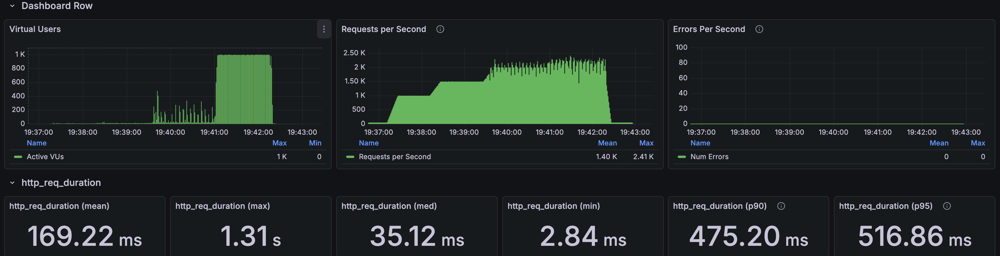

**Hikari 100, 연결 풀**

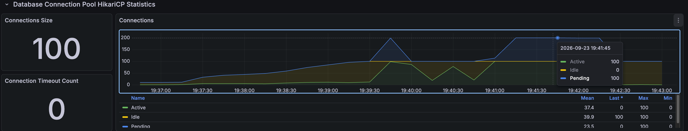

**Hikari 200, k6**

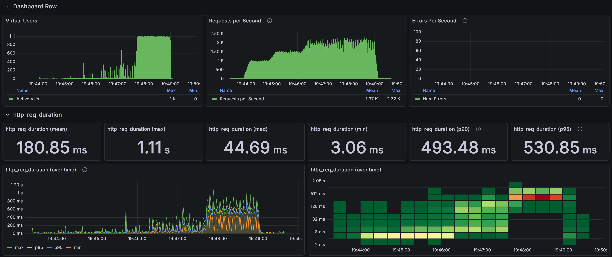

**Hikari 200, 실제 연결 152개**

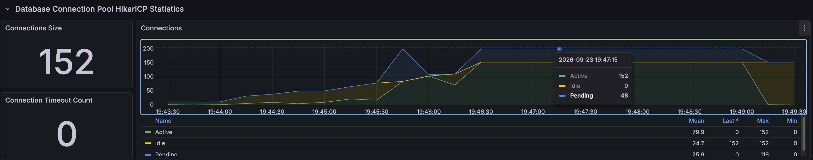

---

## 판단

Hikari는 50으로 정했습니다. 
10에서는 연결 대기가 스레드를 묶어 처리량을 막았지만, 50부터는 연결을 늘려도 처리량이 늘지 않고 연결 점유 시간과 CPU 사용만 늘었습니다. 
연결 대기가 줄어드는 것과 처리할 수 있는 양이 늘어나는 것은 다르다는 것을 확인했고, 이어서 요청 스레드 수를 바꿔 [Tomcat 실험](tomcat.md)을 진행했습니다.

연결 풀을 늘릴 때는 모든 애플리케이션 인스턴스의 풀 합계와 관리, 모니터링용 연결까지 DB 연결 한도 안에서 잡아야 한다는 것도 확인했습니다.
