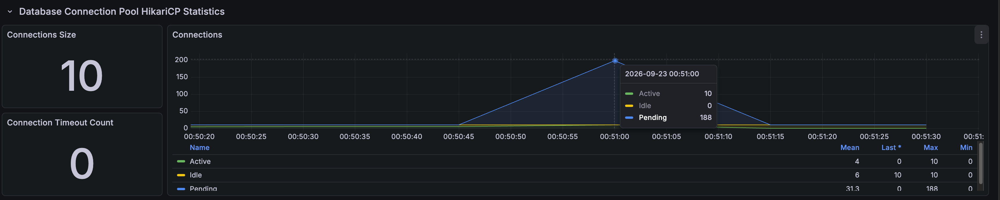
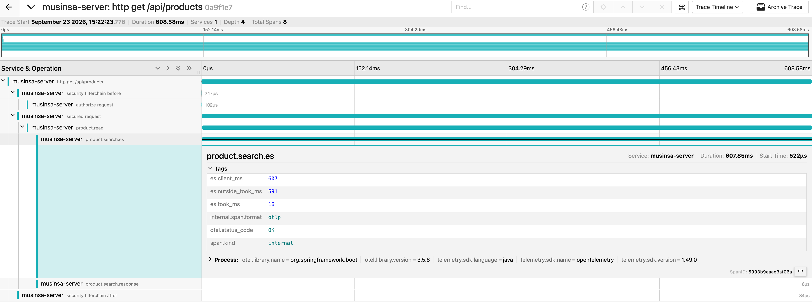
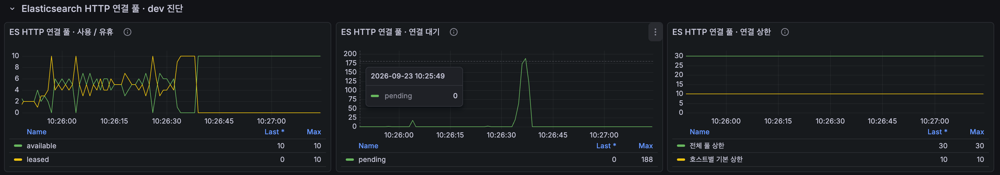
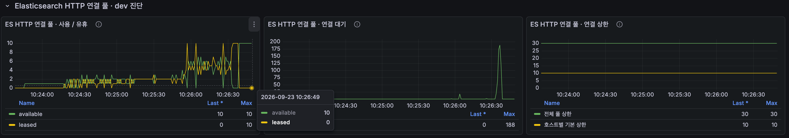
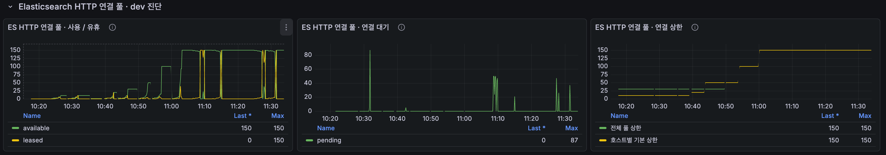
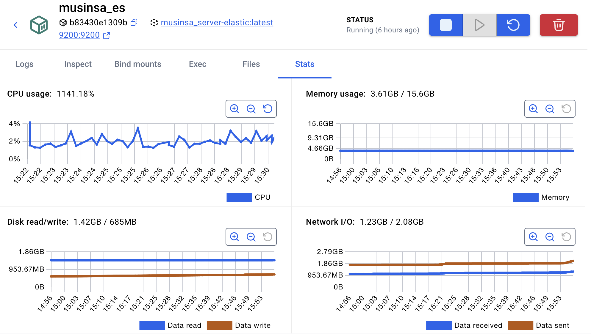
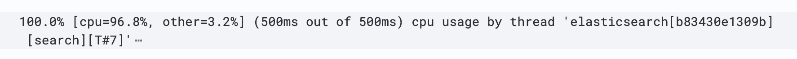
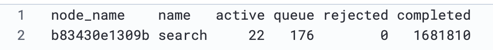
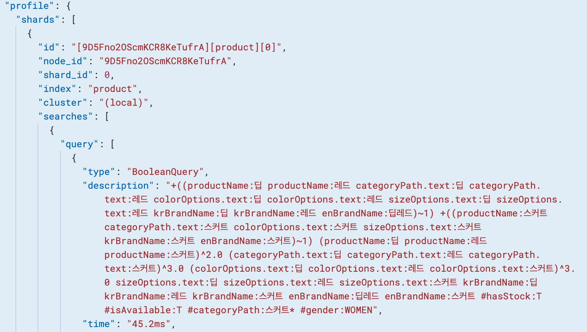

# 검색 고부하: 트랜잭션, HTTP 풀, ES 연산을 순서대로 좁히기

[English](../../en/troubleshooting/search-capacity.md) · [README](../../../README.ko.md)

---

## 문제와 비교 조건

검색 고부하 테스트가 500 RPS로 올리는 중 drop 179건으로 중단됐습니다.<br>
Jaeger에서는 처음에 서비스 본문에 들어가기 전 대기가 길었고, 이를 해결한 뒤에는 ES 클라이언트 호출이 오래 걸렸습니다.<br>
그래서 DB 트랜잭션 범위 → ES HTTP 연결 풀 → ES 내부 처리 순서로 원인을 좁혔습니다.

네 검색어를 번갈아 조회했고, Hikari 10, VU 상한 200, timeout 5초로 실행했습니다.

| 첫 진단 실행 | 완료 요청 | 평균 | p95 |
| --- | --- | --- | --- |
| 50 RPS 유지 | 1,500 | 19.50ms | 46.62ms |
| 100 RPS 유지 | 3,000 | 19.01ms | 47.09ms |
| 250 RPS 유지 | 7,500 | 19.29ms | 48.13ms |
| 500 RPS 증가 중 중단 | 3,369 | 208.46ms | 618.87ms |

---

## 1. ES 검색을 감싸던 DB 트랜잭션

검색 서비스 클래스에 붙은 `@Transactional(readOnly = true)`가 ES 검색에도 적용돼, DB를 쓰지 않는 검색이 실행되는 동안 DB 연결을 쥐고 있었습니다.<br>
첫 트레이스에서는 전체 623ms 중 서비스 본문에 들어가기까지 608ms가 걸렸고 ES 호출은 10ms였습니다.<br>
같은 실행에서 Hikari 연결 10개가 모두 쓰이며 대기가 188건까지 쌓여, 요청들이 서비스에 들어가기 전에 DB 연결을 기다리고 있었습니다.

검색 메서드(`searchProducts`)에만 `Propagation.NOT_SUPPORTED`를 적용해 ES 검색은 트랜잭션 밖에서 실행하고, 키워드 없는 MySQL 조회와 상세 조회는 트랜잭션을 유지했습니다.

| 비교 | 분리 전 | 분리 후 |
| --- | ---: | ---: |
| Hikari 대기 최대 | 188 | 0 |
| ES HTTP 연결 대기 최대 | — | 185 |
| 250 RPS p95 | 48.13ms | 45.31ms |
| 500 RPS 증가 구간 p95 | 618.87ms | 513.87ms |
| 전체 drop | 179 | 55 |
| 1,000 RPS 유지 | 미도달 | 미도달 |

DB 연결 대기는 사라졌지만 비슷한 규모의 대기가 ES 클라이언트의 HTTP 연결 풀로 옮겨갔고, 테스트는 여전히 같은 단계에서 중단됐습니다.

<details>
<summary>결과 화면</summary>

**트랜잭션 분리 전 Hikari 연결**



</details>

---

## 2. ES 호출 시간 나눠 보기

ES 호출이 오래 걸리는 원인이 ES 안쪽인지 바깥쪽인지 나누기 위해 시간을 세 가지로 기록했습니다.

| 태그 | 의미 |
| --- | --- |
| `es.client_ms` | 클라이언트에서 검색을 호출해 결과를 받기까지 걸린 전체 시간 |
| `es.took_ms` | ES가 응답에 담아 보내는 서버 쪽 처리 시간 |
| `es.outside_took_ms` | 둘의 차이로, 연결 대기와 전송, 응답 변환 시간 |

한 요청에서 ES 처리 시간은 16ms였지만 전체는 607ms로, 591ms가 ES 밖에서 쓰였습니다.<br>
그래서 ES 클라이언트의 연결 풀을 살펴봤습니다.

<details>
<summary>결과 화면</summary>

**클라이언트 시간과 ES 처리 시간**



</details>

---

## 3. ES HTTP 연결 풀 계측과 확대

ES 클라이언트의 연결 풀은 기본값인 호스트별 10개, 전체 30개였고, 사용 중인 연결과 대기를 1초 간격으로 수집하도록 계측을 추가했습니다.<br>
첫 실행에서 연결 10개가 모두 쓰이며 대기가 188건까지 쌓여, 상한을 늘려가며 비교했습니다.

| Tomcat | ES 호스트별 / 전체 | 사용 / 대기 최대 | 전체 p95 | drop |
| ---: | --- | --- | ---: | ---: |
| 200 | 10 / 30 | 10 / 188 | 118.46ms | 132 |
| 300 | 10 / 30 | 10 / 157 | 214.40ms | 31 |
| 200 | 20 / 30 | 20 / 175 | 288.50ms | 162 |
| 200 | 50 / 30 | 30 / 166 | 173.89ms | 55 |
| 200 | 50 / 50 | 50 / 133 | 295.43ms | 97 |
| 200 | 100 / 100 | 100 / 15 | 127.67ms | 12 |
| 200 | 150 / 150 | 150 / 30 | 114.33ms | 18 |

호스트별 값만 50으로 올렸을 때는 전체 상한 30에 막혀 30개까지만 쓰였습니다.<br>
100/100에서 연결 대기와 drop이 크게 줄었지만, 150/150에서도 테스트는 중단됐습니다.<br>
연결을 충분히 준 뒤에도 남은 원인을 찾기 위해 ES 내부를 살펴봤습니다.

<details>
<summary>결과 화면</summary>

**ES HTTP 연결 풀, 대기 최대 188**



**초기 ES HTTP 연결 풀**



**상한을 바꿔 가며 실행한 결과**



</details>

---

## 4. ES 내부: CPU와 검색 작업 큐

drop이 생겨도 중단하지 않도록 바꾸고 150/150으로 다시 실행했습니다.<br>
약 250초 동안 drop이 23,419건까지 쌓였고, 시스템 CPU가 99.9%에 이르러 직접 중단했습니다.<br>
이때 ES는 CPU를 약 11.4코어(1141%) 쓰고 있었습니다.

hot threads로 보니 검색 스레드가 CPU를 96.8% 쓰며 문서 매칭(`ConjunctionDISI`), 점수 계산(`RelevanceComparator`), 상품별 묶기(`SinglePassGroupingCollector`)를 하고 있었습니다.<br>
검색 작업 큐에는 실행 중 22개, 대기 176개가 쌓여 있어, HTTP 연결을 늘린 뒤에도 ES 안에서 검색 작업이 줄을 서고 있었습니다.

```http
GET /_nodes/hot_threads?type=cpu&threads=10&ignore_idle_threads=true
GET /_cat/thread_pool/search?v&h=node_name,name,active,queue,rejected,completed
```

<details>
<summary>결과 화면</summary>

**ES CPU (docker stats)**



**검색 스레드 CPU (hot threads)**



**검색 작업 큐**



</details>

---

## 5. Profile: 어떤 쿼리가 비싼가

`딥 레드 스커트` 검색을 Profile로 보니, 한 샤드에서 `BooleanQuery`에 45.2ms가 걸렸습니다.<br>
단어마다 여러 필드를 조회하는 조건과 전체 검색어 가중치 조건이 겹쳐, 여러 필드의 매칭 결과와 점수를 합치는 비용이 컸습니다.

<details>
<summary>결과 화면</summary>

**딥 레드 스커트 BooleanQuery Profile**



</details>

---

## 판단

트랜잭션을 분리해 DB 연결 대기를 없애고, HTTP 연결 풀을 늘려 연결 대기를 줄였지만, 마지막에는 ES 내부의 CPU와 검색 작업 큐가 남았습니다.<br>
옵션 문서 약 1,100만 개에 여러 필드 매칭, 점수 계산, 상품별 묶기가 겹치는 비용이라, 다음 개선은 검색 필드와 조건을 줄이거나 상품 단위의 nested 구조로 바꾸는 쪽입니다.<br>
다만 필드를 줄이면 검색 결과와 순위가 달라질 수 있어, 속도와 검색 품질을 함께 비교해야 합니다.
